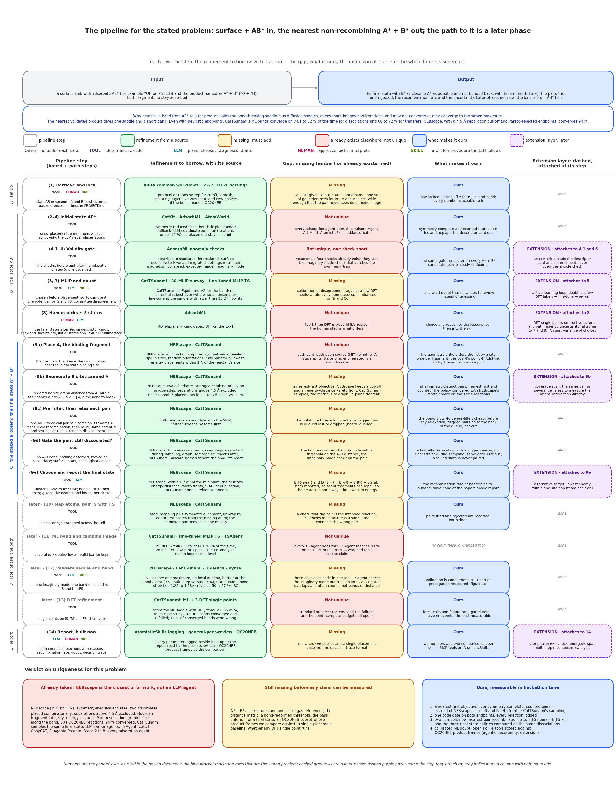
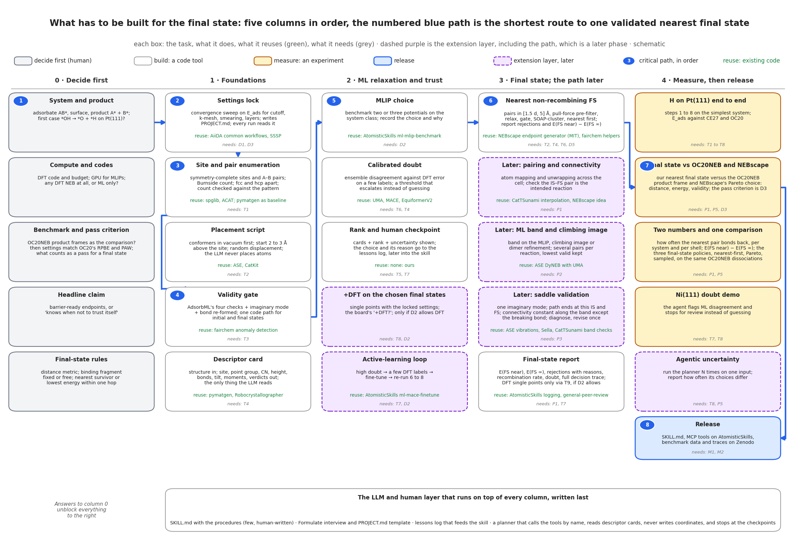
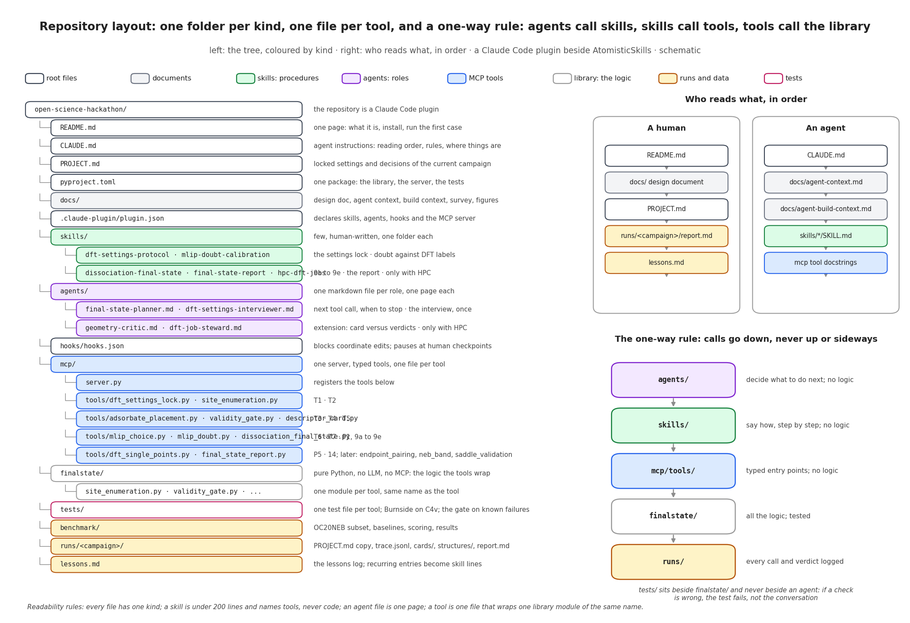

# open-science-hackathon: the nearest non-recombining final state

## The problem

Given a surface with the adsorbate AB\* and the desired product A\* + B\*, both fragments adsorbed, find the final state in which B\* sits as close to A\* as it can while the two stay fully dissociated and do not bond back. That is the whole scope, fixed by the team. Not catalysis, not kinetics, not yet the barrier: those are a later phase and no core task or measurable depends on them. The plan follows the shape of NEBscape, the closest prior work; CatTSunami is secondary. Everything a coding agent needs is in `agent.md`; the theory and the design history are in `archive/`.

## Inputs and output

Three relaxed structures and the named product go in; the nearest validated final states come out, with the pairs they rejected and why.


*Figure: the team's visualisation · 5 panels, inputs and output, schematic*

Reading the figure: panel 1, three relaxed inputs; panel 3, the unit cell and its unique sites; panel 4, how far B can sit from A before the molecule pulls it back, the stated problem; panel 5, the best configuration for both fragments; panel 2, the dissociated final state.

| Item | Content | Owner |
|---|---|---|
| Inputs | Relaxed initial state AB\* on the surface; relaxed clean surface; relaxed adsorbate in vacuum, each with its energy; the product named as A\* + B\*, both fragments adsorbed | Human |
| Input prompt | Surface, adsorbates, system description; critic and knowledge prompts as a fixed list; reasoning questions as a written skill | Human |
| Known | E_ads of the adsorbate from the literature, one or two published values with functional and site; a human verifies each | Literature |
| Settings | DFT settings locked in `PROJECT.md` by the dft-settings-protocol skill before anything is computed | Human |
| Output | The nearest non-recombining final states in order, the first few survivors, each on a card with its issues and the calibrated doubt from mlip_doubt; the human interprets them and the chosen final states go to DFT single points, P5; E(FS near) and E(FS ∞); every rejected pair with its reason; the recombination rate | Tool |

## The pipeline in five steps

The team's five panels map onto the full pipeline without changing their numbering; panel 4, the least distance before pull-back, is the stated problem.


*Figure: simplified pipeline · 5 steps, owners, row mapping, schematic*

Reading the figure: boxes run left to right in the team's numbering, the owner line under each title is in colour, the highlighted box is the stated problem, and the grey line under each box names the rows of the full pipeline. The table below carries the same owners and row mapping.

| Step | What it does | Owner | Rows of the full pipeline |
|---|---|---|---|
| 1 Inputs | Relaxed AB\* on the surface, clean surface, adsorbate in vacuum, retrieved and locked with the settings in `PROJECT.md`; the human approves; the MLIP chosen before any placement | Human, Tool | 1, 1\* |
| 3 Unit cell and unique sites | Cell wide enough that the pair never sees its periodic image, locked in row 1; symmetry-inequivalent sites on the slab, counted; the fragment keeping the binding atom placed near its old site | Tool | 2, 9a |
| 4 Least distance before pull-back | B sites around A within [1.5 d, 5] Å; one force call per pair, then relaxation; the validity gate: no A–B bond, nothing desorbed | Tool | 9b, 9c, 9d |
| 5 Best configuration for both | For adsorbent #1, A, and adsorbent #2, B: survivors clustered by SOAP; nearest first, then energy; the nearest and the lowest kept per cluster, more is open: team decision; the geometry-critic may order, never remove; doubt from the committee; the human picks up to five | Tool, LLM | 9e, 7, 8 |
| 2 Output | A\* + B\* as close as they can be without bonding back; both energies; rejected pairs with reasons; recombination rate; the calibrated doubt from mlip_doubt; the LLM drafts the report and the human interprets | Tool, Human | 14 |

Owners: Tool is deterministic code; LLM plans, chooses and drafts from descriptor cards and never touches coordinates; Human locks settings, picks and interprets; Skill is a written procedure the LLM follows; Literature enters before the run and after it only, and a human verifies every value.

The board's step 3, placing the dissociated fragment, has six points; each lands in one row of step 4 or step 5.

| Point of the board's step 3 | Row that holds it |
|---|---|
| 1 Estimate the least distance at which B is not pulled back | 9d, the bond-re-formed check |
| 2 Window [1.5 d, 5] Å, d the length of the bond to break | 9b |
| 3 The MLIP's pull force on the binding fragment | 9c, one force call per pair before relaxing |
| 4 Agentic knowledge of what the cleavage does, to criticise and adjust | geometry-critic on cards at 9a and 9b, core: proposes a site type per fragment to order the list; never removes a pair, never overrides a check |
| 5 Site and orientation with pymatgen so the binding fragment adsorbs | 9a, symmetry-complete and counted |
| 6 Alternatively minima hopping with the MLIP | 9a, NEBscape's generator wrapped as the baseline policy |

## The full pipeline

Every row is borrowed or standard; the claim sits in rows 9b, 9d and 9e, the nearest-first objective, the logged gate and the recombination rate.



*Figure: full pipeline · 15 rows, 5 columns, one colour per kind of idea, schematic*

Reading the figure: each row is one pipeline step with its owner line, then the refinement borrowed with its source in green, the gap in amber for missing or red for already exists, what is ours in blue, and the extension layer dashed at the step it attaches to. The blue bracket marks rows 9a to 9e, the stated problem. Rows 10 to 13 are dashed grey, a later phase; row 14, the final-state report, is built now. The figure folds row 1\* into row 5, 7; the table lists it apart. The verdict band at the bottom names what is taken, what is still missing before a claim can be measured, and what is ours in hackathon time.

| Row | Borrowed from | Missing or exists | Ours | Extension |
|---|---|---|---|---|
| 1 Retrieve and lock | AiiDA common workflows, SSSP, OC20 settings | Missing: A\* + B\* as structures, one set of gas references, a wide enough cell | One locked settings file for IS and FS; the same file serves the later band | none |
| 1\* MLIP selection before placement | AtomisticSkills ml-mlip-benchmark, CatBench, 80-MLIP survey | Missing: a rule by system class; spin for Ni and Co | One potential for IS and FS, chosen before any placement, benchmark and reason recorded; the LLM explains | Active learning: doubt, DFT labels, fine-tune, re-run steps 6 to 8 |
| 2 to 4 Initial state AB\* | CatKit, AdsorbML, AtomWorld | Exists: every adsorption agent | Symmetry-complete and counted; fcc and hcp apart; descriptor card | none |
| 4.1, 6 Validity gate | AdsorbML anomaly checks | Exists, one check short: no imaginary-mode check; the board's ML variant of the filter is not taken, the gate is code | The same gate, validity_gate, on every A\* + B\* candidate | geometry-critic on descriptor cards, never overrides |
| 5, 7 MLIP and doubt | CatTSunami, fine-tuned MLIP TS, AtomisticSkills ml-committee-uncertainty | Missing: calibration on DFT labels | Committee of every potential benchmarked in 1\*, calibrated on DFT labels; doubt escalates to review | The active-learning loop of 1\* re-runs steps 6 to 8 |
| 8 Human picks up to 5 | AdsorbML top-k then DFT | Exists: the human step is what differs | Up to five initial states chosen on cards, rank and doubt; choice and reason to the lessons log, then the skill; the human chooses a second time on the final-state report, row 14 | The board's three question marks: DFT on the five; agentic uncertainty over N runs; a vision model for the placement, only after the geometry benchmark shows an image helps |
| 9a Place A | The board's pymatgen site and orientation so the binding fragment adsorbs, made symmetry-complete with spglib and ACAT; NEBscape minima hopping with the MLIP, the board's alternative route, wrapped as the baseline policy; CatTSunami 5 placements within 2 Å | Exists: both open source; A fixed or enumerated is open: team decision | The geometry-critic orders the list by a site type per fragment, the board's point 4; it never removes a pair | none |
| 9b Enumerate B around A | NEBscape combinatorial pairs under 4.5 Å, CatTSunami 1 to 3 Å shell | Missing: a nearest-first objective and the metric | All symmetry-distinct pairs, nearest first, counted; compared with NEBscape's Pareto choice | Coverage scan over cell sizes |
| 9c Pre-filter, then relax | NEBscape, CatTSunami relax every candidate | Missing: the pull-force threshold; queued or dropped | One force call per pair before any relaxation; flagged pairs queued last | none |
| 9d Gate the pair | NEBscape Hookean constraints and graph checks, CatTSunami discards reacting frames | Missing: bond-re-formed check as code; imaginary mode on the pair | A test after relaxation with a logged reason; a failing state is never paired | none |
| 9e Choose and report | NEBscape Pareto fronts and SOAP, CatTSunami random survivor | Missing: E(FS near) and E(FS ∞) both reported | The recombination rate of nearest pairs; the nearest and the lowest kept per SOAP cluster | Lowest energy within one site hop, and more than three per cluster: open: team decision |
| 10 Map atoms, pair IS with FS | NEBscape mapping and alignment, CatTSunami unwrapping | Missing: intended-reaction check | Rejected pairs reported, not hidden | none |
| 11 ML band and climbing image | CatTSunami ML NEB, fine-tuned MLIP TS, TSAgent | Exists: every TS agent | No claim: a wrapped tool | none |
| 12 Validate saddle and band | NEBscape, CatTSunami, TSBench, Pynta | Missing: these checks as code in one tool | Validation in code; propagation measured | none |
| 13 DFT refinement | CatTSunami ML plus 3 DFT single points | Exists: standard practice | Later phase: force calls and failure rate, gated versus naive | DFT single points on the chosen final states, dft_single_points, task T9, only if D2 allows DFT |
| 14 Report, built now | AtomisticSkills hyperparameter logging and general-peer-review; OC20NEB product frames | Missing: OC20NEB subset, single-placement baseline, trace format | Two numbers and two comparisons; open skill and MCP tools on AtomisticSkills | BEP check, energetic span, multi-step and catalysis: later phase |

Rows 10 to 13 are a later phase and are not built now. Row 14, the final-state report, task P5, is built now. DFT single points on the chosen final states are the extension T9 and run only if decision D2 allows DFT.

The row numbers are the planner's; the second board numbered its steps differently, and each board step lives in one row.

| Board step | Row |
|---|---|
| 1 Structure retriever | 1 |
| 1\* MLIP selection before placement | 1\* |
| 2 Adsorption sites; 4 initial configurations | 2 to 4 |
| 3 Adsorbate placement, six points | 9a to 9e |
| 5 Physics-based and anomaly filtering | 4.1, 6 |
| 6 SOAP clustering, lowest per cluster | 9e |
| 7 Uncertainty with all models from 1\* | 5, 7 |
| 8 Rank; user picks up to 5 | 8, and again on the report at 14 |
| Solution | 14 |

## What is ours and what is not

Ours is the nearest-first objective, the logged gate and two numbers nobody reports; everything else is a wrapped tool.

- NEBscape is the closest prior work and not an LLM agent: symmetry-inequivalent sites by spglib, two adsorbates placed combinatorially, separations beyond a cut-off excluded, Hookean fragment integrity, energy–distance Pareto selection, SOAP deduplication, a converged OC20NEB benchmark. Its endpoint generator is what row 9 wraps and its Pareto choice is the baseline our policy is scored against.
- CatTSunami's AutoFrameDissociation, open source in fairchem, builds the same final state by sampling a shell and picks one survivor at random; its rejected frames are not reported.
- Ours: a nearest-first objective over symmetry-complete, counted pairs, instead of a cut-off and a trade-off or a sampled shell.
- Ours: one validity gate, validity_gate, on both endpoints, run after relaxation, with every rejection logged and its reason kept; a failing state is never paired.
- Ours: two numbers nobody reports, the recombination rate of nearest pairs and the lateral interaction E(FS near) − E(FS ∞), and the three final-state policies compared on the same dissociations.
- Not ours and not claimed: site finding, placement, ML relaxation, ML bands and DFT refinement. Every adsorption agent does rows 2 to 8; every transition-state agent does row 11. These are wrapped tools.

## Measured

Two numbers are measured now and two comparisons, on an OC20NEB subset starting with \*OH → \*O + \*H on Pt(111); the barrier shift and the band cost are a later phase.

| Number | Definition | Compared |
|---|---|---|
| Recombination rate | How often the nearest pair bonds back after relaxation | Per system and per distance shell |
| Lateral interaction | E_lat in the equation below, with E(FS ∞) from separate cells | Per system; sign and size |
| Three policies | Nearest-first, ours; energy–distance Pareto, NEBscape; shell sampling, CatTSunami; on the same dissociations: distance, energy, validity, recombination | Per reaction; NEBscape converged 94 % of 304 |
| Final state versus OC20NEB | Our nearest validated final state against the product frame of the released band: A–B distance, energy, validity | Per reaction in the subset |

$$
E_{\mathrm{lat}} = E(\mathrm{FS\,near}) - E(\mathrm{FS}\,\infty),\qquad E(\mathrm{FS}\,\infty) = E(\mathrm{A}^*) + E(\mathrm{B}^*) - E(\mathrm{slab})
$$

Pass criterion, open: team decision: a validated minimum with no A–B bond, at least as near as the OC20NEB product frame, within an energy tolerance still to be set. The subset size and whether any DFT single point runs are also open: team decision.

## Build order

The shortest route to one validated nearest final state runs through eight numbered tasks; the answers in column 0 unblock everything to their right.



*Figure: build plan · 5 columns, 26 tasks, critical path of 8, schematic*

Reading the figure: five columns in build order, from the team's decisions through code foundations, ML trust and the final state to measurements and release; the numbered blue path is the critical path, grey boxes are off-path tasks, dashed boxes the later phase, and each box names what it reuses and needs.

1. D1 System and product: AB\*, surface, A\* + B\*; first case \*OH → \*O + \*H on Pt(111). Human decision.
2. T1 Settings lock. Needs D1, D3. Reuses AiiDA common workflows and SSSP.
3. T2 Site and pair enumeration. Needs T1. Reuses spglib and ACAT, pymatgen as the baseline.
4. T4 Validity gate. Needs T3. Reuses fairchem anomaly detection.
5. T6 MLIP choice. Needs D2. Reuses AtomisticSkills ml-mlip-benchmark.
6. P1 Nearest non-recombining final state. Needs T2, T4, T6, D5. Reuses the NEBscape endpoint generator and fairchem AutoFrameDissociation.
7. M2 The \*OH → \*O + \*H final state against the OC20NEB product frame. Needs P1, P5, D3.
8. R1 Release: SKILL.md, MCP tools on AtomisticSkills, benchmark data and traces on Zenodo. Needs M1, M2.

Off-path tasks the path needs, built when it needs them: T3 Placement script, needs T2, reuses ASE; P5 the final-state report, needs P1 and T7, reuses AtomisticSkills logging and general-peer-review; M1 H on Pt(111) end to end, needs T1 to T8. T9, DFT single points on the chosen final states, is an extension that needs T8 and D2.

Decisions D2 compute and codes, D3 benchmark and pass criterion, D4 headline claim and D5 final-state rules are open: team decision. The LLM and human layer, the skills, the Formulate interview run by dft-settings-interviewer, the lessons log and final-state-planner, is written last because it only calls the tools.

## Running the first case

Nothing runs yet; the first run waits on the settings lock and the site enumeration. Only `README.md`, `agent.md`, `CLAUDE.md`, `archive/` and `figures/` exist today. The first case is \*OH → \*O + \*H on Pt(111), decision D1, open: team decision. Before the first command, the Formulate interview run by dft-settings-interviewer writes `PROJECT.md` and the human locks it at the approve-settings checkpoint, and D2 and D3 are decided. The first run then calls dft_settings_lock, T1, and site_enumeration, T2; this section gains the command line when those two tools exist.

## Repository layout

A Claude Code plugin beside AtomisticSkills, with three rules: one kind per file and one folder per kind; calls go one way, agents to skills to tools to the library, never up or sideways; one reading order for a human and one for an agent.



*Figure: repository layout · tree, reading orders, the one-way rule, schematic*

Reading the figure: one folder per kind, arrows run one way from agents to skills to tools to the library, and the two reading orders, one for a human and one for an agent, are listed at the side.

```
open-science-hackathon/
├── README.md                     this file: the problem, the simplified and the full pipeline, what is ours, the build order, how to run the first case
├── agent.md                      what a coding agent needs: the exact pipeline, tools, repositories, rules
├── CLAUDE.md                     agent instructions: read agent.md first
├── archive/                      theory, design history, reviews, figure scripts; not needed to code
├── figures/                      the five figures of this page
├── PROJECT.md                    the locked settings and decisions of the current campaign
├── pyproject.toml                one package: the library, the server and the tests
├── .claude-plugin/plugin.json    declares the skills, agents, hooks and the MCP server
├── skills/                       few, human-written, one folder each, under 200 lines each
│   ├── dft-settings-protocol/    pseudopotentials, cutoff, k-mesh, smearing, layers; the lock
│   ├── mlip-doubt-calibration/   committee disagreement against DFT labels; when to escalate
│   ├── dissociation-final-state/ the 9a to 9e procedure
│   ├── final-state-report/       the report: E(FS near), E(FS ∞), rejections, trace
│   ├── hpc-dft-jobs/             only with HPC: submission, what custodian handles, what to escalate
│   └── neb-saddle-diagnosis/     later phase: what to do when a band or saddle fails validation
├── agents/                       one markdown file per role, one page each
│   ├── final-state-planner.md    decides the next tool call and when to stop
│   ├── dft-settings-interviewer.md runs the Formulate interview; writes PROJECT.md
│   ├── geometry-critic.md        extension: whether a card and its verdicts disagree; never overrides
│   └── dft-job-steward.md        only with HPC: resubmit, adjust or escalate a failed DFT job
├── hooks/hooks.json              blocks coordinate edits; pauses at human checkpoints
├── mcp/                          one server, typed tools, one file per tool
│   ├── server.py                 registers the tools
│   └── tools/                    dft_settings_lock, site_enumeration, adsorbate_placement,
│                                 validity_gate, descriptor_card, mlip_choice, mlip_doubt,
│                                 dissociation_final_state, final_state_report;
│                                 extension: dft_single_points, only if D2 allows DFT;
│                                 later phase: endpoint_pairing, neb_band, saddle_validation
├── finalstate/                   pure Python, no LLM, no MCP: one module per tool, same name
├── tests/                        one test file per tool; Burnside on C4v; the gate on known failures
├── benchmark/                    OC20NEB subset, baselines, scoring scripts, results
├── runs/<campaign>/              PROJECT.md copy, trace.jsonl, cards/, structures/, report.md
└── lessons.md                    the lessons log; recurring entries become skill lines
```

Only `README.md`, `agent.md`, `CLAUDE.md`, `archive/` and `figures/` exist today; the rest is the planned layout.

## Where everything else is

`agent.md` holds what a coding agent needs: the exact pipeline with inputs, outputs, checks and thresholds per tool, the repositories to wrap with their licences, the rules the LLM must obey and the decisions still open. `archive/README.md` indexes the theory and the design history in a table, one row per file: the design document with its figures, the agent context, the long build context, the repository survey, the review of chemistry agents and the writing style.

## Sources

- [NEBscape, npj Computational Materials 2026](https://www.nature.com/articles/s41524-026-02298-1) and its [code, MIT](https://gitlab.mpcdf.mpg.de/hjung/nebscape)
- [CatTSunami and OC20NEB](https://arxiv.org/abs/2405.02078) and the [fairchem code](https://github.com/facebookresearch/fairchem)
- [AdsorbML and OC20-Dense](https://arxiv.org/pdf/2211.16486)
- [OC20 dataset paper, with the DFT settings](https://arxiv.org/pdf/2010.09990)
- [AtomisticSkills](https://arxiv.org/abs/2605.24002) and its [code](https://github.com/learningmatter-mit/AtomisticSkills)
- [Pynta, JCIM 2023, preprint](https://chemrxiv.org/engage/chemrxiv/article-details/647114454f8b1884b755bc5a)
- [TSAgent](https://arxiv.org/abs/2605.14154) and [TSBench](https://arxiv.org/abs/2609.08503)
- [Kempen, Cheula and Andersen: 80 MLIPs benchmarked](https://phys.au.dk/intercat/news-and-events/show/artikel/new-intercat-paper-luuk-kempen-raffaele-cheula-and-mie-andersen)
- [CatKit](https://github.com/SUNCAT-Center/CatKit), [ACAT](https://gitlab.com/asm-dtu/acat), [spglib](https://github.com/spglib/spglib), [pymatgen-core](https://github.com/materialsproject/pymatgen-core), where AdsorbateSiteFinder now lives; the old path in [pymatgen](https://github.com/materialsproject/pymatgen) is a stub
- [AiiDA common workflows, npj Computational Materials 2021](https://www.nature.com/articles/s41524-021-00594-6) and the [SSSP library](https://www.materialscloud.org/discover/sssp)
- [AtomWorld](https://arxiv.org/html/2510.04704): LLM coordinate edits fail, so placement stays a script
- [Robocrystallographer](https://www.cambridge.org/core/journals/mrs-communications/article/robocrystallographer-automated-crystal-structure-text-descriptions-and-analysis/3C201F132450877464B2D0B1B8C4ED01), for the descriptor card
