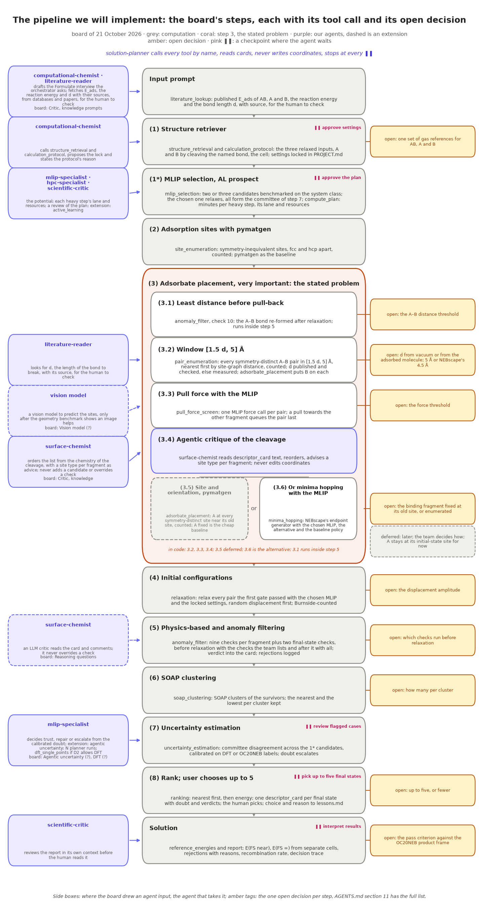
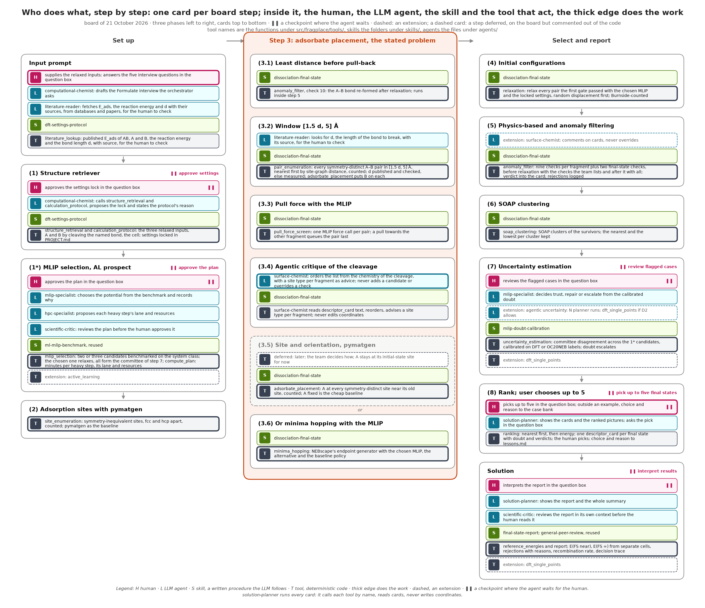
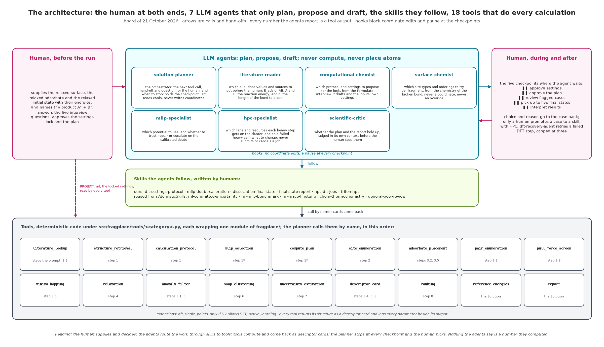

# open-science-hackathon: the nearest non-recombining final state

## The problem

Given a surface with the adsorbate AB\* and the desired product A\* + B\*, both fragments adsorbed, find the final state in which B\* sits as close to A\* as it can while the two stay fully dissociated and do not bond back. That is the whole scope, fixed by the team. Not catalysis, not kinetics, not yet the barrier: those are a later phase and no core task or measurable depends on them. The plan follows the shape of NEBscape, the closest prior work; CatTSunami is secondary. Everything a coding agent needs is in `AGENTS.md`; the theory and the design history are in `docs/`.

## Inputs and output

Three relaxed structures and the named product go in; the nearest validated final states come out, with the pairs they rejected and why.


*Figure: the team's visualisation · 5 panels, inputs and output, schematic*

Reading the figure: panel 1, three relaxed inputs; panel 3, the unit cell and its unique sites; panel 4, how far B can sit from A before the molecule pulls it back, the stated problem; panel 5, the best configuration for both fragments; panel 2, the dissociated final state.

| Item | Content | Owner |
|---|---|---|
| Inputs | Relaxed initial state AB\* on the surface; relaxed clean surface; relaxed adsorbate in vacuum, each with its energy; the product named as A\* + B\*, both fragments adsorbed | Human |
| Input prompt | Surface, adsorbates, system description; critic and knowledge prompts as a fixed list; reasoning questions as a written skill | Human |
| Known | E_ads of the adsorbate from the literature, one or two published values with functional and site; a human verifies each | Literature |
| Settings | The settings the run uses, locked in `PROJECT.md` by the dft-settings-protocol skill before anything is computed: with no DFT, every study until `dft_single_points` is built, protocol mlip locks the cell, the force threshold, the gas references and the open decisions, and nothing about DFT is asked; DFT settings only in a study that runs DFT | Human |
| Output | The nearest non-recombining final states in order, the first few survivors, each on a card with its verdicts and the calibrated doubt from uncertainty_estimation; the human picks and interprets; E(FS near) and E(FS ∞); every rejected pair with its reason; the recombination rate; DFT single points on the chosen states only through the extension dft_single_points | Tool |

## The pipeline we will implement

The plan is a single pass from the input prompt to the solution; step 3, placing the dissociated fragment, is the stated problem. Each box carries the board's step and the tool that implements it; the amber tags are the decisions still open; the purple boxes are our agents where the board drew an agent input; the pause signs are the checkpoints where the agent waits for the human.

**Step 3.5 is commented out for now.** Placing fragment A at every symmetry-distinct site near its old site stays on the board, numbered, but is not in the pipeline code: the team decides later how to implement it. Until then A stays at its initial-state site, the cheap baseline the board named, and `adsorbate_placement` runs at step 3.2 for B, right after the pairs, because the pull-force screen of 3.3 needs placed structures. The figures and tables keep the step, drawn grey and dashed and marked deferred, so the board's numbering stays whole.



*Figure: the pipeline we will implement · 16 steps, 9 open decisions, 5 checkpoints, schematic*

Reading the figure: grey boxes are computation, each with its tool name and action; the coral box is step 3 with its six points in the board's order, 1 to 4 then 5 or 6, and a note on the order the code runs them; the purple boxes on the left are our agents at the steps where the board drew an agent input, dashed where they are extensions; the amber tags on the right are the open decisions. The panels of the team's visualisation above map onto these steps as follows.

| Panel of the visualisation | Board steps |
|---|---|
| 1 Inputs: relaxed initial state, surface, adsorbate | 1, 1\* |
| 3 Unit cell and unique adsorption sites | 2, 3.5 (deferred) |
| 4 Least distance before the molecule pulls the atom back | 3.1, 3.2, 3.3, 4, 5 |
| 5 Most favourable configuration for both components | 3.4, 3.6, 6, 7, 8 |
| 2 Output: dissociated final state | Solution |

Each step is one or two tools, defined once in `src/fragplace/registry/tools.py` and implemented in category modules under `src/fragplace/tools/`; this table is generated from the registry.

<!-- registry:modules -->
| Phase | Board step | Tool | Takes | Returns | Status |
|---|---|---|---|---|---|
| Set up | Input prompt | `literature_lookup` | system, quantity, sources, reported | values | core |
| Set up | (1) Structure retriever | `structure_retrieval` | slab, adsorbate_vacuum, initial_state, bond_to_break | fragment_A, fragment_B, cell_repeat, structures | core |
| Set up | (1) Structure retriever | `calculation_protocol` | settings_from_inputs, physics_choices, protocol, protocol_reason | settings | core |
| Set up | (1\*) MLIP selection, AL prospect | `mlip_selection` | candidates, system_class, labels | chosen, committee, benchmark | core |
| Set up | (1\*) MLIP selection, AL prospect | `compute_plan` | calculator, slab, adsorbate, items, rules, timing | timing, estimates, rules, warnings | core |
| Set up | (1\*) MLIP selection, AL prospect | `active_learning` | flags, labels, base_model | fine_tuned | extension |
| Set up | (2) Adsorption sites with pymatgen | `site_enumeration` | slab, cell_repeat | sites | core |
| Step 3: adsorbate placement, the stated problem | (3.1) Least distance before pull-back | `anomaly_filter` | candidate, start, slab, settings, prior_E_ads_eV, frequencies_cm | gate | core |
| Step 3: adsorbate placement, the stated problem | (3.2) Window [1.5 d, 5] Å | `pair_enumeration` | sites, d_bond_A, window, site_A | pairs, count | core |
| Step 3: adsorbate placement, the stated problem | (3.2) Window [1.5 d, 5] Å | `literature_lookup` | system, quantity, sources, reported | values | core |
| Step 3: adsorbate placement, the stated problem | (3.2) Window [1.5 d, 5] Å | `adsorbate_placement` | sites, fragment, site_index, orientation, height_A, displacement_amplitude_A, base | candidate | core |
| Step 3: adsorbate placement, the stated problem | (3.3) Pull force with the MLIP | `pull_force_screen` | candidates, calculator | screens | core |
| Step 3: adsorbate placement, the stated problem | (3.4) Agentic critique of the cleavage | `descriptor_card` | candidate, gate, sites | card | core |
| ~~Step 3: adsorbate placement, the stated problem~~ | ~~(3.5) Site and orientation, pymatgen~~ | ~~`adsorbate_placement`~~ | ~~sites, fragment, site_index, orientation, height_A, displacement_amplitude_A, base~~ | ~~candidate~~ | ~~deferred at this step~~ |
| Step 3: adsorbate placement, the stated problem | (3.6) Or minima hopping with the MLIP | `minima_hopping` | slab, fragments, calculator, n_hops | candidates | core |
| Select and report | (4) Initial configurations | `relaxation` | candidates, calculator, fmax_eV_per_A, max_steps | results | core |
| Select and report | (5) Physics-based and anomaly filtering | `anomaly_filter` | candidate, start, slab, settings, prior_E_ads_eV, frequencies_cm | gate | core |
| Select and report | (5) Physics-based and anomaly filtering | `descriptor_card` | candidate, gate, sites | card | core |
| Select and report | (6) SOAP clustering | `soap_clustering` | survivors, energies, pairs | clusters, kept | core |
| Select and report | (7) Uncertainty estimation | `uncertainty_estimation` | candidates, committee, labels | flags | core |
| Select and report | (7) Uncertainty estimation | `dft_single_points` | structures, settings, backend | energies, failures | extension |
| Select and report | (8) Rank; user chooses up to 5 | `ranking` | kept, cards, flags, pairs | ranked | core |
| Select and report | (8) Rank; user chooses up to 5 | `descriptor_card` | candidate, gate, sites | card | core |
| Select and report | Solution | `reference_energies` | slab, fragments, calculator, gas | E_slab_eV, E_A_eV, E_B_eV, E_inf_eV, E_ads_A_eV, E_ads_B_eV | core |
| Select and report | Solution | `report` | study, final_states, rejected, flags, comparison | report | core |
| Select and report | Solution | `dft_single_points` | structures, settings, backend | energies, failures | extension |
<!-- /registry:modules -->

## How the plan evolved, step by step

The board is the reference: one row per board step, in the board's order and numbering, with what the board says, what the literature refined, and what we added. Nothing on the board was dropped; the ML variant of the filter in step 5 and the vision model in step 3 are recorded as not taken and as an extension.


*Figure: evolution of the plan · 16 board steps, 4 columns, schematic*

Reading the figure: the left column quotes the board, with the owner line under each step; green is the refinement the literature gave, with its source; blue is what we added or decided; amber is a decision still open and dashed purple an extension. The dashed bracket marks step 3, the stated problem, with its six points in the board's order.

<!-- board:evolution -->
| Board step | What the board says | Refined by the literature | What we added or decided | Open, or an extension |
|---|---|---|---|---|
| Input prompt | surf + adsorbates (2) + a general system description; surface and adsorbate with their energies, E_ads from the literature | Get Physics Done · AutoDFT: a Formulate interview that locks scope, conventions and verification targets; compact written settings rules, such as spin for Ni and Co | the computational-chemist drafts five fixed questions, the orchestrator asks them, code writes the answers into PROJECT.md; the three relaxed inputs, and A and B in vacuum when given, are supplied | none |
| (1) Structure retriever | fed by the input prompt: surf + adsorbates (2) and a general system description; surface and adsorbate with their energies | AiiDA common workflows · SSSP · OC20: no DFT runs until dft_single_points is built: protocol mlip locks the cell, the force threshold and the gas species, and the potential computes every energy; DFT settings only from a verified protocol, never from the model | the three relaxed inputs plus A and B as structures; settings locked in PROJECT.md; a cell wide enough for the pair | Open: one set of gas references for AB, A and B |
| (1\*) MLIP selection, AL prospect | chosen before placement so step 3 can use it; active learning as a prospect | 80-MLIP survey · CatBench · AtomisticSkills: no potential is best everywhere; CatBench classes each failure; ml-mlip-benchmark scores candidates on the system class | benchmark two or three, record why; spin for Ni and Co; the candidates become the committee of step 7; the hpc-specialist sets each heavy step's lane and resources from compute_plan's estimate | Extension: active_learning: doubt → a few DFT labels → fine-tune → re-run |
| (2) Adsorption sites with pymatgen | Python, with pymatgen | pymatgen · ACAT · spglib: pymatgen's site finder labels no fcc or hcp hollow; ACAT gives labelled sites and the site graph; spglib the symmetry operations | symmetry-complete and counted; fcc and hcp apart; pymatgen kept as the baseline | none |
| (3.1) Least distance before pull-back | estimate the minimum distance at which the dissociated atom is not pulled back | CatTSunami · NEBscape: CatTSunami treats a bond as breaking at 1.25 to 1.63× its length; NEBscape keeps fragments intact by Hookean constraint during sampling | the bond-re-formed check as code, after relaxation, with a logged reason; a pair that fails is never kept | Open: the A–B distance threshold |
| (3.2) Window [1.5 d, 5] Å | d the max vdW length of the bond to break, from the literature | NEBscape · CatTSunami: NEBscape excludes separations above 4.5 Å; CatTSunami samples a 1 to 3 Å shell, 25 pairs, one survivor at random | every symmetry-distinct pair inside the window, ordered by site-graph distance, nearest first, counted: the objective is explicit; B placed on each | Open: d from vacuum or from the adsorbed molecule; 5 Å or NEBscape's 4.5 Å |
| (3.3) Pull force with the MLIP | use the selected MLIP to estimate the pull force on the binding fragment | NEBscape · CatTSunami: neither screens by force; both relax every candidate they generate | one force call per pair before relaxing; a pull towards the other fragment queues the pair last, never drops it | Open: the force threshold |
| (3.4) Agentic critique of the cleavage | criticise and adjust the placement from knowledge of what the cleavage does | AdsMind · AtomWorld · ChemCrow: AdsMind: the LLM returns a site type, code places, 98.8 %; AtomWorld: LLM coordinate edits fail; an LLM judge rates fluent wrong answers well | surface-chemist reads descriptor cards, proposes a site type per fragment, orders the list; never edits coordinates, never overrides a check | Extension: a vision model to predict the sites, only after the geometry benchmark shows an image helps |
| ~~(3.5) Site and orientation, pymatgen~~ | ~~agentic knowledge or a package such as pymatgen, so the binding fragment adsorbs~~ | ~~El Agente Potente · CatTSunami: symmetry-distinct sites and orientations enumerated by code; CatTSunami: 5 placements within 2 Å of the old binding site~~ | ~~code places, the LLM never does: the fragment keeping the binding atom at symmetry-distinct sites near its old site, counted~~ | ~~Deferred: later; the team decides how; A stays at its initial-state site for now. Open: the binding fragment fixed at its old site, or enumerated~~ |
| (3.6) Or minima hopping with the MLIP | alternatively, minima hopping with the selected MLIP for the binding fragment | NEBscape: minima hopping from symmetry-inequivalent sites with Hookean constraints; 94 % of 304 OC20NEB reactions converge; MIT code | kept as the alternative generator, wrapped, and as the baseline policy our nearest-first choice is scored against | none |
| (4) Initial configurations | output of step 3: all degrees of freedom of the adsorbate × all sites | Burnside · symmetry trap: the count checked by Burnside's lemma; a small random displacement before relaxing, or a symmetric start relaxes to a saddle | every candidate pair relaxed with the chosen potential and the locked settings, displacement first | Open: the displacement amplitude |
| (5) Physics-based and anomaly filtering | physics by script; anomaly by ML and/or script; reasoning questions injected | AdsorbML in fairchem: four anomaly checks exist; the desorbed check treats A\* + B\* as one adsorbate and misses B leaving while A stays | nine checks as code, per fragment, before and after relaxation; the ML variant not taken; every rejection logged with its reason | Open: which checks run before relaxation |
| (6) SOAP clustering | pick the 3 lowest-energy configurations from each cluster, could be more | NEBscape: deduplicates by SOAP and keeps the first two energy–distance Pareto fronts within 1.2 eV | cluster the survivors; keep the nearest and the lowest per cluster; nearest first overall | Open: how many per cluster |
| (7) Uncertainty estimation | with all relevant models from 1\*; agentic uncertainty and DFT as question marks | MACE committees · uncertainty-toolbox: committee variance is cheap; calibration metrics exist; El Agente Potente saw two MLIPs disagree in sign on a reaction energy | disagreement calibrated on a few DFT or OC20NEB labels; doubt escalates to the human instead of guessing | Extension: agentic uncertainty: N planner runs; dft_single_points if D2 allows DFT |
| (8) Rank; user chooses up to 5 | optional: uncertainty estimates and potential issues; critic and knowledge prompts | AdsorbML · CatDT: top-k then DFT is AdsorbML's recipe; CatDT: a raw case bank scores 68 % against 52 to 54 % for distilled lessons | descriptor cards with rank, doubt and verdicts; the choice and reason go to the case bank; only a human promotes a case to a skill | Open: up to five, or fewer |
| Solution | final output, with uncertainty and issues alongside | OC20NEB · AtomisticSkills: OC20NEB product frames as the comparison; every parameter logged beside its output; general-peer-review reads the report | the nearest non-recombining final state with E(FS near), E(FS ∞), rejections, recombination rate, trace; two numbers and two comparisons | Open: the pass criterion against the OC20NEB product frame |
<!-- /board:evolution -->

The board's own open questions, answered as far as we can: step 3 applies to dissociative adsorption only, which is the fixed scope; the models of step 7 are the candidates benchmarked at 1\*; "phys. int." at step 8 is read as the physical issues shown on each card; the vision model feeds step 3 and is an extension. The path from AB\* to the final state and its barrier are out of scope and live in `docs/design/adsorption-agent-workflow.md`, sections 12 and 15.

## What is ours and what is not

Ours is the nearest-first objective of 3.2, the logged gate of 3.1 and 5, the pull-force pre-filter of 3.3, and two numbers nobody reports; everything else is a wrapped tool.

- NEBscape is the closest prior work and not an LLM agent: symmetry-inequivalent sites by spglib, two adsorbates placed combinatorially, separations beyond a cut-off excluded, Hookean fragment integrity, energy–distance Pareto selection, SOAP deduplication, a converged OC20NEB benchmark. Its endpoint generator is what step 3.6 wraps and its Pareto choice is the baseline our policy is scored against.
- CatTSunami's AutoFrameDissociation, open source in fairchem, builds the same final state by sampling a shell and picks one survivor at random; its rejected frames are not reported.
- Ours: a nearest-first objective over symmetry-complete, counted pairs, instead of a cut-off and a trade-off or a sampled shell.
- Ours: one gate, the anomaly_filter tool, on both endpoints, run after relaxation, with every rejection logged and its reason kept; a failing state is never kept.
- Ours: two numbers nobody reports, the recombination rate of nearest pairs and the lateral interaction E(FS near) − E(FS ∞), and the three final-state policies compared on the same dissociations.
- Not ours and not claimed: site finding, placement and ML relaxation. Every adsorption agent does steps 2, 3.5 and 4. These are wrapped tools.

## Measured

Two numbers are measured and two comparisons, on an OC20NEB subset starting with \*OH → \*O + \*H on Pt(111).

| Number | Definition | Compared |
|---|---|---|
| Recombination rate | How often the nearest pair bonds back after relaxation | Per system and per distance shell |
| Lateral interaction | E_lat in the equation below, with E(FS ∞) from separate cells | Per system; sign and size |
| Three policies | Nearest-first, ours; energy–distance Pareto, NEBscape; shell sampling, CatTSunami; on the same dissociations: distance, energy, validity, recombination | Per reaction; NEBscape converged 94 % of 304 |
| Final state versus OC20NEB | Our nearest validated final state against the product frame of the released band: A–B distance, energy, validity | Per reaction in the subset |

$$
E_{\mathrm{lat}} = E(\mathrm{FS\,near}) - E(\mathrm{FS}\,\infty),\qquad E(\mathrm{FS}\,\infty) = E(\mathrm{A}^*) + E(\mathrm{B}^*) - E(\mathrm{slab})
$$

Pass criterion, open: team decision: a validated minimum with no A–B bond, at least as near as the OC20NEB product frame, within an energy tolerance still to be set. The subset size and whether any DFT single point runs are also open: team decision.

## Who does what

Tools do every deterministic step; the LLM reads cards, chooses with a stated reason and drafts; the human locks, picks and interprets; skills are the written procedures the LLM follows.



*Figure: who does what · 16 cards, 3 phases, 5 checkpoints, schematic*

Reading the figure: three phases left to right, cards top to bottom in the board's order; inside each card a chip per actor with its concrete name, H human, L LLM agent, S skill, T tool; the chip with the thick edge does the work, the thin ones feed it, dashed chips are extensions, and the pause sign marks a checkpoint where the agent waits. The solution-planner runs every card: it calls each tool by name, reads cards, never writes coordinates, and the hooks enforce that. The seven other roles, named as the literature names them, are in `AGENTS.md` section 6.

<!-- board:who -->
| Step | Human | LLM agent | Skill | Tool | Checkpoint |
|---|---|---|---|---|---|
| Input prompt | supplies the relaxed inputs; answers the five interview questions in the question box | computational-chemist: drafts the Formulate interview the orchestrator asks; literature-reader: fetches E_ads, the reaction energy and d with their sources, from databases and papers, for the human to check | dft-settings-protocol | literature_lookup: published E_ads of AB, A and B, the reaction energy and the bond length d, with source, for the human to check |  |
| (1) Structure retriever | approves the settings lock in the question box | computational-chemist: calls structure_retrieval and calculation_protocol, proposes the lock and states the protocol's reason | dft-settings-protocol | structure_retrieval and calculation_protocol: the three relaxed inputs, A and B by cleaving the named bond, the cell; settings locked in PROJECT.md | approve settings |
| (1\*) MLIP selection, AL prospect | approves the plan in the question box | mlip-specialist: chooses the potential from the benchmark and records why; hpc-specialist: proposes each heavy step's lane and resources; scientific-critic: reviews the plan before the human approves it | ml-mlip-benchmark, reused | mlip_selection: two or three candidates benchmarked on the system class; the chosen one relaxes, all form the committee of step 7; compute_plan: minutes per heavy step, its lane and resources | approve the plan |
| (2) Adsorption sites with pymatgen |  |  |  | site_enumeration: symmetry-inequivalent sites, fcc and hcp apart, counted; pymatgen as the baseline |  |
| (3.1) Least distance before pull-back |  |  | dissociation-final-state | anomaly_filter, check 10: the A–B bond re-formed after relaxation; runs inside step 5 |  |
| (3.2) Window [1.5 d, 5] Å |  | literature-reader: looks for d, the length of the bond to break, with its source, for the human to check | dissociation-final-state | pair_enumeration: every symmetry-distinct A–B pair in [1.5 d, 5] Å, nearest first by site-graph distance, counted; d published and checked, else measured; adsorbate_placement puts B on each |  |
| (3.3) Pull force with the MLIP |  |  | dissociation-final-state | pull_force_screen: one MLIP force call per pair; a pull towards the other fragment queues the pair last |  |
| (3.4) Agentic critique of the cleavage |  | surface-chemist: orders the list from the chemistry of the cleavage, with a site type per fragment as advice; never adds a candidate or overrides a check | dissociation-final-state | surface-chemist reads descriptor_card text, reorders, advises a site type per fragment; never edits coordinates |  |
| ~~(3.5) Site and orientation, pymatgen~~ |  |  | ~~dissociation-final-state~~ | ~~deferred, later; the team decides how; A stays at its initial-state site for now; adsorbate_placement: A at every symmetry-distinct site near its old site, counted; A fixed is the cheap baseline~~ |  |
| (3.6) Or minima hopping with the MLIP |  |  | dissociation-final-state | minima_hopping: NEBscape's endpoint generator with the chosen MLIP, the alternative and the baseline policy |  |
| (4) Initial configurations |  |  | dissociation-final-state | relaxation: relax every pair the first gate passed with the chosen MLIP and the locked settings, random displacement first; Burnside-counted |  |
| (5) Physics-based and anomaly filtering |  | extension: surface-chemist: comments on cards, never overrides | dissociation-final-state | anomaly_filter: nine checks per fragment plus two final-state checks, before relaxation with the checks the team lists and after it with all; verdict into the card; rejections logged |  |
| (6) SOAP clustering |  |  | dissociation-final-state | soap_clustering: SOAP clusters of the survivors; the nearest and the lowest per cluster kept |  |
| (7) Uncertainty estimation | reviews the flagged cases in the question box | mlip-specialist: decides trust, repair or escalate from the calibrated doubt; extension: agentic uncertainty: N planner runs; dft_single_points if D2 allows | mlip-doubt-calibration | uncertainty_estimation: committee disagreement across the 1\* candidates, calibrated on DFT or OC20NEB labels; doubt escalates | review flagged cases |
| (8) Rank; user chooses up to 5 | picks up to five in the question box; outside an example, choice and reason to the case bank | solution-planner: shows the cards and the ranked pictures; asks the pick in the question box |  | ranking: nearest first, then energy; one descriptor_card per final state with doubt and verdicts; the human picks; choice and reason to lessons.md | pick up to five final states |
| Solution | interprets the report in the question box | solution-planner: shows the report and the whole summary; scientific-critic: reviews the report in its own context before the human reads it | final-state-report; general-peer-review, reused | reference_energies and report: E(FS near), E(FS ∞) from separate cells, rejections with reasons, recombination rate, decision trace | interpret results |

The actor that does the work in each step, in order: Input prompt human, (1) Structure retriever tool, (1*) MLIP selection, AL prospect tool, (2) Adsorption sites with pymatgen tool, (3.1) Least distance before pull-back tool, (3.2) Window [1.5 d, 5] Å tool, (3.3) Pull force with the MLIP tool, (3.4) Agentic critique of the cleavage llm, (3.5) Site and orientation, pymatgen tool, (3.6) Or minima hopping with the MLIP tool, (4) Initial configurations tool, (5) Physics-based and anomaly filtering tool, (6) SOAP clustering tool, (7) Uncertainty estimation tool, (8) Rank; user chooses up to 5 human, Solution tool.
<!-- /board:who -->

## The architecture in one picture



*Figure: architecture · 2 human boxes, the agents, 11 skills, 18 tools, schematic*

Reading the figure: the human supplies the inputs and answers the interview on the left and takes the five checkpoints and the interpretation on the right; the agents in the middle only plan, propose and draft; the skills under them are the procedures they follow; the tools at the bottom, in the order the planner calls them, do every calculation and return descriptor cards. Nothing the agents say is a number they computed.

## Build order

The shortest route to one validated nearest final state runs through eight numbered tasks; the answers in column 0 unblock everything to their right.

1. D1 System and product: AB\*, surface, A\* + B\*; first case \*OH → \*O + \*H on Pt(111). Human decision.
2. T1 `structure_retrieval` and `calculation_protocol`. Needs D1, D3. Reuses AiiDA common workflows and SSSP.
3. T2 `site_enumeration`. Needs T1. Reuses spglib and ACAT, pymatgen as the baseline.
4. T4 `anomaly_filter`. Needs T3. Reuses fairchem's anomaly detection.
5. T6 `mlip_selection`. Needs D2. Reuses CatBench and AtomisticSkills ml-mlip-benchmark.
6. P1 `pair_enumeration`, `pull_force_screen`, `relaxation`, `soap_clustering`, with `minima_hopping` as the baseline. Needs T2, T4, T6, D5. Reuses the NEBscape endpoint generator and fairchem's helpers.
7. M2 The \*OH → \*O + \*H final state against the OC20NEB product frame. Needs P1, P5, D3.
8. R1 Release: the skills, the MCP server beside AtomisticSkills, benchmark data and traces on Zenodo. Needs M1, M2.

Off-path tasks the path needs, built when it needs them: T0 `literature_lookup`, needs D1; T3 `adsorbate_placement`, needs T2; T5 `descriptor_card`, needs T4; T7 `uncertainty_estimation`, needs T6 and T4; T8 `ranking` with the checkpoint record, needs T5 and T7; P5 `reference_energies` and `report`, needs P1 and T7; M1 H on Pt(111) end to end, needs T1 to T8. T9 `dft_single_points` and T10 `active_learning` are extensions that need D2.

Decisions D2 compute and codes, D3 benchmark and pass criterion, D4 headline claim and D5 final-state rules are open: team decision. The LLM and human layer, the skills, the Formulate interview run by the computational-chemist, the case bank and the agents of `AGENTS.md` section 6, is written last because it only calls the tools.

## Running a study

A study runs in a Claude Code chat: the orchestrator, `agents/solution-planner.md`, runs the pipeline, hands each specialist its task, shows you the structures and asks you every question in Claude Code's question box. The tools compute; the orchestrator never states a number a tool did not return; your answers are recorded by code under your name. The example study is \*OH → \*O + \*H on Pt(111) with ASE's EMT, a test potential, and every value under its decisions is a test value, so nothing it reports is a result about Pt. A walkthrough of one study, with what you see and what you answer, is `docs/try-the-agent.md`.

### Once per machine

```bash
python3 -m venv .venv && .venv/bin/pip install -e ".[structures,agents,dev,figures]"
```

Then add these keys to `.claude/settings.local.json` in the repository, a file that stays on your machine, and reopen the chat; the path is the absolute path of your checkout.

```json
{
  "extraKnownMarketplaces": {"fragplace-local": {"source": {"source": "directory", "path": "/path/to/open-science-hackathon"}}},
  "enabledPlugins": {"fragplace@fragplace-local": true},
  "disabledMcpjsonServers": ["fragplace"],
  "env": {"FRAGPLACE_SRUN": "--partition=interactive --cpus-per-task=4 --mem=8G --time=02:00:00"}
}
```

| Key | What it does |
|---|---|
| `extraKnownMarketplaces`, `enabledPlugins` | Load the plugin from the checkout in every Claude Code session of this repository, the VS Code chat included, without `--plugin-dir` |
| `disabledMcpjsonServers` | Keep the repository's `.mcp.json` from starting a second copy of the server outside the plugin |
| `FRAGPLACE_SRUN` | On a cluster, the srun options the heavy tools run with, so relaxations, potentials and site finding run on a compute node while the chat stays on the login node; leave it out on a workstation |
| `FRAGPLACE_SLURM_JOB`, optional | The id of an allocation you already hold, from `salloc --no-shell`; the heavy tools then run as a step of it, `srun --jobid=<id> --overlap`, and no new job is queued |
| `FRAGPLACE_LANE`, optional | `local` to compute in the server's own process, `worker` for a compute node; by default `worker` when either variable above is set, else `local` |
| `FRAGPLACE_SRUN_IDLE_MIN`, optional | Minutes the compute-node worker waits for a call before it leaves and its job ends, 20 by default |
| `CATHUB_API_KEY`, optional | A personal Catalysis-Hub key, free with an ORCID sign-in, for the literature lookup on metals |

Where each heavy call runs is part of the plan you approve. At step 1\* the hpc-specialist calls `compute_plan` for the expected minutes of each heavy step and proposes a rule per step with a reason: the lane, worker, batch or auto, and the cores, memory, wall time and relaxation pool; the approve-the-plan box shows it, and after that box it cannot change. The worker is one job per session on a compute node, started by the plugin on the first heavy call, which keeps the potential loaded between steps; batch submits one sbatch job per heavy call with a pool sized to its cores, records it in `runs/<study>/jobs.json` and finds it again by its hash; auto sends a call to batch once its estimate passes the rule's threshold. Code polls no more often than every 15 seconds and resubmits a job that ran out of time or memory with twice as much, three attempts in all; after that the call fails with the Slurm state and the log tail, which the hpc-specialist reads before you see it. Nothing is ever cancelled for you. Inside a Slurm job every call is local; without Slurm every call is local. The facts the hpc-specialist works from, Triton's partitions and Aalto's rules for agents, are in `skills/triton-hpc/SKILL.md`. Claude Code moves a tool call that runs longer than two minutes to a background task and tells the orchestrator when it ends; the server's timeout in `.mcp.json` is 24 hours. In an interactive session, `/plugin marketplace add /path/to/open-science-hackathon` and then `/plugin install fragplace@fragplace-local` install the same plugin as the first two keys.

### A study

```text
/fragplace:study nacl-h2o
```

| The orchestrator | You |
|---|---|
| Asks for the input files and the bond to break, and runs `fragplace init` | Give the paths, their format and the bond, A's side first |
| Asks the five interview questions of `PROJECT.md`, with answers the computational-chemist drafted, then every open decision | Pick an answer or write your own; your words go into `PROJECT.md` |
| Shows the inputs, the settings and the published values the literature-reader found | Approve the settings, and tick the values you checked against their source |
| Shows the potential the mlip-specialist chose, the compute plan the hpc-specialist proposed and the scientific-critic's review of the plan | Approve the plan, the compute plan with it |
| Runs sites, pairs, placement, the screen, the gate, relaxation, the gate again, clustering; after each step shows its summary and opens its pictures | Look; ask anything between steps |
| Shows the doubt flags | Review them |
| Shows the ranked final states as pictures and cards | Pick up to five |
| Writes the report, shows the critic's review and the whole summary | Interpret the result |

Every answer goes to the trace word for word, and a checkpoint passes only on your answer: the model cannot answer its own question, edit a record or run `fragplace approve`, and the hooks block it if it tries. A study stopped half way resumes from where it stands with the same command.

### What a study leaves in `runs/<study>/`

| File | Content |
|---|---|
| `summary.md` | One short block per step, written by code from the tool's numbers; the report opens with it |
| `geometries/<step>/` | Every structure of the step as `.xyz` with its energy and as a picture, top view over side view, with a contact sheet per step; a relaxed candidate shows start and end |
| `report.md` | Final states with both energies and each fragment's adsorption energy, every survivor and rejection with its reason, the recombination rate, doubt, open decisions, cost, your choices and interpretation, the agents' notes |
| `PROJECT.md` | The locked settings, the decisions with who set them, your interview answers |
| `trace.jsonl`, `checkpoints.json` | Every tool call, decision, answer and approval, each under its actor |
| `cards/` | The descriptor card of each candidate, the only view of geometry the agents get |

| Agent | Acts at | Decides |
|---|---|---|
| solution-planner, the orchestrator | every step, in the chat | the order of calls, the hand-offs, the questions to you, where to stop |
| computational-chemist | prompt, 1 | the interview it drafts, the protocol and its reason; calls `structure_retrieval` and `calculation_protocol` |
| literature-reader | prompt, 3.2 | the published values and their sources, from databases and papers |
| mlip-specialist | 1\*, 7 | the candidate potentials it proposes, the one used, and trust, repair or escalate |
| hpc-specialist | 1\*, and a heavy call that fails with a Slurm state | the lane, cores, memory and time of each heavy step, from `compute_plan`'s estimate; what to change after a failed job; never submits or cancels one |
| surface-chemist | 3.4 | the relaxation order, with a site type per fragment as advice |
| scientific-critic | 1\*, solution | what the plan and the report leave unsupported |

### The command line

The orchestrator uses `fragplace init` and `fragplace status`; the rest is for a terminal without Claude.

| Command | What it does |
|---|---|
| `fragplace init <study> --slab F --adsorbate F --initial-state F --bond i,j --facet hkl [--fragment-a F --fragment-b F] [--energies ...]` | Copies the supplied relaxed structures into `runs/<study>/inputs/` and writes the system they describe into its `PROJECT.md` |
| `fragplace init <study> --example [--calculator <name>]` | Builds the example study's inputs with the named potential and a `PROJECT.md` of test values |
| `fragplace status <study>` | Where the study stands and what the human is owed |
| `fragplace decisions [<study>]` | Every open decision of the registry and its value |
| `fragplace decide`, `fragplace approve` | Record a decision or a checkpoint from a terminal; `--chosen` takes several ids, and who defaults to your git name |
| `fragplace run <study>` | The test harness: the pipeline without an LLM, every agent's choice replaced by a fixed rule; for tests and CI, not for studies |
| `fragplace check` | Figures, README, AGENTS.md and the registry agree; tests pass |

A study's root is the folder that holds `runs/`, the repository by default or `FRAGPLACE_ROOT`. The potentials `mlip_selection.candidates` may name are `emt`, MACE-MP-0 as `mace-mp-small`, `mace-mp-medium` and `mace-mp-large`, the MACE foundation models registered in `calculators/mace.py`, `uma-s-1p2p1` with `fairchem-core` and `HF_TOKEN`, and `chgnet`. Every entry point sets the thread counts of OpenMP, torch and OpenBLAS to the CPUs the process may use, so a shared login node that grants two CPUs while showing forty does not run the optimisers a hundred times slower; with `FRAGPLACE_SRUN` set the heavy tools leave the login node altogether.

## Repository layout

The agent is FragPlace: the board calls the pieces of the broken bond the binding fragments, and the agent places them. The repository is a Claude Code plugin around one Python package, `fragplace`, in two layouts that exist elsewhere and that anyone who has opened them will recognise. The plugin side is the one Claude Code documents and its own `hookify` plugin uses: `agents/`, `skills/`, `hooks/` and `.mcp.json`. The package side follows [ChemGraph](https://github.com/argonne-lcf/ChemGraph)'s folders: `registry/`, `tools/`, `schemas/`, `runtime/`, `memory/`, `execution/`, `mcp/`, `eval/`, `cli/` under `src/`, with `study/` in place of ChemGraph's `agent/`, since every agent of FragPlace is a page under `agents/` and none lives in Python; the tools are grouped by category as ChemCrow and Biomni group theirs. Which step, tools and agents run next, and where the human is asked, is data in `registry/steps.py`: `study_status` gives it to the orchestrator, and the hooks and the tools enforce the order and the checkpoints whatever the orchestrator does. The tree is generated from the files on disk, the registry and the roster, so every tool, skill and agent in it is one named in the tables above; the naming rules and the operational modules are in `AGENTS.md` section 7.

<!-- registry:layout -->
```
open-science-hackathon/                    the FragPlace plugin, laid out as Claude Code lays out a plugin
├── README.md, CLAUDE.md, AGENTS.md        the entry points; CLAUDE.md points a coding agent to AGENTS.md
├── PROJECT.md, lessons.md                 the settings template; the case bank
├── pyproject.toml                         package fragplace, commands fragplace and fragplace-server, one extra per lane
├── .claude-plugin/plugin.json             declares skills/, hooks/hooks.json and .mcp.json; Claude Code finds agents/ and commands/ by their names
├── .claude-plugin/marketplace.json        a local marketplace, so Claude Code loads the plugin for this repository without --plugin-dir
├── .mcp.json                              the MCP server fragplace-server from the plugin's .venv; its tools are called as mcp__plugin_fragplace_fragplace__<tool>
├── commands/study.md                      /fragplace:study <name>: the session becomes the orchestrator of agents/solution-planner.md
├── hooks/hooks.json                       PreToolUse: block coordinate and record edits, the model passing a checkpoint, a gated tool before its checkpoint, an answer the model filled in; PostToolUse: record the human's answers
├── agents/                                the eight agents of section 6, one page each, allowed tools in the frontmatter; solution-planner is the orchestrator, the others its subagents
│   ├── solution-planner.md                the orchestrator: the next tool call
│   ├── literature-reader.md               which published values and sources to put before the human: E_ads of AB
│   ├── computational-chemist.md           which protocol and settings to propose for the lock
│   ├── surface-chemist.md                 which site types and orderings to try per fragment
│   ├── mlip-specialist.md                 which potential to use
│   ├── hpc-specialist.md                  which lane and resources each heavy step gets on the cluster
│   ├── scientific-critic.md               whether the plan and the report hold up
│   └── dft-recovery-agent.md              how to retry a failed DFT step; only with HPC
├── skills/                                the six skills of section 6; five more are reused from AtomisticSkills
│   ├── dft-settings-protocol/SKILL.md
│   ├── mlip-doubt-calibration/SKILL.md
│   ├── dissociation-final-state/SKILL.md
│   ├── final-state-report/SKILL.md
│   ├── hpc-dft-jobs/SKILL.md
│   └── triton-hpc/SKILL.md
├── src/fragplace/                         the package; the folder names are ChemGraph's, the tools by category ChemCrow's and Biomni's
│   ├── registry/                          every tool and every agent defined once
│   │   ├── tools.py                       ToolSpec and REGISTRY, the tools of section 3; CATEGORY maps each tool to its module
│   │   ├── agents.py                      the roster, the checkpoints, the skill names; the figures import it
│   │   └── steps.py                       the steps in execution order, each with its agents, its tools and its checkpoint; 3.5 commented out
│   ├── tools/                             one module per category, as ChemCrow and Biomni group theirs; a function per tool, parameters as in the registry
│   │   ├── literature.py                  literature_lookup
│   │   ├── structure.py                   structure_retrieval, calculation_protocol
│   │   ├── uncertainty.py                 mlip_selection, uncertainty_estimation, active_learning
│   │   ├── compute.py                     compute_plan
│   │   ├── sites.py                       site_enumeration, pair_enumeration
│   │   ├── placement.py                   adsorbate_placement, minima_hopping
│   │   ├── screening.py                   pull_force_screen
│   │   ├── relaxation.py                  relaxation, reference_energies
│   │   ├── filtering.py                   anomaly_filter, descriptor_card
│   │   ├── clustering.py                  soap_clustering, ranking
│   │   ├── report.py                      report
│   │   └── dft.py                         dft_single_points
│   ├── schemas/                           the records of section 4
│   │   └── records.py                     the Pydantic records every tool takes and returns
│   ├── runtime/                           what every tool runs under; the names are ChemGraph's
│   │   ├── project.py                     PROJECT.md: read, write, lock, require_locked, settings_hash; decision() for every open threshold
│   │   ├── journal.py                     Run, trace.jsonl, the @traced decorator
│   │   ├── cache.py                       content-addressed results of relaxations and force calls
│   │   ├── checkpoints.py                 the five checkpoints of registry/agents.py: require, record
│   │   ├── state.py                       the position in the pipeline, persisted in state.json
│   │   ├── policy.py                      the PreToolUse hooks of hooks/hooks.json: no coordinate or record edits, no approval by the model, the checkpoint before a gated tool, no answer filled in by the model
│   │   ├── artifacts.py                   structures on disk as StructureRef; tags 0 subsurface, 1 surface, 2 fragment A, 3 fragment B; each fragment's binding atom; the structure hash
│   │   └── geometry.py                    the geometry the tools share: minimum images, bonds, heights, the nearest site, the site graph, symmetry operations
│   ├── memory/                            what a study learns
│   │   └── casebank.py                    lessons.md as records; retrieve by system and failure
│   ├── calculators/                       one ASE adapter base and a Committee; potentials imported lazily
│   │   ├── emt.py                         ASE EMT, the test potential: Pt-group metals and H, C, N, O
│   │   ├── uma.py                         UMA through fairchem; needs HF_TOKEN
│   │   ├── mace.py                        MACE: MACE-MP by name, or a model or committee from files
│   │   └── chgnet.py                      CHGNet
│   ├── execution/                         Job and Backend
│   │   ├── local.py                       the laptop and GPU lanes; the CPU budget every entry point sets the thread counts to
│   │   ├── srun.py                        the lanes of the heavy tools: here, or the worker, one per session on a compute node under srun or a step of FRAGPLACE_SLURM_JOB
│   │   ├── batch.py                       the batch lane: one sbatch job per heavy call, recorded in runs/<study>/jobs.json, found again by its hash, polled no more often than every 15 s, resubmitted on TIMEOUT, OUT_OF_MEMORY, NODE_FAIL and PREEMPTED, three attempts in all
│   │   ├── pool.py                        the relaxation pool inside a job: workers sized to its cores, the potential loaded once per worker
│   │   ├── slurm.py                       the HPC lane, custodian inside the job script
│   │   └── tracker.py                     job attempts, diagnoses, the retry cap of three
│   ├── study/                             a study's records and the calls on them; no agent lives here, the agents are agents/*.md
│   │   ├── calls.py                       the tools as the agents call them, by study name, each answering with a summary, the step's files and the question box when the human is owed an answer; what the MCP server publishes
│   │   ├── store.py                       Study: binds each tool's inputs from the run's artifacts; records the human's decisions, interview answers and checkpoint choices
│   │   ├── human.py                       the question boxes the orchestrator asks, built from the records, and the hook that records the human's answers under the human's name
│   │   ├── summary.py                     summary.md: one short block per step from the tool's own numbers, shown after the step and again at the end
│   │   ├── views.py                       the geometry files and pictures under geometries/<step>/, and show_structures for the human
│   │   ├── example.py                     the example study, OH on Pt(111) with a named potential and test values; init from the supplied structures
│   │   └── rollout.py                     the test harness: the deterministic rollout over registry/steps.py without an LLM; stops at every checkpoint, resumes from state.json
│   ├── mcp/                               the MCP side
│   │   └── server.py                      one MCP tool per registry entry and the three study operations; heavy tools sent to a compute node; the fragplace-server command
│   ├── eval/                              the agent-level benchmark
│   │   └── harness.py                     the study with and without each skill and agent, on the OC20NEB subset
│   ├── cli/                               the command line
│   │   └── main.py                        fragplace registry | check | init | run | approve | decide | status | decisions
│   └── errors.py                          SettingsNotLocked, SettingsMismatch, Rejected, Escalate, CheckpointPending, OpenDecision
├── tests/                                 registry, tool modules, agent files and the figures' data module agree; records; operations; hooks; state and jobs; one golden example per tool; the example study end to end, scripted and as an agent drives it
├── ci/github-workflow.yml                 ruff, pytest, the figures rendered, the generated blocks checked; move to .github/workflows/ with a token that has the workflow scope
├── runs/<study>/                          PROJECT.md copy, trace.jsonl, checkpoints.json, summary.md, geometries/, cards/, structures/, cache/, report.md; state.json under the test harness
├── figures/                               the README figures, PNG and SVG
└── docs/                                  README.md indexes it
    ├── design/                            the design history and the three reviews
    ├── figures/src/_board.py              the data module figures 29 to 32 and the generated blocks come from
    └── benchmark/                         the OC20NEB subset, baselines, scoring: planned
```
<!-- /registry:layout -->

## Where everything else is

`AGENTS.md` holds what a coding agent needs: the exact pipeline with inputs, outputs, checks and thresholds per tool, the repositories to wrap with their licences, the rules the LLM must obey and the decisions still open. `docs/README.md` indexes the theory and the design history in a table, one row per file: the design document with its figures, the agent context, the long build context, the repository survey, the review of chemistry agents and the writing style.

## Sources

- [NEBscape, npj Computational Materials 2026](https://www.nature.com/articles/s41524-026-02298-1) and its [code, MIT](https://gitlab.mpcdf.mpg.de/hjung/nebscape)
- [CatTSunami and OC20NEB](https://arxiv.org/abs/2405.02078) and the [fairchem code](https://github.com/facebookresearch/fairchem)
- [AdsorbML and OC20-Dense](https://arxiv.org/pdf/2211.16486)
- [OC20 dataset paper, with the DFT settings](https://arxiv.org/pdf/2010.09990)
- [AtomisticSkills](https://arxiv.org/abs/2605.24002) and its [code](https://github.com/learningmatter-mit/AtomisticSkills)
- [Pynta, JCIM 2023, preprint](https://chemrxiv.org/engage/chemrxiv/article-details/647114454f8b1884b755bc5a)
- [TSAgent](https://arxiv.org/abs/2605.14154) and [TSBench](https://arxiv.org/abs/2609.08503)
- [Kempen, Cheula and Andersen: 80 MLIPs benchmarked](https://phys.au.dk/intercat/news-and-events/show/artikel/new-intercat-paper-luuk-kempen-raffaele-cheula-and-mie-andersen)
- [CatKit](https://github.com/SUNCAT-Center/CatKit), [ACAT](https://gitlab.com/asm-dtu/acat), [spglib](https://github.com/spglib/spglib), [pymatgen-core](https://github.com/materialsproject/pymatgen-core), where AdsorbateSiteFinder now lives; the old path in [pymatgen](https://github.com/materialsproject/pymatgen) is a stub
- [AiiDA common workflows, npj Computational Materials 2021](https://www.nature.com/articles/s41524-021-00594-6) and the [SSSP library](https://www.materialscloud.org/discover/sssp)
- [AtomWorld](https://arxiv.org/html/2510.04704): LLM coordinate edits fail, so placement stays a script
- [Robocrystallographer](https://www.cambridge.org/core/journals/mrs-communications/article/robocrystallographer-automated-crystal-structure-text-descriptions-and-analysis/3C201F132450877464B2D0B1B8C4ED01), for the descriptor card
