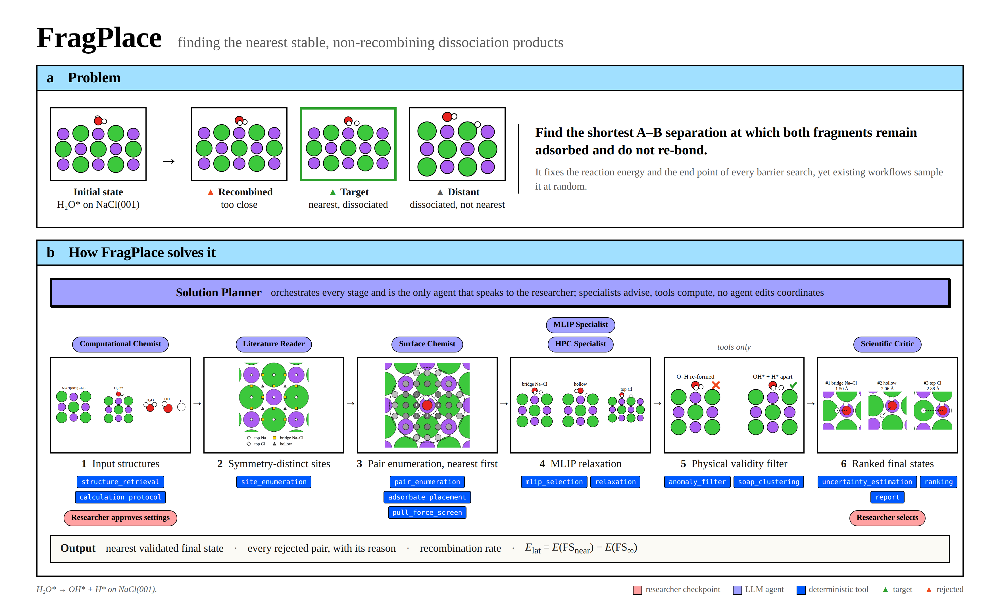

# FragPlace

FragPlace finds the nearest stable, non-recombining final state of a dissociated adsorbate. When a molecule AB breaks apart on a surface, the product A\* + B\* is not one structure but many: fragments placed too close recombine on relaxation, and fragments placed too far apart miss their lateral interaction, which shifts the reaction energy and the end point of every barrier search. FragPlace targets the nearest state that stays dissociated.

It is a Claude Code plugin. LLM agents plan and critique, deterministic tools do every calculation, and the researcher decides at each checkpoint, so every search is systematic, auditable and reproducible.



*(a) Possible final states of H₂O\* → OH\* + H\* on NaCl(001): recombined, the target, and distant. (b) The Solution Planner, the only agent that speaks to the researcher, directs specialist agents through six stages run by deterministic tools, with checkpoints for the researcher, ending in the nearest validated final state.*

## How to use

**You need** Claude Code (VS Code extension or terminal), Python 3.10 or newer, and this repository. On a Slurm cluster such as Triton, the heavy steps run on a compute node; on a workstation they run locally.

**1. Install, once**

```bash
git clone https://github.com/sethih10/open-science-hackathon && cd open-science-hackathon
python3 -m venv .venv
.venv/bin/pip install -e ".[structures,agents,dev,figures]"
.venv/bin/pip install mace-torch chgnet        # the machine-learned potentials
```

**2. Enable the plugin, once.** In a terminal, from the repository:

```bash
claude plugin marketplace add "$PWD"
claude plugin install fragplace@fragplace-local --scope local
```

Then create `.claude/settings.local.json`:

```json
{
  "disabledMcpjsonServers": ["fragplace"],
  "env": {"FRAGPLACE_SRUN": "--partition=interactive --cpus-per-task=4 --mem=8G --time=04:00:00"}
}
```

`FRAGPLACE_SRUN` holds the srun options for one compute-node job per session; leave `env` out on a workstation. Reopen Claude Code in the repository and type `/mcp`: `plugin:fragplace:fragplace` should be connected.

**3. Try the example.** In the chat, type `/fragplace:study demo` and choose the built-in example, \*OH → \*O + \*H on Pt(111) with a test potential. It takes about 20 minutes and shows every checkpoint.

**4. Run your own study.** Put the relaxed structures in one folder as `.xyz` or `.extxyz`, energies optional:

| File | Holds |
|---|---|
| slab | the clean surface |
| adsorbate | AB in vacuum |
| initial state | AB on the slab, same cell as the slab |
| fragment A, fragment B | A and B in vacuum, optional |

Type `/fragplace:study <name>`. When asked for the inputs, give the paths, the facet and the bond to break, A's side first, for example:

```text
slab inputs/surface.xyz, adsorbate inputs/h2o.xyz, initial state inputs/system.xyz,
fragment A inputs/oh.xyz, fragment B inputs/h.xyz, facet 100, bond 0,1
```

Then answer each question in the question box: the interview, the settings, the plan, the flagged cases, your pick and your interpretation. Nothing runs past a checkpoint without your answer. A study stopped half way resumes with the same command.

**5. Read the results** in `runs/<name>/`:

| File | Holds |
|---|---|
| `summary.md` | one short block per step |
| `geometries/` | `.xyz` files and pictures of every step |
| `report.md` | the final states, both energies, every rejection with its reason |
| `PROJECT.md` | the locked settings, decisions and your interview answers |
| `trace.jsonl` | every tool call, hand-off and answer, under who made it |

**Optional settings**, as `env` keys in `.claude/settings.local.json`: `FRAGPLACE_SLURM_JOB` to run the heavy steps inside an allocation you already hold; `CATHUB_API_KEY` for Catalysis-Hub values; `HF_TOKEN` for the UMA potential, which also needs `fairchem-core`.

**Checks without Claude**, on a compute node: `.venv/bin/python -m pytest -q`.

## Repository

```text
agents/       the orchestrator and the specialist agents
commands/     /fragplace:study
skills/       the procedures the agents follow
hooks/        code that records your answers and blocks unsafe edits
src/fragplace/
  tools/      the deterministic tools: sites, pairs, placement, relaxation, the filter, ranking, report
  study/      a study's records, summaries, pictures and question boxes
  execution/  where heavy steps run: locally, a compute-node worker, or batch jobs
  mcp/        the MCP server that exposes the tools to Claude Code
tests/        the test suite
docs/         design notes, a walkthrough and the archive
runs/         one folder per study
```
