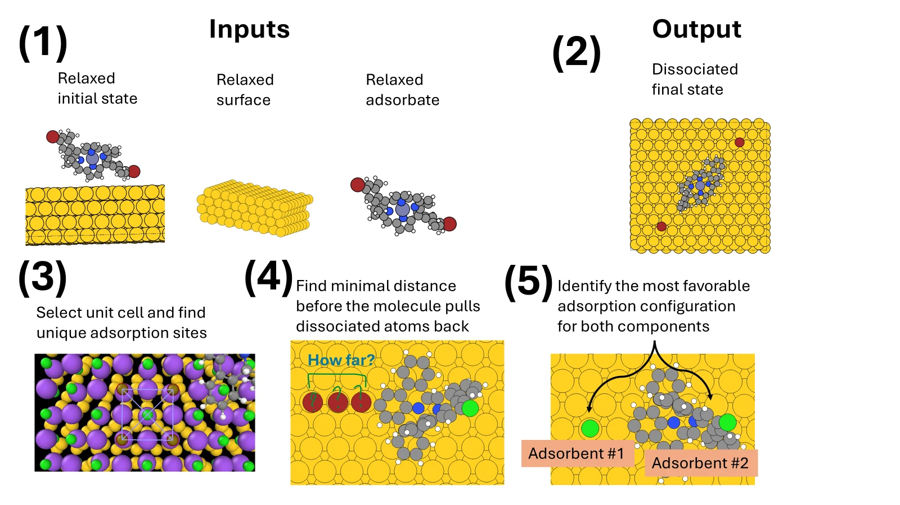
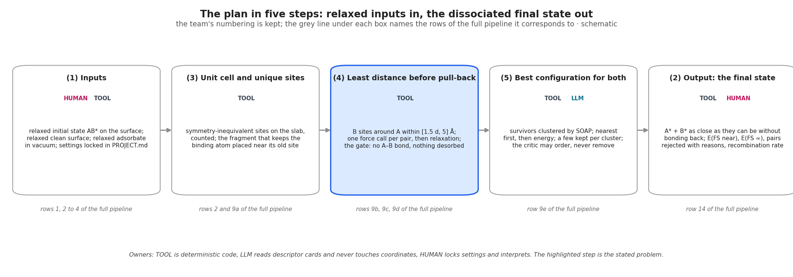
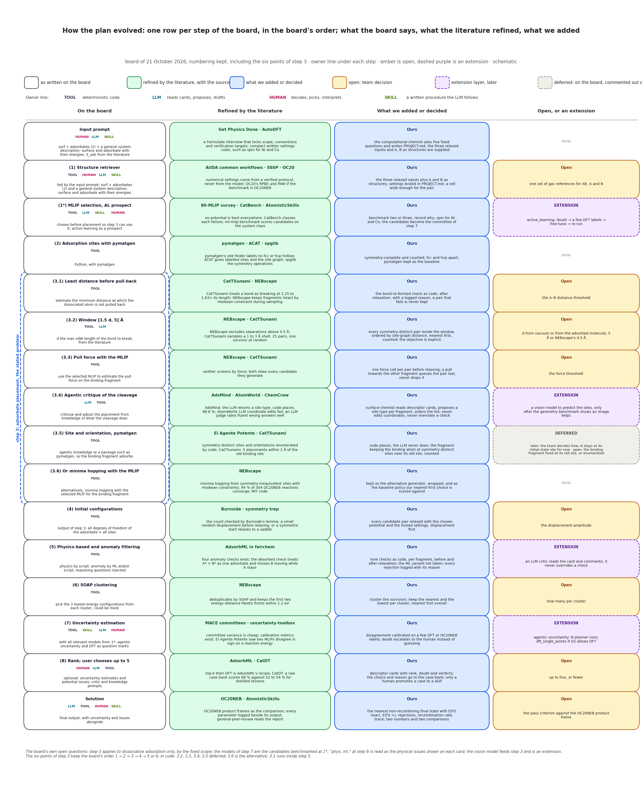
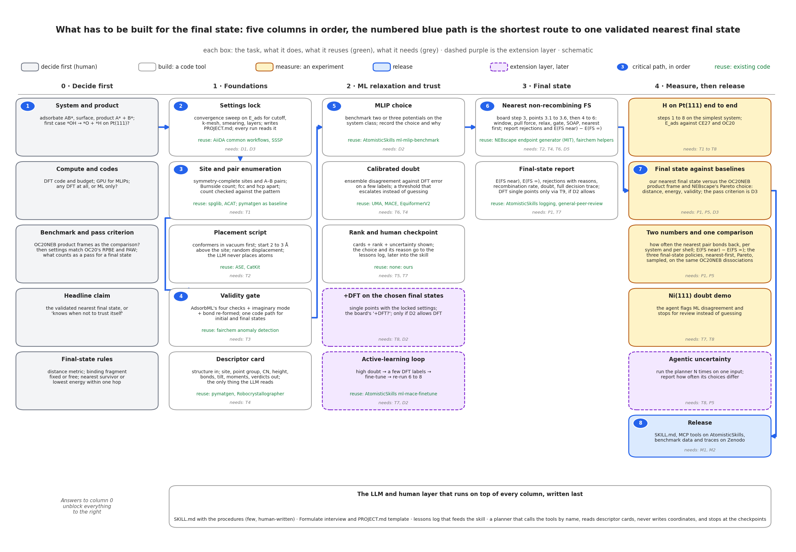

# open-science-hackathon: the nearest non-recombining final state

## The problem

Given a surface with the adsorbate AB\* and the desired product A\* + B\*, both fragments adsorbed, find the final state in which B\* sits as close to A\* as it can while the two stay fully dissociated and do not bond back. That is the whole scope, fixed by the team. Not catalysis, not kinetics, not yet the barrier: those are a later phase and no core task or measurable depends on them. The plan follows the shape of NEBscape, the closest prior work; CatTSunami is secondary. Everything a coding agent needs is in `agent.md`; the theory and the design history are in `archive/`.

## Inputs and output

Three relaxed structures and the named product go in; the nearest validated final states come out, with the pairs they rejected and why.



*Figure: the team's visualisation · 5 panels, inputs and output, schematic*

Reading the figure: panel 1, three relaxed inputs; panel 3, the unit cell and its unique sites; panel 4, how far B can sit from A before the molecule pulls it back, the stated problem; panel 5, the best configuration for both fragments; panel 2, the dissociated final state.

| Item | Content | Owner |
|---|---|---|
| Inputs | Relaxed initial state AB\* on the surface; relaxed clean surface; relaxed adsorbate in vacuum, each with its energy; the product named as A\* + B\*, both fragments adsorbed | Human |
| Input prompt | Surface, adsorbates, system description; critic and knowledge prompts as a fixed list; reasoning questions as a written skill | Human |
| Known | E_ads of the adsorbate from the literature, one or two published values with functional and site; a human verifies each | Literature |
| Settings | DFT settings locked in `PROJECT.md` by the dft-settings-protocol skill before anything is computed | Human |
| Output | The nearest non-recombining final states in order, the first few survivors, each on a card with its issues and the calibrated doubt from mlip_doubt; the human interprets them and the chosen final states go to DFT single points, P5; E(FS near) and E(FS ∞); every rejected pair with its reason; the recombination rate | Tool |

## The pipeline in five steps

The team's five panels, numbered here in flow order, map onto the full pipeline; step 3, the least distance before pull-back, is the stated problem.



*Figure: simplified pipeline · 5 steps, owners, board steps, schematic*

Reading the figure: boxes run left to right in flow order, the owner line under each title is in colour, the highlighted box is the stated problem, and the grey line under each box names the board steps it covers. The table below carries the same owners and mapping.

| Step | What it does | Owner | Board steps |
|---|---|---|---|
| 1 Inputs | Relaxed AB\* on the surface, clean surface, adsorbate in vacuum, retrieved and locked with the settings in `PROJECT.md`; the human approves; the MLIP chosen before any placement | Human, Tool | 1, 1\* |
| 2 Unit cell and unique sites | Cell wide enough that the pair never sees its periodic image, locked in row 1; symmetry-inequivalent sites on the slab, counted; the fragment keeping the binding atom placed near its old site | Tool | 2, 3.5 |
| 3 Least distance before pull-back | B sites around A within [1.5 d, 5] Å; one force call per pair, then relaxation; the validity gate: no A–B bond, nothing desorbed | Tool | 3.1, 3.2, 3.3, 4, 5 |
| 4 Best configuration for both | For adsorbent #1, A, and adsorbent #2, B: survivors clustered by SOAP; nearest first, then energy; the nearest and the lowest kept per cluster, more is open: team decision; the geometry-critic may order, never remove; doubt from the committee; the human picks up to five | Tool, LLM | 3.4, 3.6, 6, 7, 8 |
| 5 Output | A\* + B\* as close as they can be without bonding back; both energies; rejected pairs with reasons; recombination rate; the calibrated doubt from mlip_doubt; the LLM drafts the report and the human interprets | Tool, Human | Solution |

Owners: Tool is deterministic code; LLM plans, chooses and drafts from descriptor cards and never touches coordinates; Human locks settings, picks and interprets; Skill is a written procedure the LLM follows; Literature enters before the run and after it only, and a human verifies every value.

## How the plan evolved, step by step

The board is the reference: one row per board step, in the board's order and numbering, with what the board says, what the literature refined, and what we added. Nothing on the board was dropped; the ML variant of the filter in step 5 and the vision model in step 3 are recorded as not taken and as an extension.



*Figure: evolution of the plan · 15 board steps, 4 columns, schematic*

Reading the figure: the left column quotes the board, with the owner line under each step; green is the refinement the literature gave, with its source; blue is what we added or decided; amber is a decision still open and dashed purple an extension. The dashed bracket marks step 3, the stated problem, with its six points in the board's order.

| Board step | What the board says | Refined by the literature | What we added or decided |
|---|---|---|---|
| 1 Structure retriever | Input prompt: surface, adsorbates, system description; surface and adsorbate with energies | Settings from a verified protocol, AiiDA common workflows and SSSP; OC20's RPBE and PAW if OC20NEB is the benchmark | Three relaxed inputs plus A and B as structures; settings locked in `PROJECT.md`; a cell wide enough for the pair; gas references open |
| 1\* MLIP selection, AL prospect | Chosen before placement; active learning as a prospect | No potential is best everywhere, 80-MLIP survey; CatBench classes failures; ml-mlip-benchmark | Two or three candidates benchmarked on the system class, reason recorded; spin for Ni and Co; the candidates are the committee of step 7; active learning an extension |
| 2 Adsorption sites with pymatgen | Python, with pymatgen | pymatgen labels no fcc or hcp hollow; ACAT gives labelled sites and the site graph; spglib the symmetry | Symmetry-complete and counted; fcc and hcp apart; pymatgen kept as the baseline |
| 3.1 Least distance before pull-back | Estimate the minimum distance at which the dissociated atom is not pulled back | CatTSunami treats a bond as breaking at 1.25 to 1.63 times its length; NEBscape keeps fragments intact by constraint | The bond-re-formed check as code after relaxation, logged; the threshold open |
| 3.2 Window [1.5 d, 5] Å | d the maximum vdW length of the bond to break, from the literature | NEBscape excludes separations above 4.5 Å; CatTSunami samples a 1 to 3 Å shell and picks one survivor at random | Every symmetry-distinct pair inside the window, ordered by site-graph distance, nearest first, counted; d and the upper bound open |
| 3.3 Pull force with the MLIP | Estimate the pull force on the binding fragment to estimate its position | Neither NEBscape nor CatTSunami screens by force | One force call per pair before relaxing; a pull towards the other fragment queues the pair last, never drops it; threshold open |
| 3.4 Agentic critique of the cleavage | Criticise and adjust the placement from knowledge of what the cleavage does | AdsMind: the LLM returns a site type and code places, 98.8 %; AtomWorld: LLM coordinate edits fail | geometry-critic reads descriptor cards, proposes a site type per fragment, orders the list; never edits coordinates, never overrides a check; a vision model is an extension |
| 3.5 Site and orientation, pymatgen | Agentic knowledge or a package, so the binding fragment adsorbs | Code enumerates symmetry-distinct sites and orientations, El Agente Potente; CatTSunami 5 placements within 2 Å | Code places, never the LLM: the binding fragment at symmetry-distinct sites near its old site, counted; fixed or enumerated open |
| 3.6 Or minima hopping with the MLIP | Alternative to 3.5 | NEBscape: minima hopping from symmetry-inequivalent sites with Hookean constraints; 94 % of 304 OC20NEB reactions converge; MIT | Kept as the alternative generator and as the baseline policy our nearest-first choice is scored against |
| 4 Initial configurations | Output of step 3: all degrees of freedom times all sites | Burnside's lemma checks the count; a random displacement before relaxing avoids the symmetry trap | Every candidate pair relaxed with the chosen potential and the locked settings, displacement first; amplitude open |
| 5 Physics-based and anomaly filtering | Physics by script; anomaly by ML and/or script; reasoning questions injected | AdsorbML's four checks in fairchem; its desorbed check treats A\* + B\* as one adsorbate | Nine checks as code, per fragment, before and after relaxation; the ML variant not taken; every rejection logged; an LLM critic on cards is an extension |
| 6 SOAP clustering | Pick the 3 lowest-energy configurations from each cluster, could be more | NEBscape deduplicates by SOAP and keeps energy–distance Pareto fronts | Cluster the survivors; keep the nearest and the lowest per cluster, nearest first overall; count per cluster open |
| 7 Uncertainty estimation | With all relevant models from 1\*; agentic uncertainty and DFT as question marks | MACE committees give variance; uncertainty-toolbox calibrates; El Agente Potente saw two MLIPs disagree in sign | Disagreement calibrated on a few DFT or OC20NEB labels; doubt escalates to the human; agentic uncertainty and DFT single points are extensions |
| 8 Rank; user chooses up to 5 | Optional uncertainty and potential issues; critic and knowledge prompts | AdsorbML top-k then DFT; CatDT: a raw case bank beats distilled lessons, 68 % against 52 to 54 % | Descriptor cards with rank, doubt and verdicts; choice and reason to the case bank; only a human promotes a case to a skill |
| Solution | Final output | OC20NEB product frames as the comparison; AtomisticSkills logging; general-peer-review | The nearest non-recombining final state with E(FS near), E(FS ∞), rejections, recombination rate and trace; pass criterion open |

The board's own open questions, answered as far as we can: step 3 applies to dissociative adsorption only, which is the fixed scope; the models of step 7 are the candidates benchmarked at 1\*; "phys. int." at step 8 is read as the physical issues shown on each card; the vision model feeds step 3 and is an extension. The path from AB\* to the final state and its barrier are out of scope and live in the archive, `archive/docs/adsorption-agent-workflow.md`, sections 12 and 15.

## What is ours and what is not

Ours is the nearest-first objective of 3.2, the logged gate of 3.1 and 5, the pull-force pre-filter of 3.3, and two numbers nobody reports; everything else is a wrapped tool.

- NEBscape is the closest prior work and not an LLM agent: symmetry-inequivalent sites by spglib, two adsorbates placed combinatorially, separations beyond a cut-off excluded, Hookean fragment integrity, energy–distance Pareto selection, SOAP deduplication, a converged OC20NEB benchmark. Its endpoint generator is what row 9 wraps and its Pareto choice is the baseline our policy is scored against.
- CatTSunami's AutoFrameDissociation, open source in fairchem, builds the same final state by sampling a shell and picks one survivor at random; its rejected frames are not reported.
- Ours: a nearest-first objective over symmetry-complete, counted pairs, instead of a cut-off and a trade-off or a sampled shell.
- Ours: one validity gate, validity_gate, on both endpoints, run after relaxation, with every rejection logged and its reason kept; a failing state is never paired.
- Ours: two numbers nobody reports, the recombination rate of nearest pairs and the lateral interaction E(FS near) − E(FS ∞), and the three final-state policies compared on the same dissociations.
- Not ours and not claimed: site finding, placement and ML relaxation. Every adsorption agent does steps 2, 3.5 and 4. These are wrapped tools.

## Measured

Two numbers are measured and two comparisons, on an OC20NEB subset starting with \*OH → \*O + \*H on Pt(111).

| Number | Definition | Compared |
|---|---|---|
| Recombination rate | How often the nearest pair bonds back after relaxation | Per system and per distance shell |
| Lateral interaction | E_lat in the equation below, with E(FS ∞) from separate cells | Per system; sign and size |
| Three policies | Nearest-first, ours; energy–distance Pareto, NEBscape; shell sampling, CatTSunami; on the same dissociations: distance, energy, validity, recombination | Per reaction; NEBscape converged 94 % of 304 |
| Final state versus OC20NEB | Our nearest validated final state against the product frame of the released band: A–B distance, energy, validity | Per reaction in the subset |

$$
E_{\mathrm{lat}} = E(\mathrm{FS\,near}) - E(\mathrm{FS}\,\infty),\qquad E(\mathrm{FS}\,\infty) = E(\mathrm{A}^*) + E(\mathrm{B}^*) - E(\mathrm{slab})
$$

Pass criterion, open: team decision: a validated minimum with no A–B bond, at least as near as the OC20NEB product frame, within an energy tolerance still to be set. The subset size and whether any DFT single point runs are also open: team decision.

## Build order

The shortest route to one validated nearest final state runs through eight numbered tasks; the answers in column 0 unblock everything to their right.



*Figure: build plan · 5 columns, 23 tasks, critical path of 8, schematic*

Reading the figure: five columns in build order, from the team's decisions through code foundations, ML trust and the final state to measurements and release; the numbered blue path is the critical path, grey boxes are off-path tasks, dashed boxes the extension layer, and each box names what it reuses and needs.

1. D1 System and product: AB\*, surface, A\* + B\*; first case \*OH → \*O + \*H on Pt(111). Human decision.
2. T1 Settings lock. Needs D1, D3. Reuses AiiDA common workflows and SSSP.
3. T2 Site and pair enumeration. Needs T1. Reuses spglib and ACAT, pymatgen as the baseline.
4. T4 Validity gate. Needs T3. Reuses fairchem anomaly detection.
5. T6 MLIP choice. Needs D2. Reuses AtomisticSkills ml-mlip-benchmark.
6. P1 Nearest non-recombining final state. Needs T2, T4, T6, D5. Reuses the NEBscape endpoint generator and fairchem AutoFrameDissociation.
7. M2 The \*OH → \*O + \*H final state against the OC20NEB product frame. Needs P1, P5, D3.
8. R1 Release: SKILL.md, MCP tools on AtomisticSkills, benchmark data and traces on Zenodo. Needs M1, M2.

Off-path tasks the path needs, built when it needs them: T3 Placement script, needs T2, reuses ASE; P5 the final-state report, needs P1 and T7, reuses AtomisticSkills logging and general-peer-review; M1 H on Pt(111) end to end, needs T1 to T8. T9, DFT single points on the chosen final states, is an extension that needs T8 and D2.

Decisions D2 compute and codes, D3 benchmark and pass criterion, D4 headline claim and D5 final-state rules are open: team decision. The LLM and human layer, the skills, the Formulate interview run by dft-settings-interviewer, the lessons log and final-state-planner, is written last because it only calls the tools.

## Running the first case

Nothing runs yet; the first run waits on the settings lock and the site enumeration. Only `README.md`, `agent.md`, `CLAUDE.md`, `archive/` and `figures/` exist today. The first case is \*OH → \*O + \*H on Pt(111), decision D1, open: team decision. Before the first command, the Formulate interview run by dft-settings-interviewer writes `PROJECT.md` and the human locks it at the approve-settings checkpoint, and D2 and D3 are decided. The first run then calls dft_settings_lock, T1, and site_enumeration, T2; this section gains the command line when those two tools exist.

## Repository layout

A Claude Code plugin beside AtomisticSkills, with three rules: one kind per file and one folder per kind; calls go one way, agents to skills to tools to the library, never up or sideways; one reading order for a human and one for an agent. The drawing of it is archive/docs/figures/24-repository-layout.png.

```
open-science-hackathon/
├── README.md                     this file: the problem, the simplified and the full pipeline, what is ours, the build order, how to run the first case
├── agent.md                      what a coding agent needs: the exact pipeline, tools, repositories, rules
├── CLAUDE.md                     agent instructions: read agent.md first
├── archive/                      theory, design history, reviews, figure scripts; not needed to code
├── figures/                      the four figures of this page
├── PROJECT.md                    the locked settings and decisions of the current campaign
├── pyproject.toml                one package: the library, the server and the tests
├── .claude-plugin/plugin.json    declares the skills, agents, hooks and the MCP server
├── skills/                       few, human-written, one folder each, under 200 lines each
│   ├── dft-settings-protocol/    pseudopotentials, cutoff, k-mesh, smearing, layers; the lock
│   ├── mlip-doubt-calibration/   committee disagreement against DFT labels; when to escalate
│   ├── dissociation-final-state/ board step 3, points 3.1 to 3.6, and steps 4 to 6
│   ├── final-state-report/       the report: E(FS near), E(FS ∞), rejections, trace
│   └── hpc-dft-jobs/             only with HPC: submission, what custodian handles, what to escalate
├── agents/                       one markdown file per role, one page each
│   ├── final-state-planner.md    decides the next tool call and when to stop
│   ├── dft-settings-interviewer.md runs the Formulate interview; writes PROJECT.md
│   ├── geometry-critic.md        extension: whether a card and its verdicts disagree; never overrides
│   └── dft-job-steward.md        only with HPC: resubmit, adjust or escalate a failed DFT job
├── hooks/hooks.json              blocks coordinate edits; pauses at human checkpoints
├── mcp/                          one server, typed tools, one file per tool
│   ├── server.py                 registers the tools
│   └── tools/                    dft_settings_lock, site_enumeration, adsorbate_placement,
│                                 validity_gate, descriptor_card, mlip_choice, mlip_doubt,
│                                 dissociation_final_state, final_state_report;
│                                 extension: dft_single_points, only if D2 allows DFT
├── finalstate/                   pure Python, no LLM, no MCP: one module per tool, same name
├── tests/                        one test file per tool; Burnside on C4v; the gate on known failures
├── benchmark/                    OC20NEB subset, baselines, scoring scripts, results
├── runs/<campaign>/              PROJECT.md copy, trace.jsonl, cards/, structures/, report.md
└── lessons.md                    the lessons log; recurring entries become skill lines
```

Only `README.md`, `agent.md`, `CLAUDE.md`, `archive/` and `figures/` exist today; the rest is the planned layout.

## Where everything else is

`agent.md` holds what a coding agent needs: the exact pipeline with inputs, outputs, checks and thresholds per tool, the repositories to wrap with their licences, the rules the LLM must obey and the decisions still open. `archive/README.md` indexes the theory and the design history in a table, one row per file: the design document with its figures, the agent context, the long build context, the repository survey, the review of chemistry agents and the writing style.

## Sources

- [NEBscape, npj Computational Materials 2026](https://www.nature.com/articles/s41524-026-02298-1) and its [code, MIT](https://gitlab.mpcdf.mpg.de/hjung/nebscape)
- [CatTSunami and OC20NEB](https://arxiv.org/abs/2405.02078) and the [fairchem code](https://github.com/facebookresearch/fairchem)
- [AdsorbML and OC20-Dense](https://arxiv.org/pdf/2211.16486)
- [OC20 dataset paper, with the DFT settings](https://arxiv.org/pdf/2010.09990)
- [AtomisticSkills](https://arxiv.org/abs/2605.24002) and its [code](https://github.com/learningmatter-mit/AtomisticSkills)
- [Pynta, JCIM 2023, preprint](https://chemrxiv.org/engage/chemrxiv/article-details/647114454f8b1884b755bc5a)
- [TSAgent](https://arxiv.org/abs/2605.14154) and [TSBench](https://arxiv.org/abs/2609.08503)
- [Kempen, Cheula and Andersen: 80 MLIPs benchmarked](https://phys.au.dk/intercat/news-and-events/show/artikel/new-intercat-paper-luuk-kempen-raffaele-cheula-and-mie-andersen)
- [CatKit](https://github.com/SUNCAT-Center/CatKit), [ACAT](https://gitlab.com/asm-dtu/acat), [spglib](https://github.com/spglib/spglib), [pymatgen-core](https://github.com/materialsproject/pymatgen-core), where AdsorbateSiteFinder now lives; the old path in [pymatgen](https://github.com/materialsproject/pymatgen) is a stub
- [AiiDA common workflows, npj Computational Materials 2021](https://www.nature.com/articles/s41524-021-00594-6) and the [SSSP library](https://www.materialscloud.org/discover/sssp)
- [AtomWorld](https://arxiv.org/html/2510.04704): LLM coordinate edits fail, so placement stays a script
- [Robocrystallographer](https://www.cambridge.org/core/journals/mrs-communications/article/robocrystallographer-automated-crystal-structure-text-descriptions-and-analysis/3C201F132450877464B2D0B1B8C4ED01), for the descriptor card
