# Agentic Workflow for Adsorption Energies and Reaction Pathways

## Purpose and direction

We are building an AI agent that computes adsorption energies on catalyst surfaces reliably, and that knows when not to trust itself. The longer-term aim is to extend the same agent to reaction pathways and kinetics. The near-term target is an Open Science hackathon.

This document records the reasoning behind that direction, so that a colleague or another Claude instance can pick up the work without the original conversation.

**Scope, fixed on 21 October 2026.** The end goal for now is one thing: given a surface with adsorbate AB\* and the desired product A\* + B\*, both fragments adsorbed, determine the final state in which B\* is as close to A\* as possible while the two stay fully dissociated. We are not doing catalysis. The barrier to that final state, the path, kinetics and catalysis are later phases; they stay in the document as the extension layer, and no core task, demo or measurable depends on them. CatTSunami appears as the closest prior work for the final-state step, not as the model for the project.

**The position in one paragraph.** A generic "agent that computes adsorption energies" already exists several times over (Adsorb-Agent, AdsMind, DREAMS, CatMaster, Catalyst-Agent, AutoDFT). Our contribution is therefore not the workflow itself but its trustworthiness: symmetry-complete site enumeration, explicit validity checks, detection of machine-learning failures (notably on magnetic Ni and Co), designed human checkpoints, a measured failure rate against a baseline, and an open, reusable release.

**How to read it.** Sections 2 to 5 give the science, the basic workflow, how the DFT numerical setup is chosen, and where the literature enters. Sections 6 and 7 cover prior adsorption agents and benchmarks. Sections 8 to 10 explain what scientific intuition the agent needs and where it comes from, why geometry stays in code, and what others have done to give agents such intuition. Section 11 places our work on AtomisticSkills. Sections 12 and 13 extend the workflow to reaction pathways. Section 14 records the whiteboard solution planner, its gaps and its extension layer. Section 15 augments that pipeline with refinements from the transition-state papers, the gaps, and what is ours. Section 16 states the final-state problem for a dissociation step and who has solved it. Sections 17 and 18 give strategy, decisions and open questions.

**Who owns each step.** Each step has one owner: a deterministic tool (code), an LLM, a human, or a literature or benchmark input; knowledge files sit beside the flow. The diagram in section 13 carries its own key.

## Scientific background

The adsorption energy is the quantity everything else is built on. It is computed with density functional theory (DFT) on a periodic slab model of the surface:

$$
E_{\mathrm{ads}} = E(\mathrm{slab}+A) - E(\mathrm{slab}) - E(A)
$$

Here E(slab + A) is the energy of the relaxed slab with adsorbate A, E(slab) that of the clean relaxed slab, and E(A) that of a stated gas-phase reference (for an H atom, usually half of E(H₂)). A negative value means binding is favourable. Changing the reference shifts every value but not the ranking of sites.

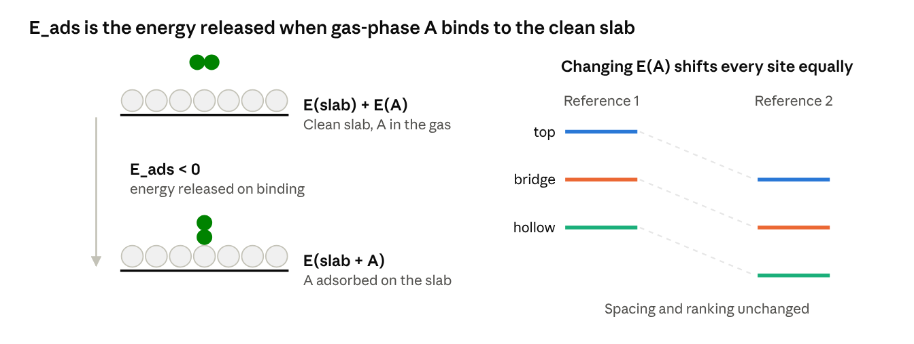

adsorption energy as an energy-level drop · reference choice

Reading the figure: on the left, the upper level is the clean slab with A far away in the gas; the lower level is A bound to the slab. The drop between them is E_ads, negative when binding releases energy. On the right, the same three sites (top, bridge, hollow) are plotted with two different gas references: every level moves by the same amount, so the gaps between sites and their ranking do not change.

For thermodynamics we correct to a free energy:

$$
\Delta G = \Delta E + \Delta E_{\mathrm{ZPE}} - T\Delta S
$$

where ZPE is the zero-point energy from vibrational frequencies, T the temperature and S the entropy.

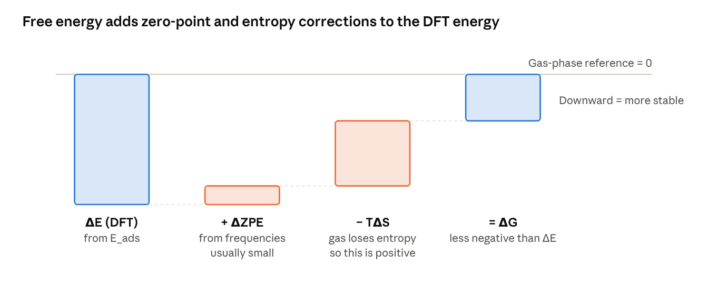

from DFT energy to free energy · schematic, not to scale

Reading the figure: start from the DFT adsorption energy ΔE (a drop below the gas reference). The zero-point correction usually raises it slightly. Because a gas molecule loses most of its translational and rotational entropy when it adsorbs, ΔS is negative and −TΔS raises the energy further. The result, ΔG, is less negative than ΔE, and the gap grows with temperature. Bar heights are schematic.

**What "adsorption curves" can mean.** Four different objects share the name:

- Binding curve: energy against height z over one site; its minimum gives the equilibrium height and E_ads.

- Potential energy surface: energy over lateral positions; the hollow-to-bridge difference approximates the diffusion barrier.

- Coverage curve: E_ads against coverage θ, showing lateral repulsion.

- Isotherm: coverage against pressure, e.g. Langmuir θ = KP / (1 + KP), built on top of the DFT energies.

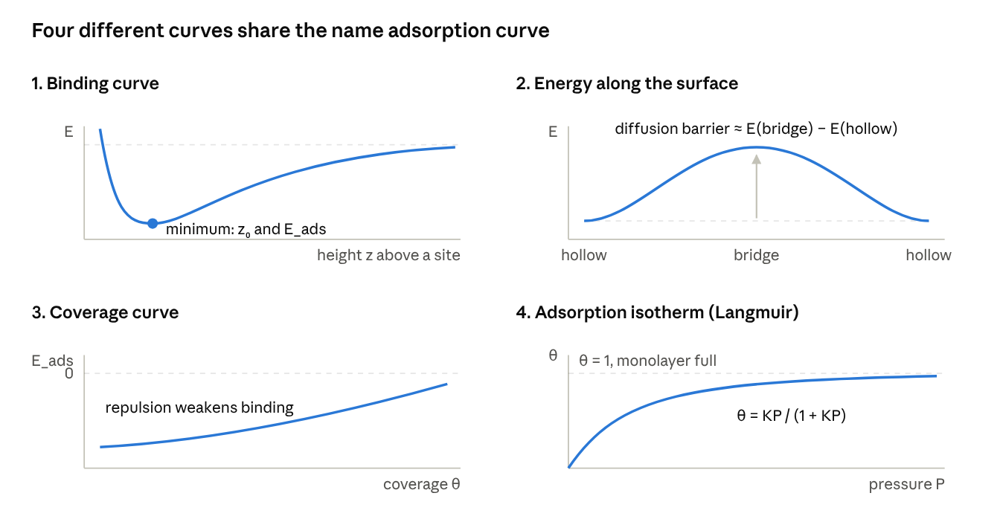

four kinds of adsorption curve · schematic

Reading the figure: (1) energy against height over one site, whose minimum gives z₀ and E_ads; (2) energy along a lateral path hollow–bridge–hollow, whose bump is the diffusion barrier; (3) E_ads against coverage, rising towards zero as neighbouring adsorbates repel; (4) the Langmuir isotherm, coverage against pressure, saturating at one monolayer. Curves 1 to 3 come directly from DFT; curve 4 is built from DFT free energies through the equilibrium constant K.

**Where symmetry and group theory enter.**

- Site enumeration: the slab has a two-dimensional layer group, and inequivalent sites are its inequivalent high-symmetry Wyckoff positions. On fcc(111) these are top (C3v), bridge (C2v), fcc hollow (C3v) and hcp hollow (C3v); on fcc(100), top, bridge and four-fold hollow.

- Orientation enumeration: only orientations inequivalent under the site's stabiliser (site-symmetry) group need testing.

- Configuration counting at higher coverage uses Burnside's lemma, below, where N is the number of distinct arrangements, G the symmetry group of the supercell and \|X^g\| the number of arrangements left unchanged by operation g.

- Spectroscopy: by the surface selection rule, only modes of the totally symmetric representation of the site group are IR-active on a metal, which helps identify the site experimentally.

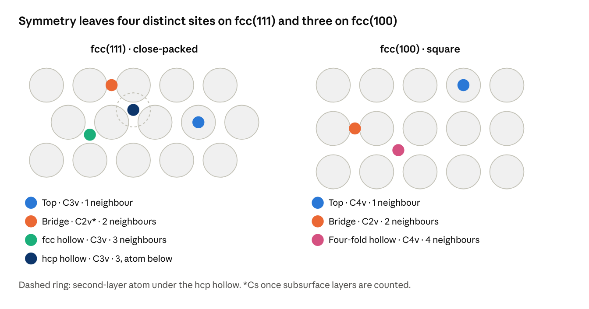

inequivalent adsorption sites · fcc(111) and fcc(100)

Reading the figure: grey discs are surface metal atoms seen from above; coloured dots mark the only sites the agent needs to test, each labelled with its site-symmetry group and coordination number. The fcc and hcp hollows look alike from above and differ only in whether a second-layer atom lies beneath (hcp) or not (fcc). Every other point on the surface is equivalent by symmetry to one of these.

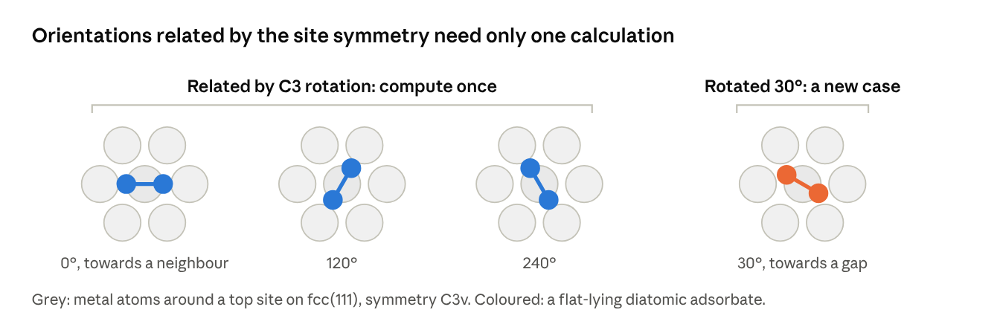

orientation enumeration on a C3v top site

Reading the figure: a flat-lying diatomic sits on a top site, whose surroundings have threefold (C3v) symmetry. The three orientations on the left are carried into one another by a 120° rotation, so they have identical energies and the agent computes only one. Rotating by 30° points the molecule at a gap between neighbours instead of at a neighbour; no symmetry operation maps this onto the first case, so it is a separate calculation.

$$
N = \frac{1}{|G|} \sum_{g \in G} |X^{g}|
$$

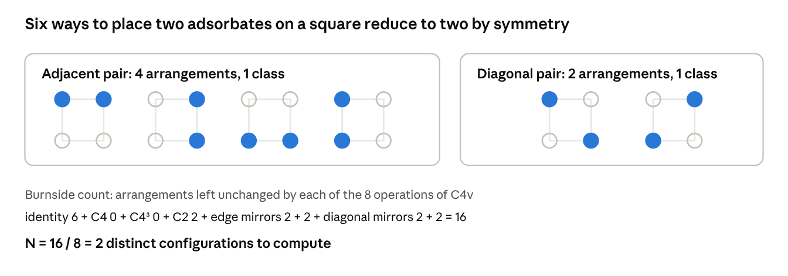

Burnside counting · two adsorbates on a square

Reading the figure: two identical adsorbates on the four corners of a square cell can be placed in six ways. The square's symmetry group C4v has eight operations; counting how many of the six arrangements each operation leaves unchanged gives 16, and 16 / 8 = 2. Indeed the six collapse into two classes, adjacent and diagonal, so the agent computes two configurations, not six. The same count, done by code, scales to large supercells where enumerating by eye is impossible.

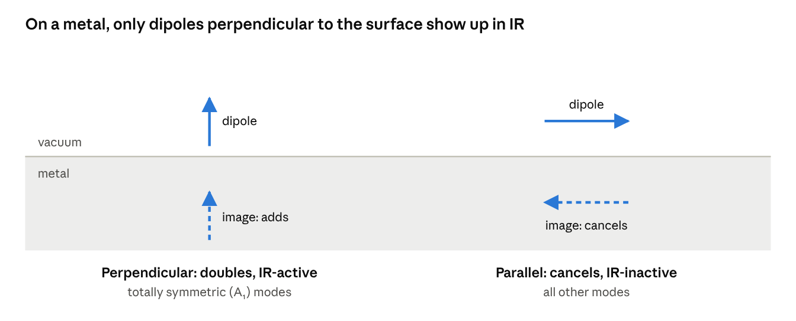

surface selection rule · image dipoles

Reading the figure: the conduction electrons of a metal respond to a nearby dipole as if a mirror-image dipole sat inside the metal. A dipole perpendicular to the surface has an image pointing the same way, so the two add and the vibration absorbs infrared light. A dipole parallel to the surface has an image pointing the opposite way, so they cancel. Only vibrations of the totally symmetric representation (A₁) of the site group carry a perpendicular dipole, which is why IR spectra help identify the adsorption site.

**A trap that matters for automation.** Forces preserve the symmetry of the starting structure. An adsorbate placed exactly on a high-symmetry site can stay there even when a tilted, lower-symmetry geometry is lower in energy. The agent must apply a small random displacement before relaxing and confirm minima with a frequency calculation (no imaginary modes).

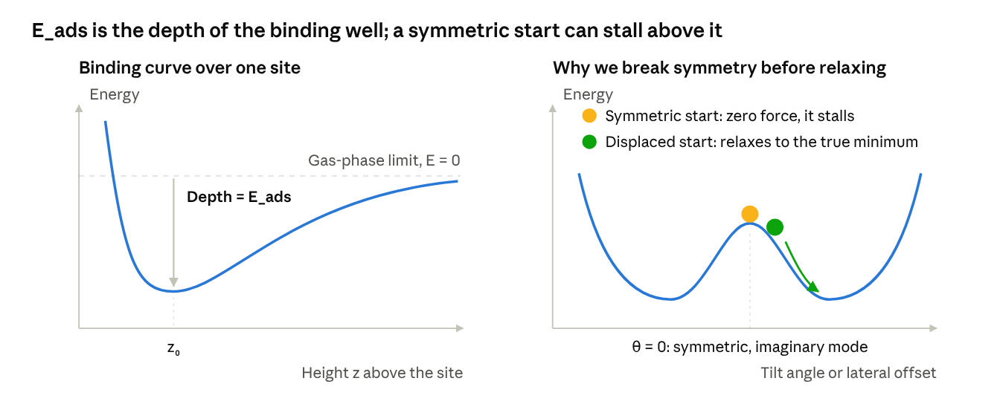

binding curve and the symmetry trap · schematic, not to scale

Reading the figure: on the left, energy falls as the adsorbate approaches the site, reaches a minimum at height z₀, and rises steeply when it is pushed closer; the depth of the well below the gas-phase limit is E_ads. On the right, energy is plotted against a tilt or lateral offset. The symmetric position (θ = 0) is a local maximum where symmetry makes the force exactly zero, so an unperturbed relaxation stays there; a frequency calculation reveals it through an imaginary mode. A small displacement lets the structure roll into the lower, tilted minimum. Both curves are schematic.

## The adsorption workflow and where to automate

Automate the deterministic middle; keep humans where a wrong choice silently corrupts every later number. The table lists the steps in order, with who owns each.

| Step                             | Owner | What it does                                                    | Tools                             |
|----------------------------------|-------|-----------------------------------------------------------------|-----------------------------------|
| Choose system and settings       | Human | Metal, facet, adsorbate, functional, references                 | Literature, PROJECT.md            |
| Converge numerical settings      | Tool  | Pseudopotential set, cutoff, k-mesh, smearing, layers, on E_ads | Convergence tool (ours), ASE      |
| Bulk relaxation                  | Tool  | Lattice constant                                                | ASE, VASP or Quantum ESPRESSO     |
| Slab construction                | Tool  | Facet, layers, vacuum, fixed bottom layers                      | ASE, pymatgen                     |
| Site and orientation enumeration | Tool  | All symmetry-inequivalent sites and orientations                | spglib, pymatgen, CatKit, ACAT    |
| ML pre-screening                 | Tool  | Relax all candidates cheaply, keep the top few                  | Universal ML potentials, AdsorbML |
| DFT relaxation                   | Tool  | Accurate energies for the best candidates                       | VASP or QE via AiiDA or atomate2  |
| Diagnose failed jobs             | LLM   | Read errors, adjust, resubmit                                   | Agent                             |
| Validity checks                  | Tool  | The nine checks of the gate below, on every relaxed structure   | Custom scripts                    |
| Review flagged cases             | Human | Only cases that failed checks                                   | —                                 |
| Energies and curves              | Tool  | E_ads, ΔG, E(z), E(θ)                                           | Custom scripts                    |
| Benchmark comparison             | Tool  | Error against known values                                      | OC20-Dense, CE27                  |
| Interpret results                | Human | Mechanism, next targets                                         | —                                 |

**The validity gate.** One code path, run on every relaxed structure, initial or final, before anything is ranked or paired. The agent context restates it as rules.

| #  | Check                  | Fails when                                                              | Threshold                              |
|----|------------------------|-------------------------------------------------------------------------|----------------------------------------|
| 1  | Desorbed               | Adsorbate centre too far above the surface plane                        | 3 Å                                    |
| 2  | Migrated               | Adsorbate ends on a site other than the one enumerated                  | Site label differs                     |
| 3  | Dissociated            | An intramolecular bond stretched beyond its breaking threshold          | Open                                   |
| 4  | Reconstructed          | Surface atoms displaced from their clean-slab positions                 | Open                                   |
| 5  | Intercalated           | An adsorbate atom below the top surface layer                           | Layer index                            |
| 6  | Not a minimum          | One or more imaginary vibrational modes                                 | Zero allowed                           |
| 7  | Magnetism collapsed    | Total moment of a magnetic slab vanishes on adsorption                  | Open                                   |
| 8  | Outside expected range | E_ads far from the prior for this adsorbate and metal                   | Prior width open                       |
| 9  | Settings mismatch      | Slab and slab+A differ in cutoff, mesh, smearing or pseudopotentials    | Exact equality                         |

Checks 1 to 4 are AdsorbML's anomaly checks, with intercalation as its fourth; the rest are ours. For a co-adsorbed pair, check 1 runs per fragment. The final-state gate of section 16 adds two more: the A–B bond re-formed, and the pair interacting with its periodic image.

The largest gains from automation are site enumeration (dozens of inequivalent configurations instead of three or four guesses), ML pre-screening (roughly an order of magnitude less DFT), job handling, and validity checks.

A sensible build order is: enumeration plus validity checks first (no supercomputer time needed); then DFT job management on a known system such as H on Pt(111), reproducing a literature value; then ML pre-screening, checked against DFT before relying on it.

## Choosing the DFT numerical setup

Practitioners do not choose pseudopotentials, cutoffs and k-points by taste. They take a verified library and run convergence tests on the quantity they will report. The physics choices (functional, dispersion, spin, Hubbard U, gas-phase references, slab model) need judgement and literature; the numerical choices are tests that a tool can run unattended. The two kinds are kept apart because they fail differently: a wrong functional gives a plausible but biased number that no test reveals, while an unconverged cutoff gives noise that a sweep removes.

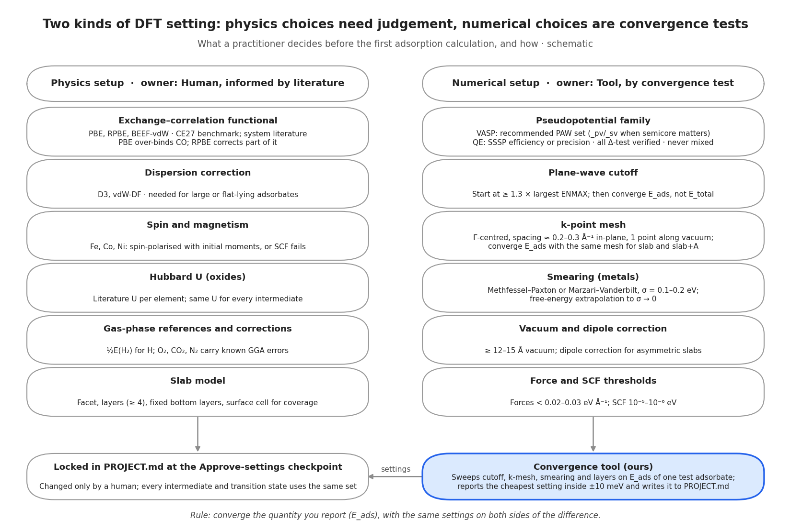

*Figure: two kinds of DFT setting · schematic*

Reading the figure: the left column lists the physics choices, each with where the answer comes from; a human makes them and they are locked in PROJECT.md at the Approve-settings checkpoint. The right column lists the numerical choices, each with the rule a practitioner applies; the highlighted box at the bottom is the convergence tool we build, which sweeps these settings on E_ads and writes the result into PROJECT.md. The grey arrow between the two bottom boxes carries the converged numbers into the locked project memory.

**Pseudopotentials.** A plane-wave code never treats the core electrons explicitly; each atom's core is replaced by a pseudopotential or PAW dataset. Nobody generates these for a project; they come from a library. VASP ships one recommended PAW dataset per element, marked in its wiki; variants with the suffixes `_pv` and `_sv` put semicore p or s states into the valence and are the recommended choice for early transition metals and wherever semicore states matter. For Quantum ESPRESSO the [SSSP library](https://www.materialscloud.org/discover/sssp) picked, for each element, the best file from the public libraries by testing against all-electron equations of state, phonon frequencies, cohesive energy, pressure and band structure; it comes as an *efficiency* set for screening and a *precision* set for final numbers, each with a recommended cutoff per element. Both families were checked against all-electron codes in the [Δ-test](https://archive.materialscloud.org/record/1874) (Lejaeghere et al., Science 2016) and its successor ([Bosoni et al., Nature Reviews Physics 2024](https://archive.materialscloud.org/record/2023.81)), which found that modern PAW and pseudopotential codes agree with each other as closely as independent experiments do. The practical rules are: take the recommended set; never mix families or versions within a project; use the same dataset for an element in bulk, slab and gas phase; record the version (PBE 54 is the current default in the Materials Project and atomate2, OC20 used PAW with RPBE).

**Plane-wave cutoff.** The cutoff sets the size of the basis. Each dataset states a minimum (ENMAX in a VASP POTCAR; the per-element table in SSSP). Start from the largest ENMAX of any element in the cell, times about 1.3 when the cell volume is relaxed (to avoid Pulay stress), then converge. OC20 used 350 eV; the Materials Project uses 520 eV because it compares total energies across many compounds. The point that matters for us is that one converges E_ads, not the total energy. The basis-set error of a metal atom is nearly the same in the clean slab and in the slab with adsorbate, so it cancels in the difference:

$$
\delta E_{\mathrm{ads}} = \delta E(\mathrm{slab}+A) - \delta E(\mathrm{slab}) - \delta E(A) \ll \delta E(\mathrm{slab}+A)
$$

E_ads therefore reaches ±10 meV at a cutoff where the total energy is still hundreds of meV from its limit. The same cancellation needs identical settings on both sides of the difference, which is why the convergence tool uses one mesh and one cutoff for slab and slab+A.

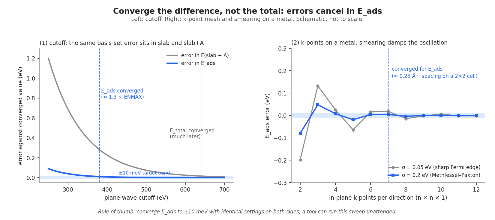

*Figure: convergence of E_ads against cutoff and k-points · schematic, not to scale*

Reading the figure: on the left, the grey curve is the error in the total energy of slab+A as the cutoff rises, and the blue curve the error in E_ads; the blue band is the ±10 meV target. E_ads enters the band at the blue dashed line, near 1.3 times ENMAX, long before the total energy does at the grey dashed line. On the right, E_ads on a metal is plotted against the in-plane k-point mesh for two smearing widths: the sharp Fermi edge (grey) oscillates for longer than the broader Methfessel–Paxton smearing (blue), which enters the band at about a 7 × 7 × 1 mesh on a 2 × 2 cell.

**k-points.** Converge likewise. Metals need denser meshes than insulators because the occupation drops sharply at the Fermi level; a smearing of the occupations (Methfessel–Paxton or Marzari–Vanderbilt, σ = 0.1 to 0.2 eV) damps the oscillation, and one reports the energy extrapolated to σ → 0. Use Γ-centred meshes on hexagonal cells, one k-point along the vacuum direction, a spacing of about 0.2 to 0.3 Å⁻¹ in-plane (OC20 derived its mesh from 40 divided by the in-plane cell lengths), and a cell-consistent density when comparing supercells of different size.

**Slab thickness, vacuum and dipole correction** are convergence tests too: add layers until E_ads stops changing (four to five for close-packed metals), use at least 12 to 15 Å of vacuum, and switch on the dipole correction when only one face of the slab is covered.

**Who does what in our agent.**

| Setting                                 | How it is chosen                                   | Owner | Channel                              |
|-----------------------------------------|----------------------------------------------------|-------|--------------------------------------|
| Pseudopotential family and version      | Library recommendation, Δ-test verified            | Tool  | Lookup; recorded in PROJECT.md       |
| Functional, dispersion, spin, Hubbard U | Literature and CE27; specific to the system        | Human | Checkpoint; locked in PROJECT.md     |
| Gas-phase references and corrections    | Literature                                         | Human | Locked in PROJECT.md                 |
| Cutoff, k-mesh, smearing                | Sweep on E_ads of a test adsorbate to ±10 meV       | Tool  | Convergence tool; result in PROJECT.md |
| Layers, vacuum, dipole correction       | Sweep on E_ads                                     | Tool  | Convergence tool                     |
| Force and SCF thresholds                | Convention: 0.02 to 0.03 eV Å⁻¹; 10⁻⁵ to 10⁻⁶ eV     | Skill | SKILL.md                             |

Protocol libraries already encode this expertise without any language model: [AiiDA common workflows](https://aiida-common-workflows.readthedocs.io/) offer *fast*, *moderate* and *precise* protocols for eleven codes, each implementer's settings made available to non-experts; SSSP fixes the pseudopotential and cutoff per element; pymatgen input sets fix the Materials Project settings. The agent should call these and the convergence tool rather than invent settings.

**Rejected.** Letting the LLM write cutoff and k-points from memory in one call, as [AutoDFT](https://arxiv.org/html/2605.26179v2) does. A number produced that way may be right for Pt and wrong for an oxide, and nothing in the run reveals which. The LLM may choose *which* protocol applies and explain the choice; the numbers come from the protocol or the sweep.

## Where the literature is needed

The calculation itself needs nothing from the literature: every term in E_ads is our own DFT energy. The literature supplies confidence that the setup behind those energies is sound, and it enters at two points only: before the run, to fix settings, and after it, to check results on known systems.

**Essential.**

- Before the first calculation on a system: choice of functional (PBE tends to overbind CO; RPBE corrects some of this; dispersion matters for large or flat-lying molecules), reference states and gas-phase corrections (O₂, CO₂ and N₂ carry known GGA errors).

- Systems with known DFT problems: CO on transition metals (the "CO/Pt(111) puzzle", where GGA predicts the hollow site but experiment shows the top site), open-shell molecules, magnetic surfaces, oxides needing a Hubbard U.

- Any comparison with, or publication against, other work: settings must match.

**Optional.** Screening many similar systems with a validated setup; relative trends, which are less sensitive to the functional than absolute values.

**Adds nothing.** Genuinely new systems with no prior data; validate the method on a similar known system instead.

**In practice** this is a targeted lookup of minutes, not a formal review: one or two published E_ads values with their functional, the preferred site (computed and, if possible, measured), and any reported DFT failure. The agent may gather these, but a human must verify them, because language models can misquote values or invent citations.

A separate, proper literature review (20 to 40 papers) is needed for the project itself, to show what the agent adds beyond existing work. That is section 6.

## Prior work and its gaps

The full chain from structure generation through DFT to E_ads has already been automated, in two generations. A re-implementation on simple metals would add little; the open problems are reliability and scope.

| Work                                                                                                                                                          | Type      | What it does                                                 | Documented limitation                      |
|---------------------------------------------------------------------------------------------------------------------------------------------------------------|-----------|--------------------------------------------------------------|--------------------------------------------|
| [CatKit](https://www.aiche.org/conferences/aiche-annual-meeting/2018/proceeding/paper/699a-catkit-symmetry-methods-automated-generation-catalytic-structures) | Toolkit   | Symmetry-based surface and site generation                   | —                                          |
| [ACAT](https://pypi.org/project/acat/1.7.0/)                                                                                                                  | Toolkit   | Site and coverage identification for slabs and nanoparticles | Metals and alloys only; not for oxides     |
| [AdsorbML](https://arxiv.org/pdf/2211.16486)                                                                                                                  | ML + DFT  | Graph neural network screening with DFT check                | Bounded by ML accuracy                     |
| [Adsorb- Agent](https://arxiv.org/html/2410.16658v3)                                                                                                          | LLM agent | LLM proposes configurations, then relaxes them               | Open loop; sign errors found later         |
| [AdsMind](https://arxiv.org/html/2606.19152)                                                                                                                  | LLM agent | Closed-loop, physics-grounded configuration search           | DFT validation on six systems; MAE 1.55 eV |
| [DREAMS](https://alphaxiv.org/abs/2507.14267)                                                                                                                 | LLM agent | Hierarchical multi-agent DFT on Quantum ESPRESSO and AutoCat | —                                          |
| [CatMaster](https://arxiv.org/pdf/2601.13508)                                                                                                                 | LLM agent | Surrogate exploration with targeted DFT validation           | —                                          |
| [Catalyst-Agent](https://arxiv.org/pdf/2603.01311)                                                                                                            | LLM agent | MCP agent around FAIRchem AdsorbML                           | Success rate 23–34%; DFT slow              |
| [AutoDFT](https://arxiv.org/html/2605.26179v2)                                                                                                                | LLM agent | Closed-loop DFT with monitoring and failure recovery         | Task completion, not chemistry accuracy    |

AtomisticSkills (2026) is not in this table because it is infrastructure rather than a competitor: a general skill library we can build on (see "Building on AtomisticSkills").

**Gaps we target.**

- Thin DFT validation: errors of order 1.5 eV, against a need for about 50 meV to preserve activity trends.

- Agents versus plain enumeration: an independent review found a case where AdsMind's closed loop converged above the minimum found by exhaustive enumeration. Whether agents beat symmetry-based brute force is unsettled.

- Dependence on ML potentials, which fail badly on magnetic Co and Ni.

- Narrow chemistry: mostly metals and alloys; oxides, magnetism, high coverage and electrochemical interfaces are largely untouched.

- Run-to-run variability of hosted LLM workflows.

## Benchmarks and the gap

Several benchmarks exist, but each tests one part of the pipeline; none tests an agent end to end against symmetry-exhaustive search with full DFT verification on hard chemistry.

| Benchmark                                                                                                                                               | Tests                            | Size or scope                                                             | Note                                                                    |
|---------------------------------------------------------------------------------------------------------------------------------------------------------|----------------------------------|---------------------------------------------------------------------------|-------------------------------------------------------------------------|
| [OC20-Dense](https://arxiv.org/pdf/2211.16486)                                                                                                          | Global-minimum search            | About 1,000 combinations per split; 74 adsorbates; 80,000+ configurations | Configurations sampled heuristically and randomly, not by full symmetry |
| [OCD-GMAE, Alloy-GMAE, FG-GMAE](https://zenodo.org/records/12104162)                                                                                    | Global-minimum energy prediction | Derived from OC20-Dense, Catalysis-Hub and a functional-groups set        | Cleaned subsets                                                         |
| AA20, OCD-GMAE62                                                                                                                                        | Agent configuration search       | Small sets used by Adsorb-Agent and AdsMind                               | —                                                                       |
| OC20                                                                                                                                                    | ML energies                      | One configuration per combination                                         | Not suitable for global minima                                          |
| OC22                                                                                                                                                    | ML energies on oxides            | Oxide surfaces                                                            | —                                                                       |
| CatBench                                                                                                                                                | ML potentials on adsorption      | 13 MLIPs, 47,000+ reactions; best about 0.2 eV                            | —                                                                       |
| [Kempen, Cheula and Andersen](https://phys.au.dk/intercat/news-and-events/show/artikel/new-intercat-paper-luuk-kempen-raffaele-cheula-and-mie-andersen) | Foundational MLIPs               | 80 models; adsorption, barriers, vibrations; metals and oxides            | Many fail on magnetic Co and Ni; no single best model                   |
| CE27 (Wellendorff et al., 2015)                                                                                                                         | DFT against experiment           | Experimental chemisorption energies on transition metals                  | For choosing the functional                                             |
| [OC20NEB](https://arxiv.org/abs/2405.02078)                                                                                                             | ML transition states             | 932 DFT NEB calculations                                                  | For the pathway extension                                               |
| VASPBench                                                                                                                                               | Agent task completion            | 34 DFT tasks                                                              | Runs succeed; chemistry not judged                                      |

**Our benchmark plan.**

1.  A subset of OC20-Dense, for comparability with published agents.

2.  Our own symmetry-complete enumeration on 30 to 50 of those systems, to test whether OC20-Dense missed lower minima.

3.  A small hard set (Ni, Co, one oxide such as TiO₂(110) or CeO₂(111)) where current tools are known to fail.

4.  Controls that should be easy: H and O on Pt(111) and Cu(111).

Reported metrics: success in finding the DFT minimum, error against DFT, fraction of own failures flagged, and compute cost, each against a baseline (a plain AdsorbML-style run).

## How human insight enters the agent

A skill is one of five channels, not the only one. Each kind of insight belongs in the channel that enforces it most reliably.

| Channel                     | Holds                          | Acts                             | Example                                                           |
|-----------------------------|--------------------------------|----------------------------------|-------------------------------------------------------------------|
| Skill (SKILL.md)            | General know-how, written once | Loaded whenever the task matches | Always break symmetry before relaxing; flag CO on Pt-group metals |
| Project memory (PROJECT.md) | Choices for this system        | Read at every step               | RPBE-D3, four-layer slab, ½E(H₂) reference                        |
| Checkpoints                 | Live judgement                 | Agent pauses for approval        | Approve settings; review flagged cases                            |
| Tools (code)                | Insight turned into rules      | Every run, without fail          | Reject an adsorbate relaxed more than 3 Å above the surface       |
| Lessons log                 | Corrections from review        | Fed back into the skill          | Ni(111): set initial magnetic moments, or SCF fails               |

**Rule of thumb.** If an insight can be written as a test, make it a tool; if it is a procedure, put it in the skill; if it is a choice for one system, put it in project memory; if it needs judgement each time, make it a checkpoint. Insight in code is the most reliable, because an LLM can misread a prompt but cannot skip a check it does not control.

**Lessons from [Get Physics Done](https://github.com/psi-oss/get-physics-done) (GPD).** GPD installs physics-research commands into agent runtimes such as Claude Code, Codex and Gemini CLI. Its ways of bringing in the human:

- A Formulate stage that asks targeted questions on scope, assumptions, notation and verification targets, and freezes the answers into files (PROJECT.md, REQUIREMENTS.md, ROADMAP.md, STATE.md).

- Locked conventions across a project, so notation and assumptions stay consistent.

- A discuss step before each plan and execute phase.

- Adjustable autonomy (Supervised, Balanced), treating each agent turn like a graduate student's work.

- A Verify stage checking dimensions, limiting cases, symmetry and conservation laws.

- Commands to defer a tangent or branch into an alternative hypothesis.

We copy the pattern (Formulate interview, locked settings, discuss-then-execute, autonomy setting) and add what GPD lacks for our domain: an adsorption and transition-state skill with DFT pitfalls, and deterministic validity-check tools exposed as an MCP server.

**Does the agent need chemistry and physics intuition?** Yes, but intuition is four different things, and only the last is hard to obtain.

1. *Procedures*: how to do a step so that it comes out right (break symmetry before relaxing; converge E_ads, not the total energy; same settings on both sides of a difference). Written in textbooks and protocol libraries. Goes into the skill.

2. *Priors and expected ranges*: what an answer should look like (H on Pt(111) near −0.5 eV; CO prefers the top site on Pt although GGA says hollow; universal ML potentials fail on magnetic Ni and Co). Written in benchmarks, datasets and reviews. Goes into the sanity checks and the ML-doubt detector as thresholds.

3. *Sanity constraints*: what cannot be true (an adsorbate 3 Å above the surface has desorbed; a minimum has no imaginary modes; a magnetic moment does not vanish on adsorption). Physics, written once. Goes into code.

4. *Judgement of when to stop*: recognising that the first three do not cover the case at hand (two ML potentials disagree; the chemistry is unseen; a value is outside the expected range). This is the part that lives in experienced researchers' heads. It enters through the Formulate interview before a run, through the review of flagged cases after it, and it is logged.

The agent does not need to *have* intuition in its weights. It needs the first three kinds written where they are enforced, and a cheap path to a human for the fourth, with every correction recorded so that the fourth kind slowly turns into the first three.

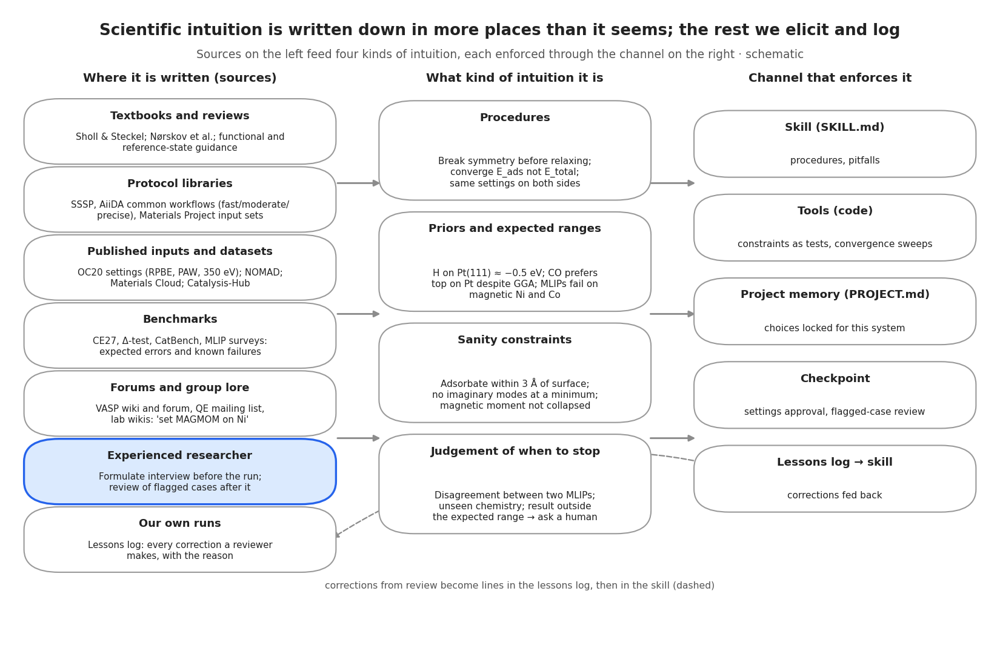

*Figure: sources of intuition, kinds of intuition, enforcing channels · schematic*

Reading the figure: the left column lists where expert knowledge is already written, from textbooks down to our own runs; the highlighted box is the experienced researcher, the only source for the fourth kind of intuition. The middle column groups the knowledge into the four kinds above. The right column is the channel from the table at the top of this section that enforces each kind. The grey arrows show knowledge flowing from sources into kinds and from kinds into channels. The dashed arrow is the learning loop: a correction made at a checkpoint becomes a line in the lessons log, and a recurring lesson becomes a line in the skill or a test in the code.

**Where to get it, concretely.**

| Source                                                                                                                               | What it gives                                   | How we extract it                                                |
|--------------------------------------------------------------------------------------------------------------------------------------|-------------------------------------------------|------------------------------------------------------------------|
| Textbooks: Sholl and Steckel, *DFT: A Practical Introduction* (2009); Nørskov, Studt, Abild-Pedersen and Bligaard, *Fundamental Concepts in Heterogeneous Catalysis* (2014) | Procedures, pitfalls, reference states          | Read once; write into SKILL.md with the citation                  |
| Protocol libraries: SSSP, AiiDA common workflows, pymatgen input sets                                                                | Numerical defaults, verified                    | Call them as tools                                               |
| Published inputs and datasets: OC20 settings, NOMAD, Materials Cloud, Catalysis-Hub                                                  | Settings used in practice; values for priors    | Lookups that set expected ranges                                 |
| Benchmarks: CE27, Δ-test, CatBench, the 80-MLIP survey                                                                               | Expected errors; list of known failures         | Thresholds in the sanity checks and the ML-doubt detector        |
| Forums and group lore: VASP wiki and forum, Quantum ESPRESSO users list, lab wikis                                                   | Fixes for failures ("set initial moments on Ni") | Mine for the pitfall list; verify on a test case before adding   |
| Experienced researcher                                                                                                               | Judgement; which defaults they do not trust     | Structured interview (below); review of flagged cases            |
| Our own runs                                                                                                                         | Corrections with reasons                        | Lessons log, promoted into the skill when a lesson recurs        |

**Interview questions for the Formulate stage.** These are the questions that pull tacit knowledge out of a researcher, adapted from cognitive task analysis: What do you check first when a number looks wrong? On which systems do you not trust the default settings, and what do you change? What do you do before you trust a machine-learned potential on a new metal? Which published values would you compare a first result against? What has silently gone wrong for you before? Each answer becomes a sanity check, a prior, or a skill line.

**What the evidence says about skills as the carrier.** [SkillsBench](https://www.emergentmind.com/papers/2602.12670) (2026) found that curated, human-written skills raised agent success by 16.2 percentage points across 84 tasks, while skills the agent wrote for itself gave no gain or a loss. [Demystifying Agent Skills](https://arxiv.org/pdf/2608.14036) (2026) found that skills help mainly as procedural anchors (65.7% of cases) rather than by injecting facts (4.5%), and that selection precision falls from 29.6% to 3.3% as a pool grows from 5 to 100 skills. Hence: few skills, written by people, procedural, verified on a test case, and the facts (ranges, thresholds) kept in code and project memory rather than in prose.

## Geometry stays in code: what the LLM may touch

Current language models cannot be trusted with three-dimensional geometry, and our agent never asks them to handle it. Geometry is where most of an adsorption calculation can go quietly wrong: which hollow (fcc or hcp differ only by the atom beneath), which orientation, what height, whether the adsorbate migrated, desorbed or dissociated during relaxation, whether the slab was cut on the right termination, which layers are fixed, and whether a relaxed structure sits on a saddle because of the symmetry trap. Every one of these is a geometric question with a deterministic answer, so every one is answered by code and shown to the LLM as text.

**What the benchmarks found.** [AtomWorld](https://arxiv.org/html/2510.04704) (2025) gave frontier models crystal structures as CIF and asked for ten kinds of edit: simple ones (add, remove, change, swap an atom) succeed 60 to 95% of the time, moving an atom 20 to 80%, and rotating a group below 12%; giving the model pymatgen as a tool brought limited gains on the hard actions, and the authors conclude that models suit a copilot role, not unsupervised structure modelling. Adsorb-Agent, which let the LLM propose adsorption configurations from its own chemical reasoning, reached a mean absolute error of 1.84 eV against DFT with a maximum above 3.5 eV, and its worst failures were sign errors on molecular adsorbates with complex binding geometry (reported in the [AdsMind](https://arxiv.org/pdf/2606.19152) paper). On the other side, [LLMConfBench](https://arxiv.org/html/2609.20666) (2026) found that the newest frontier models can rank conformers of a small molecule from raw XYZ coordinates better than a classical force field, with a Kendall τ of about 0.6 against 0.2 for UFF; but they do well on hydrogen-bonded cases and badly on ring strain, and the ability tracks general reasoning scores rather than any geometric training. [MiSI-Bench](https://arxiv.org/html/2512.10867v1) (2025) showed that a fine-tuned 7-billion-parameter vision model can beat human experts on molecular spatial transformations from images. The picture is therefore: improving, uneven, and impossible to verify case by case. A capability that cannot be verified for the case at hand is not used for a decision.

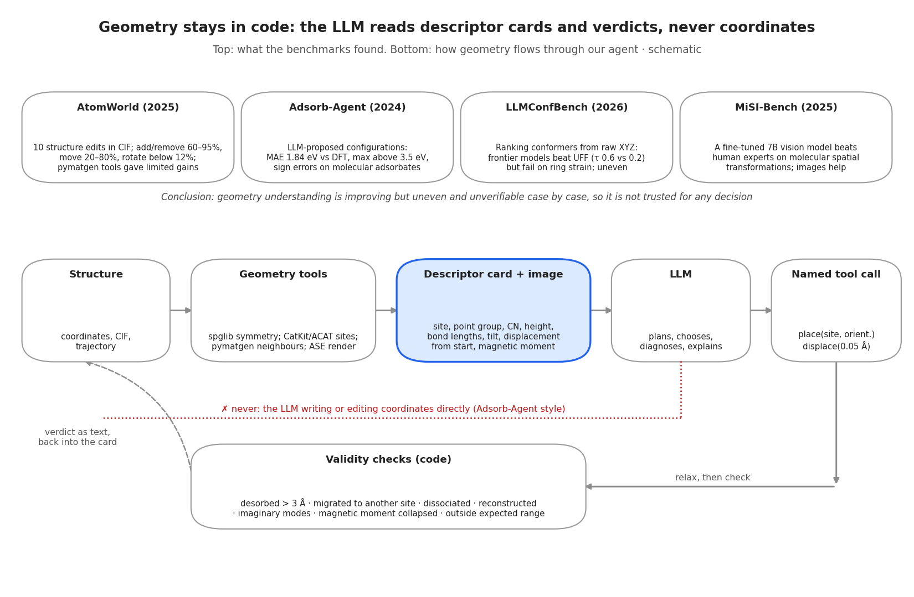

*Figure: geometry flow through the agent · evidence and design, schematic*

Reading the figure: the top row summarises the four benchmarks above. The bottom row is the flow we build: a structure goes into deterministic geometry tools, which produce the highlighted descriptor card (and a rendered image); the LLM reads the card, decides, and acts only through named tool calls such as "place adsorbate at fcc hollow, orientation 2" or "displace by 0.05 Å"; the resulting structure is relaxed and passed to the validity checks, whose verdict comes back into the card as text (dashed arrow). The red dotted path, the LLM writing or editing coordinates itself, is the one thing the design forbids.

**Design rules.**

| Geometric question                       | Who answers                                   | What the LLM sees                                            |
|------------------------------------------|-----------------------------------------------|--------------------------------------------------------------|
| Which sites exist and their symmetry     | spglib, CatKit or ACAT (Tool)                 | "fcc hollow, C3v, coordination 3; hcp hollow, C3v, atom beneath" |
| Which orientations are inequivalent      | Stabiliser-group enumeration (Tool)           | A numbered list of orientations                              |
| Where to put the adsorbate               | Tool call `place(site, orientation, height)`  | The descriptor card of the result                            |
| Did it stay where it was put             | Validity check (Tool)                         | "migrated: fcc hollow to bridge, 1.4 Å"                      |
| Is it a minimum                          | Frequency calculation (Tool)                  | "one imaginary mode, 120i cm⁻¹"                              |
| Is the slab built correctly              | Checks on layers, vacuum, termination (Tool)  | Numbers with pass or fail                                    |
| What does it look like                   | ASE render to PNG (Tool)                      | An image for a second look, never the basis of a decision    |

**The descriptor card.** A tool writes one text block per structure: composition and cell; facet, number of layers, vacuum, fixed layers; adsorbate site label and its point group; coordination number; height above the surface plane; nearest-neighbour distances; tilt angle; displacement from the starting position; total magnetic moment; and the verdicts of the validity checks. This is the same idea as [Robocrystallographer](https://www.cambridge.org/core/journals/mrs-communications/article/robocrystallographer-automated-crystal-structure-text-descriptions-and-analysis/3C201F132450877464B2D0B1B8C4ED01), which turns a CIF into the description a crystallographer would write; language models given such descriptions predicted crystal properties better than graph neural networks given the structure itself ([LLM-Prop](https://www.nature.com/articles/s41524-025-01536-2), [LLM4Mat-Bench](https://arxiv.org/pdf/2411.00177)). Text that names the chemistry is what the model reasons over well; columns of coordinates are not.

**How to inform the agent.** Four things, in order of value.

1. A geometry section in the skill: the site table of section 2, the orientation rule, the symmetry trap, the descriptor-card format, and the rule that the LLM never emits coordinates.

2. Documentation of the geometry tools written for the model. [MatTools](https://arxiv.org/html/2505.10852v2) (2025) found that GPT-4o solved 18% of real pymatgen tasks alone, 40% with retrieved documentation that an LLM had written, and 55% with self-reflection on top; documentation written for models retrieved better than the official docs.

3. A rendered image beside the card for a multimodal second look. AtomWorld recommends structural visualisations as the more natural representation, and MiSI-Bench shows vision models can be trained to read them. We treat the image as a check, not a decision input, until our own benchmark shows otherwise.

4. A geometry test in our benchmark: twenty AtomWorld-style editing tasks (place, rotate, build a supercell, cut a facet) on our surfaces, scored on whether the agent, using the tools, produces the right structure. The target is near 100% with tools; the value of the test is catching the cases where the agent bypasses them.

**Rejected.** Letting the LLM write or edit coordinates, or choose configurations from its own chemical reasoning without enumeration (Adsorb-Agent style). The evidence above is the reason, and symmetry-complete enumeration makes it unnecessary.

## Prior work on giving agents scientific intuition

Nobody has solved the transfer of researchers' tacit knowledge into agents; the approaches split by where the knowledge ends up (weights, context, or code) and by who checks it. As far as we found, Anthropic has not published research on this specific problem; its contributions are the skill format and science-specific skill sets, listed first.

| Work                                                                                                                                                                                      | Approach                                                                                     | Knowledge lives in | What it tells us                                                                             |
|-------------------------------------------------------------------------------------------------------------------------------------------------------------------------------------------|----------------------------------------------------------------------------------------------|--------------------|----------------------------------------------------------------------------------------------|
| [Agent Skills](https://www.anthropic.com/news/skills) (Anthropic, 2025)                                                                                                                   | Folders of instructions, scripts and resources an agent loads when a task matches            | Context            | The format we write our skill in                                                             |
| [Claude for Life Sciences](https://www.anthropic.com/news/claude-for-life-sciences) and [Claude Science](https://www.anthropic.com/news/claude-science-ai-workbench) (Anthropic, 2025–26) | Curated science skills (60+), coordinating agent, reviewer agent that checks citations and calculations, auditable artifacts | Context + tools    | Reviewer-agent and audit-trail patterns; no surface-chemistry or DFT-settings skill          |
| [Scientific Agent Skills](https://github.com/k-dense-ai/scientific-agent-skills) (K-Dense, 2025–26)                                                                                       | 146+ open skills over databases and packages                                                 | Context            | Breadth; nothing on DFT trust                                                                |
| [AtomisticSkills](https://arxiv.org/abs/2605.24002) (MIT, 2026)                                                                                                                           | 100+ skills, 50+ MCP tools, rules; skills validated against literature values                 | Context + tools    | Our substrate (section 11)                                                                   |
| [Get Physics Done](https://github.com/psi-oss/get-physics-done)                                                                                                                           | Formulate interview, locked conventions, verify stage                                        | Context            | The interview pattern                                                                        |
| [SkillsBench](https://www.emergentmind.com/papers/2602.12670) and [Demystifying Agent Skills](https://arxiv.org/pdf/2608.14036) (2026)                                                      | Measure when skills help and why                                                             | —                  | Human-written, procedural, few                                                               |
| [ether0](https://www.futurehouse.org/news/ether0-a-scientific-reasoning-model-for-chemistry) (FutureHouse, 2025)                                                                           | 24B model trained by reinforcement learning on 640,730 verifiable chemistry tasks            | Weights            | Intuition can be trained where a verifier exists; DFT is such a verifier, but out of hackathon scope |
| [ChemCrow](https://arxiv.org/abs/2304.05376) (2023), [Coscientist](https://www.cmu.edu/news/stories/archives/2023/december/cmu-designed-artificially-intelligent-coscientist-automates-scientific-discovery) (Nature 2023), [El Agente](https://arxiv.org/abs/2505.02484) (2025) | LLM plans; expert-designed tools execute; El Agente scores over 87% on course exercises        | Tools              | Expertise in the tool layer works; chemistry accuracy is not what their benchmarks score     |
| [Virtual Lab](https://biohub.org/news/with-no-need-for-sleep-or-food-ai-built-scientists-get-the-job-done-quickly/) (Nature 2025), [AI co-scientist](https://research.google/blog/accelerating-scientific-breakthroughs-with-an-ai-co-scientist/) (Google, 2025) | Multi-agent personas with a critic; the human wrote about 1% of the Virtual Lab's words        | Context (model's own) | The critic role is useful; the knowledge is still the model's own                           |
| [Kosmos](https://arxiv.org/html/2511.02824v2) (2025)                                                                                                                                      | Structured world model shared across 200 rollouts; 79.4% of claims judged accurate            | Context (memory)   | A structured memory is our PROJECT.md plus lessons log                                       |
| Tacit-knowledge elicitation: [LLMs for tacit knowledge discovery](https://arxiv.org/pdf/2507.03811) (2025), [KUPAS MASTER](https://arxiv.org/abs/2609.37673) and [Tacit Fragments](https://www.alphaxiv.org/abs/2609.operationalising-tacit-knowledge-agentic-ai) (2026) | Interview agents and governed memory that capture which cues matter and why a judgement holds | Context            | Formal versions of our interview and lessons log; none applied to physics yet                |
| Protocol libraries: [SSSP](https://arxiv.org/pdf/1806.05609) (2018), [AiiDA common workflows](https://www.nature.com/articles/s41524-021-00594-6) (2021), pymatgen input sets               | Expert settings as code, Δ-test verified, no LLM                                              | Code               | The numerical layer should be these, not prose                                               |
| Benchmarks of intuition: [FrontierScience](https://openai.com/index/frontierscience) (OpenAI, 2025), [K-Bench](https://arxiv.org/pdf/2608.21601) (2026), ChemBench, CURIE                   | Measure only; GPT-5.2 scores 77% on olympiad problems but 25% on research tasks; in K-Bench no model reached the level a domain scientist would accept, and over-claiming was the commonest failure | — | Weights alone are not enough; checks and humans stay in the loop                             |

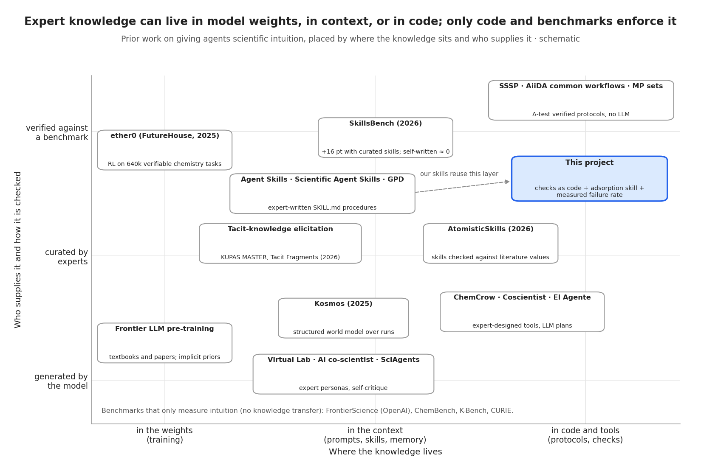

*Figure: landscape of prior work on scientific intuition in agents · schematic*

Reading the figure: left to right, the knowledge sits in the model's weights, in its context (prompts, skills, memory) or in code and tools. Bottom to top, it is generated by the model itself, curated by experts, or verified against a benchmark. Pure multi-agent systems sit bottom-centre; skill libraries sit centre; verified protocol libraries sit top-right. The highlighted box is where this project sits: checks as code, one procedural skill, and a measured failure rate. The dashed arrow shows that our skill reuses the skill-library layer rather than replacing it. Benchmarks that only measure are listed at the bottom.

**What this means for us.** Three conclusions. First, write the know-how, do not hope the model has it: the benchmarks show that frontier models over-claim on open research tasks. Second, put each kind of intuition in the channel that enforces it (section 8), and keep skills few and procedural. Third, the genuinely tacit part, judgement, is obtained by asking an experienced researcher structured questions before the run and logging their corrections after it; the tacit-knowledge papers above do this with interview agents, which we can adopt later.

## Building on AtomisticSkills

[AtomisticSkills](https://arxiv.org/abs/2605.24002) (MIT, May 2026) should become our substrate: instead of a standalone agent, we ship our adsorption and pathway work as skills and tools inside it. This sharpens our contribution to a "trust layer" for surface chemistry, and shrinks what we must build ourselves.

**What it is.** An open-source "outer harness" for general-purpose coding agents such as Claude Code, Gemini CLI and Cursor. It decomposes research into four layers:

- Workflows: whole campaigns, planned by the agent and approved by a human before execution.

- Skills: over 100 human-curated, mid-level procedures, each a SKILL.md with scripts and examples, validated against literature values where available.

- Tools: more than 50 type-checked MCP tools on more than 10 servers, including FairChem (UMA), MACE, MatGL and Atomate2 for remote DFT.

- Rules: research standards the agent must follow, such as a mandatory preliminary literature review and an MLIP registry check.

Every hyperparameter a skill uses is logged to configuration files beside its outputs. The authors describe the current mode as co-pilot, with human supervision still essential for multi-day campaigns. Code: [github.com/learningmatter-mit/AtomisticSkills](https://github.com/learningmatter-mit/AtomisticSkills).

**Why it matters to us.** Its Fe-oxide OER case study already chains surface cleavage, adsorbate placement of O\*, OH\* and OOH\*, MLIP relaxation, DFT and a free-energy and volcano analysis. That is close to our phases 2 and 4. What it does not offer, as far as the paper describes, is our trust layer: symmetry-complete site and pair enumeration, explicit validity checks, ML-doubt detection with escalation, and a measured failure rate. The authors also name evaluation of autonomous atomistic research as an open challenge, which our benchmark addresses.

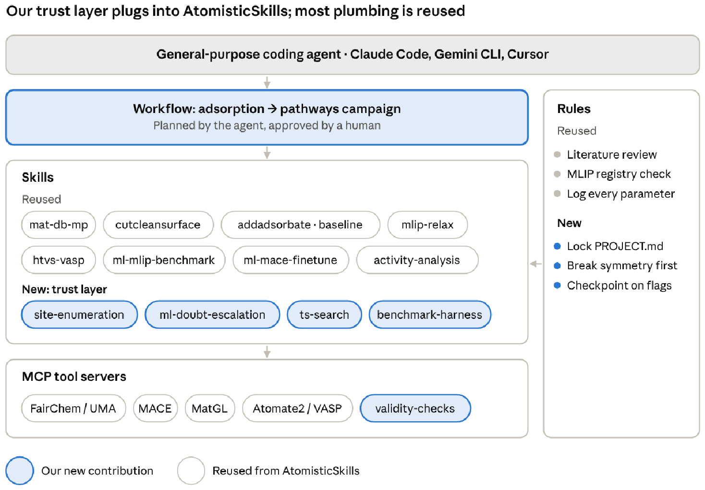

*Figure: our skills on AtomisticSkills · 4 layers*

Reading the figure: the coding agent sits on top and runs our campaign (workflow layer). Below it, skills are split into those reused from AtomisticSkills (outlined) and the four we add as the trust layer (highlighted): symmetry-complete site enumeration, ML-doubt escalation, transition-state search, and a benchmark harness. The tool layer reuses the FairChem, MACE, MatGL and Atomate2 MCP servers and adds one new validity-check server. Rules on the right apply to every layer; the lower three are ours. Skill names are shortened; full names are in the table below.

**Step-by-step mapping.**

| Our step                               | AtomisticSkills component                        | Plan                                                                           |
|----------------------------------------|--------------------------------------------------|--------------------------------------------------------------------------------|
| Literature check                       | Rule: mandatory literature review                | Reuse; add our DFT-pitfall list                                                |
| Approve settings and network           | Plan reviewed before execution                   | Reuse; add PROJECT.md lock                                                     |
| Build bulk and slab                    | mat-db-mp; ASE build                             | Reuse; the mat-htvs-cutcleansurface skill of the paper is not public           |
| Enumerate sites and pairs              | mat-surface-adsorption: MatCalc AdsorptionCalc on pymatgen's AdsorbateSiteFinder | New skill: symmetry-complete enumeration on ACAT and spglib; their placement becomes our baseline |
| ML pre-screen                          | FairChem, MACE and MatGL MCP servers             | Reuse; mat-htvs-mlip-relax is not public                                       |
| Flag ML doubt and escalate             | ml-committee-uncertainty, ml-mlip-benchmark, ml-mace-finetune | New skill that triggers these on doubt; calibration against DFT labels is ours |
| DFT relaxation                         | Atomate2 MCP server                              | Reuse; mat-htvs-vasp is not public                                             |
| Validity checks                        | —                                                | New MCP tool server                                                            |
| Transition-state search and validation | chem-neb-barrier (ASE NEB, IDPP, climbing image; no frequency or connectivity check); chem-ts-optimization and chem-irc-verification (Sella, molecules only) | New: periodic saddle validation with frequencies, IRC and band connectivity |
| Free-energy diagram                    | chem-thermochemistry; the catalysis-activity skill is not public | Build for thermal catalysis                                     |
| Microkinetic model                     | Thermodynamics and kinetics skills (unspecified) | Check coverage                                                                 |
| Benchmark comparison                   | —                                                | New; our main contribution                                                     |
| Open release                           | Hyperparameter logging                           | Reuse; add provenance and Zenodo export                                        |

**A new loop from ML doubt to fine-tuning.** When the agent doubts its ML potential (as on Ni or Co), it can sample a few configurations, label them with DFT, run the ml-mlip-benchmark skill to measure the error, and, if needed, fine-tune MACE with ml-mace-finetune before continuing. This turns "stop and ask" into "stop, measure, repair, then ask only if repair fails".

**Verified on 21 October 2026** ([repository survey](repo-survey.md)). The public repository holds 133 skills under MIT, but none of the mat-htvs catalysis skills of the paper. Its adsorption baseline is mat-surface-adsorption, which calls MatCalc's AdsorptionCalc and so pymatgen's AdsorbateSiteFinder, whose hollows carry no fcc or hcp label. Its transition-state and IRC skills are molecular only, and its NEB skill checks neither frequencies nor connectivity. It ships ml-committee-uncertainty and MCP servers for fairchem, MACE, MatGL and atomate2. So the substrate stands, and the catalysis layer on it is ours to write.

## Extension to reaction pathways

The adsorption agent becomes a subroutine inside a larger loop: adsorption energies → reaction energies → transition states and barriers → a microkinetic model of rates and selectivity.

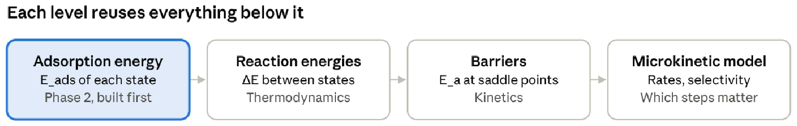

*Figure: from adsorption to kinetics · 4 levels*

Reading the figure: the highlighted box is what the current agent already computes; each box to its right is built from the outputs of the boxes to its left, so errors made early propagate to every later level.

**Governing relations.** ΔE = E(FS) − E(IS) and E_a = E(TS) − E(IS), where IS and FS are the relaxed initial and final states and TS the transition state (a saddle point). The rate constant from harmonic transition-state theory is:

$$
k = \frac{k_{\mathrm{B}} T}{h} \exp\left(-\frac{\Delta G^{\ddagger}}{k_{\mathrm{B}} T}\right)
$$

where k_B is Boltzmann's constant, h Planck's constant and ΔG‡ the free-energy barrier. A cheap pre-screen is the Brønsted–Evans–Polanyi relation, E_a ≈ αΔE + β, fitted per reaction family.

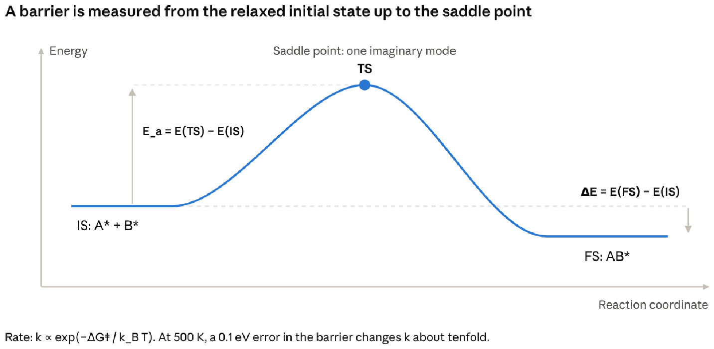

*Figure: reaction energy profile · schematic, not to scale*

Reading the figure: the curve traces energy along the reaction coordinate from the co-adsorbed initial state (IS, A\* + B\*) over the transition state (TS) to the final state (FS, AB\*). The barrier E_a is the rise from IS to TS; the reaction energy ΔE is the drop from IS to FS. The TS is a saddle point: a minimum in every direction but one, hence exactly one imaginary vibrational mode, and an IRC from it must lead back to IS and FS. The energies shown are schematic.

**Why accuracy matters more here.** At 500 K, k_B T ≈ 0.043 eV, so a 0.1 eV error changes k by exp(2.3) ≈ 10. An error harmless for ranking sites is a tenfold error in rate. Hence the loop that sends rate-controlling steps back to DFT. The same arithmetic is the reason the adsorption stage must be trusted before any barrier is computed: because E_a = E(TS) − E(IS), an error in the initial state enters the barrier in full, and an initial state that is the wrong configuration (a different site, an unrelaxed geometry, a saddle left by the symmetry trap) connects the transition state to the wrong reactant altogether.

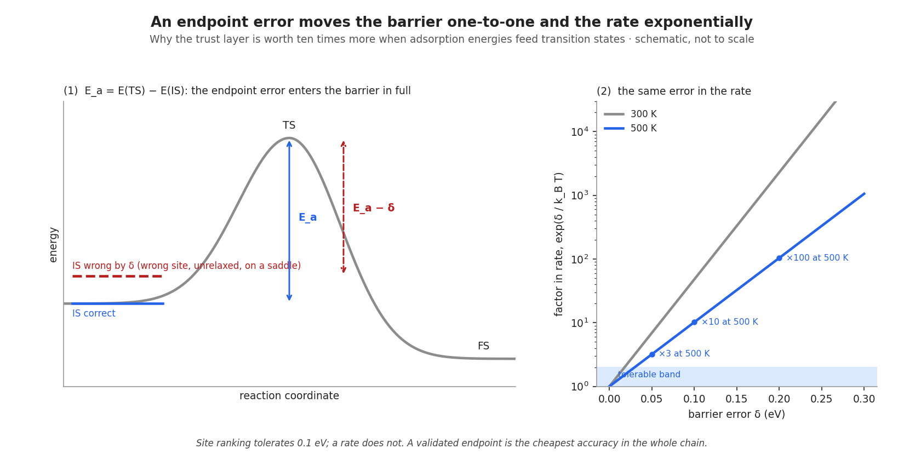

*Figure: endpoint error propagation · schematic, not to scale*

Reading the figure: on the left, the grey curve is a reaction profile from initial state (IS) over the transition state (TS) to the final state (FS); the blue level is the correct IS and the red dashed level an IS that is wrong by δ, so the barrier measured from it is wrong by the same δ. On the right, that δ is turned into a factor in the rate through exp(δ / k_B T) at two temperatures; the blue band is the tolerable range. At 500 K, 0.05 eV is a factor of three, 0.1 eV a factor of ten, 0.2 eV a factor of a hundred.

**What changes for the adsorption stage.**

- One consistent set of gas-phase references (e.g. H₂, H₂O, CO or CO₂) for every intermediate.

- Identical DFT settings for every intermediate and transition state.

- Co-adsorbed endpoints: A\* + B\* in one cell, so pair enumeration (where Burnside counting earns its keep) and lateral interactions.

- Return the top few configurations per intermediate, since the global minimum may not lie on the lowest-barrier path.

- Mirror-equivalent paths need computing once; a symmetric starting band in NEB can hide a lower, symmetry-broken path.

**Prior work.** The transition-state side is no longer empty ground; what is still open is the quality of the endpoints and the validation of the saddle.

| Work                                                                                                  | Type              | What it does                                                                                                            | Documented limitation or gap                                                            |
|-------------------------------------------------------------------------------------------------------|-------------------|-------------------------------------------------------------------------------------------------------------------------|-----------------------------------------------------------------------------------------|
| [CatTSunami](https://arxiv.org/abs/2405.02078) (2024)                                                 | ML, no LLM        | ML NEB on surfaces; TS within 0.1 eV of DFT 91% of the time, 28× faster; 174-reaction network in 12 GPU days            | Needs good endpoints as input                                                           |
| [Fine-tuned MLIP TS search](https://arxiv.org/pdf/2603.24482) (2026)                                  | ML, no LLM        | TS with fewer than 10 DFT single points on average                                                                      | Surface elementary steps only; not reconstructions                                      |
| [NEBscape](https://www.nature.com/articles/s41524-026-02298-1) (npj Comput. Mater. 2026)              | Automated, no LLM | Endpoints from global optimisation, paired by atom mapping and symmetry alignment, then NEB; no human intervention       | Heuristic endpoint selection; no agent reasoning or checkpoints                         |
| [TSAgent](https://arxiv.org/abs/2605.14154) (2026), [code, no licence](https://github.com/transition-state-search/TSAgent) | LLM agent | Plan–execute–analyse–replan loop at DFT level; 83% on a 100-example OC20NEB subset; 70% on held-out versus 73 ± 12% for human experts; reproduces BEP for NH₃ dissociation | A saddle counts if the band converges, one significant imaginary mode appears and the barrier fits the endpoints; no IRC; endpoints are inputs, not generated; VASP only |
| [CatDT](https://urop.hkust.edu.hk/node/40500) (HKUST, in development)                                 | LLM multi-agent   | Eight agents on UMA or CHGNet; a propose–validate hard gate iterates up to ten rounds to produce valid NEB endpoints before any barrier run; microkinetic rates | No published results or code yet; electrochemical reactions only                        |
| [CopyCAT](https://iciq.org/es/?p=72665) (ICIQ, 2026)                                                  | LLM multi-agent   | Turns chemical reasoning into 3D structures for adsorbates and transition states on surfaces                           | Thesis-stage; accuracy against DFT not reported where we looked                         |
| [Pynta](https://chemrxiv.org/engage/chemrxiv/article-details/647114454f8b1884b755bc5a) (JCIM 2023)      | Automated, no LLM | Reactants, products and atom maps in; symmetry-unique adsorbate configurations; harmonically forced saddle guesses; frequencies and IRC on every saddle; rate coefficients out | DFT-level cost; closest-product choice not an explicit objective                        |
| [El Agente Potente](https://arxiv.org/abs/2609.14840) (2026)                                         | LLM agent         | Typed execution graphs plus a coding mode on MLIPs; adsorption and catalytic reaction workflows; the agent selects the band's initial and final images | Abstract gives no success rate and does not say how final images are chosen             |
| [TSBench](https://arxiv.org/abs/2609.08503) (2026)                                                    | Benchmark         | Seven frontier LLMs build TS guesses with structure-editing tools for 78 elementary reactions; 50% success, 67% with diagnosis-driven revision | Most failures are plausible saddles that connect the wrong reactant–product pair         |

Two readings. First, CatDT's propose–validate gate on endpoints is the closest thing to our trust layer and confirms the need; it is unpublished, so the field is open on measured results. Second, TSBench's main failure mode, a saddle that connects the wrong pair, is an endpoint problem, not a saddle-finding problem: it is exactly what symmetry-complete enumeration, co-adsorption pair enumeration and connectivity checks prevent. The gap we fill is therefore *barrier-ready endpoints*, validated before any barrier is run, and a measurement of how much endpoint quality moves the barrier, which nobody above reports.

**Is automation worth it?** Yes for the middle (endpoint mapping, TS search, validation, free-energy corrections, microkinetics): repetitive, numerous and error-prone. No for the ends: a human approves the network and interprets the mechanism, because a missing step cannot be recovered downstream.

## The complete workflow

The whole agent runs in four phases; phase 2 is the original adsorption agent, reused for every intermediate in phase 3.

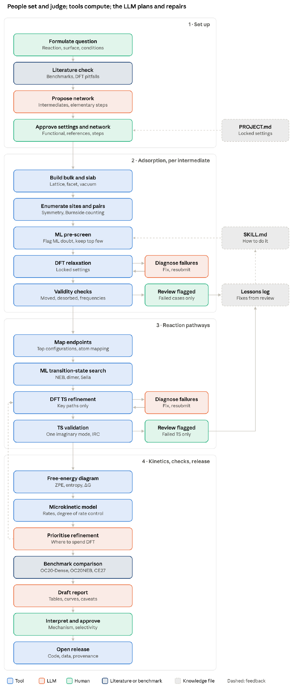

*Figure: complete agent workflow · 4 phases, 20 steps*

The dashed loop on the left sends rate-controlling steps from the microkinetic model back to DFT refinement. Corrections made in either review step go to the lessons log, and recurring lessons are folded into the skill.

- **Phase 1** fixes everything before any calculation: literature check, reaction network, and one locked set of references and settings.

- **Phase 2** adds two upgrades for pathways: pair (co-adsorption) enumeration, and passing on the top few configurations. "Flag ML doubt" is the Ni/Co self-distrust feature.

- **Phase 3** repeats the phase 2 pattern for transition states: ML search, DFT refinement, failure diagnosis, validation, review.

- **Phase 4** adds kinetics, benchmark comparison and the open release.

The single box whose silent failure corrupts everything downstream is "Approve settings and network": a wrong reference or a missing step cannot be repaired by later accuracy.

## The solution planner from the whiteboard

The whiteboard plan (21 October 2026) finds adsorption configurations well and stops before the path; the path steps are the part still to build, and the board's question marks form an extension layer kept outside the core.

**The problem as stated on the board.** We know what we have (a surface with its energy, adsorbates relaxed in vacuum with theirs) and what we want (a final adsorbed product), and we do not know how to get from one to the other; the transition energy tells us how fast the product forms. That is a double-ended search: both endpoints are known, the saddle between them is not.

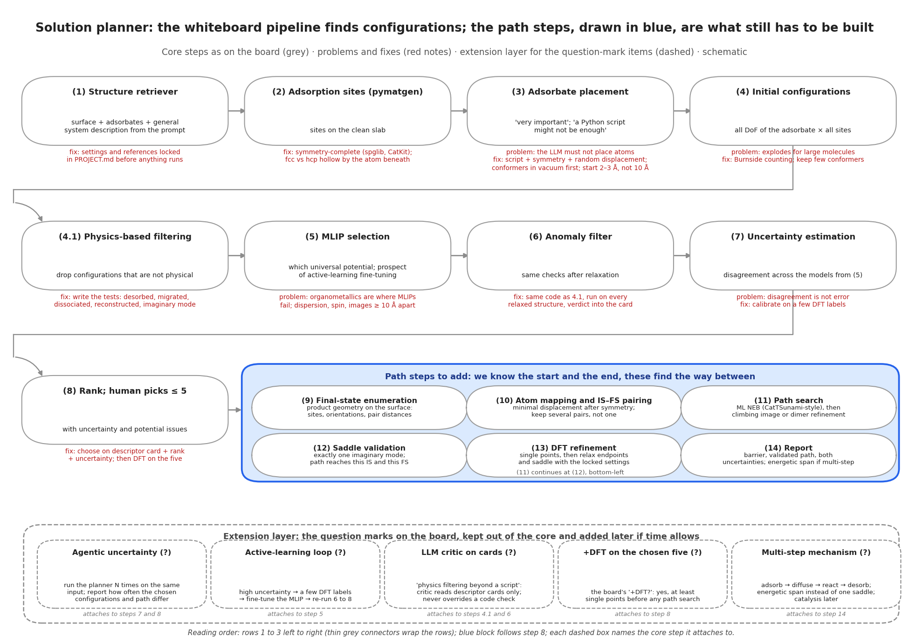

*Figure: solution planner · core, gaps, extension layer, schematic*

Reading the figure: rows one and two are the eight whiteboard steps in grey, read left to right, with thin connectors wrapping each row to the next; under each step a red note names the problem we see and the fix. Step 8, the human choosing up to five configurations, hands over to the highlighted block of six path steps that the board does not yet contain: final-state enumeration, atom mapping and pairing, path search, saddle validation, DFT refinement, and the report. The dashed band at the bottom holds the board's question-mark items as an extension layer; each dashed box names the core step it attaches to, and none of them is needed for the core to run.

**Mapping to the workflow table.**

| Whiteboard step                      | Workflow step (section 3)                 | Status                                                                   |
|--------------------------------------|-------------------------------------------|--------------------------------------------------------------------------|
| (1) Structure retriever              | Choose system and settings                | Keep; lock settings and references in PROJECT.md first                   |
| (2) Adsorption sites with pymatgen   | Site and orientation enumeration          | Fix: symmetry-complete with spglib and CatKit; fcc and hcp hollows apart |
| (3) Adsorbate placement              | Site and orientation enumeration          | Fix: script only; symmetry, random displacement; the LLM never places atoms |
| (4) Initial configurations           | Site and orientation enumeration          | Fix: conformers in vacuum first, Burnside counting; start 2 to 3 Å up    |
| (4.1) Physics-based filtering        | Validity checks                           | Fix: write the tests (section 3 list)                                    |
| (5) MLIP selection                   | ML pre-screening; flag ML doubt           | Problem: organometallics; dispersion, spin, images 10 Å apart            |
| (6) Anomaly filter                   | Validity checks                           | Same code as (4.1), on every relaxed structure                           |
| (7) Uncertainty estimation           | Flag ML doubt                             | Fix: calibrate disagreement against a few DFT labels                     |
| (8) Rank; human picks up to five     | Review flagged cases                      | Fix: choose on card, rank and uncertainty; then DFT on the five          |
| (9) to (14) path steps               | Extension to reaction pathways (section 12) | New: the part to build                                                   |

**Extension layer** (the board's question marks, added later if time allows): agentic uncertainty, meaning the planner run several times on the same input with the variance of its choices reported; the active-learning loop from high uncertainty to DFT labels to a fine-tuned MLIP; an LLM critic that reads descriptor cards but never overrides a code check; DFT on the five chosen configurations before any path search; and multi-step mechanisms scored by energetic span, with catalysis after that.

**Questions still open with the team.** The adsorbate class and size; whether the end product is the same molecule in a final geometry or a new molecule formed from two adsorbates; one elementary step or a short mechanism, and who supplies it; which DFT code, compute budget and MLIPs; and the pass criterion for the hackathon.

## The augmented pipeline: what to borrow, what is missing, what is ours

Measured step by step against the transition-state papers, the current pipeline is either borrowed or standard at every step, so the claim must come from four things that none of the papers report: validated endpoints with the endpoint-to-barrier propagation measured, calibrated ML doubt, agentic uncertainty, and an open release scored on a public benchmark.

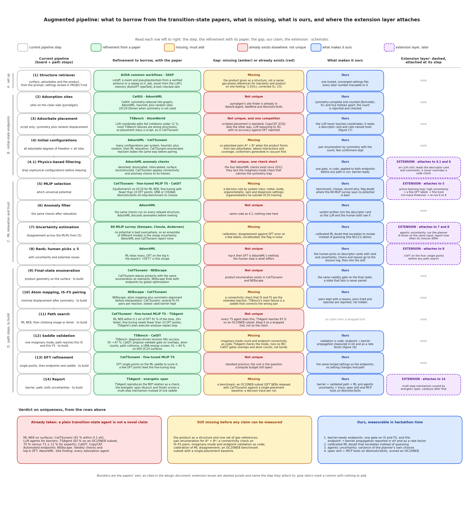

*Figure: augmented pipeline · 15 steps, 5 columns, one colour per kind of idea, schematic*

Reading the figure: the legend at the top is the key. Each row is one step of the current pipeline, read left to right. The white box is the step as we have it, with the path steps 9 to 14 marked "to build". The green box is the refinement to borrow and names the paper it comes from. The amber box is something missing that we must add; the red box is something that already exists elsewhere, so it cannot carry the claim. The blue box is what would make that step ours. The dashed purple box is the extension layer, drawn beside the step it attaches to and labelled as an extension so it is never mistaken for the core. Grey italics mark a column with nothing to add. The three boxes at the bottom collect the verdict: what is already taken, what is still missing, and what is ours and measurable in hackathon time.

**Refinements to borrow, each with its source.**

1.  Numerical settings from a verified protocol or a sweep on E_ads, never from the LLM: [AiiDA common workflows](https://www.nature.com/articles/s41524-021-00594-6), [SSSP](https://arxiv.org/pdf/1806.05609), [Δ-test](https://archive.materialscloud.org/record/1874); AutoDFT rejected (section 4).

2.  Heuristic plus random placement as the fallback when symmetry is unknown, and ML relaxation of many candidates followed by DFT on the top few: [AdsorbML](https://arxiv.org/pdf/2211.16486). Its four anomaly checks, desorbed, dissociated, intercalated and surface reconstructed, become our validity gate, plus the imaginary-mode check they lack.

3.  Product states placed by the same enumeration as reactant states, several initial-to-final pairs per reaction, and the lowest valid barrier kept: [CatTSunami](https://arxiv.org/abs/2405.02078). Its released OC20NEB set of DFT nudged-elastic-band calculations is the natural benchmark for the path steps.

4.  Atom mapping and symmetry alignment of the two endpoints before interpolation: [NEBscape](https://www.nature.com/articles/s41524-026-02298-1).

5.  Fine-tuning the potential at the saddle with fewer than ten DFT single points: [fine-tuned MLIP transition-state search](https://arxiv.org/pdf/2603.24482). This is the active-learning extension at step 5, with AtomisticSkills' ml-mace-finetune as the tool.

6.  A propose-then-validate gate on endpoints that iterates before any barrier run: [CatDT](https://urop.hkust.edu.hk/node/40500), unpublished; and a diagnosis-driven revision loop when validation fails, which lifts success from 50 % to 67 % in [TSBench](https://arxiv.org/abs/2609.08503).

7.  The Brønsted–Evans–Polanyi relation as a sanity check on each barrier, which [TSAgent](https://arxiv.org/abs/2605.14154) reproduces for NH₃ dissociation; the energetic span (Kozuch and Shaik, from memory, not looked up here) in place of a single saddle when the mechanism has more than one step.

8.  Placement stays a script because LLM coordinate edits fail: [AtomWorld](https://arxiv.org/html/2510.04704) and the TSBench failure analysis (section 9).

**Where the pipeline is not unique, and what would make it ours.**

| Step                        | Already exists in                                         | What makes it ours                                                                 |
|-----------------------------|-----------------------------------------------------------|------------------------------------------------------------------------------------|
| (2) Sites                   | pymatgen site finder in Adsorb-Agent, AdsMind, AtomisticSkills | Symmetry-complete and counted; the count checked                                 |
| (3) Placement               | Every agent scripts it; CopyCAT bets on LLM reasoning to 3D | The LLM never touches coordinates; descriptor card and named tools                |
| (4.1), (6) Validity checks  | AdsorbML's four checks                                     | One gate in code on both endpoints before any path: barrier-ready                 |
| (8) Top-k then DFT          | AdsorbML                                                   | The human picks on cards with uncertainty; choice and reason logged               |
| (9) Final-state enumeration | CatTSunami, NEBscape                                       | The same gate on the final state; a failing state is never paired                 |
| (11) Path search            | CatTSunami, TSAgent, CatDT, NEBscape                       | Nothing; a wrapped tool                                                            |
| (12) Saddle validation      | Partly: TSBench revision, CatDT gate                       | Imaginary mode and endpoint connectivity as code; propagation measured            |
| (13) DFT refinement         | Standard                                                   | Same locked settings as the endpoints                                              |

**What is still missing before any claim can be measured.** The product given as a structure rather than a name, with one set of gas-phase references for reactants and product; pair enumeration for A\* + B\* when the product forms from two adsorbates; a connectivity check that an initial–final pair is the intended reaction, since TSBench's main failure is a saddle that connects the wrong pair; imaginary-mode and endpoint validation as code, since TSAgent checks the mode but runs no IRC and CatDT has not published; calibration of ML disagreement against a few DFT labels; and an OC20NEB benchmark subset with a single-placement baseline.

**Verdict.** A plain transition-state agent is not a novel claim: ML NEB on surfaces exists in CatTSunami, LLM agents for barriers in TSAgent, CatDT and CopyCAT, automated endpoints in NEBscape, validity checks and top-k DFT in AdsorbML. What is ours and measurable in hackathon time is four things: barrier-ready endpoints, meaning one gate on both endpoints with the endpoint-to-barrier propagation reported in eV and as a rate factor; calibrated ML doubt that escalates instead of guessing; agentic uncertainty, the variance of the planner's own choices over repeated runs; and an open skill with MCP tools on AtomisticSkills, scored on an OC20NEB subset.

**Questions this raises for the team.** Whether an OC20NEB subset is acceptable as ground truth, since it fixes the DFT settings to OC20's RPBE and PAW choices and our locked settings must then match them; which of the four claims is the headline of the three-minute demo; whether the product forms from two adsorbates, which moves pair enumeration into the core; and whether any DFT nudged-elastic-band compute exists for the propagation experiment, or whether it runs on ML with OC20NEB labels as the reference.

## The final-state problem: the nearest non-recombining product

The product state of a dissociation step is the co-adsorbed pair that sits as close together as possible without bonding back; CatTSunami already builds it heuristically, so our contribution is to enumerate it completely, gate it in code, and report what was rejected.

**The problem as stated (21 October 2026).** Given a surface with adsorbate AB\* and the desired product, A\* and B\* both adsorbed, find the final state in which B\* is as close to A\* as possible while the two stay fully dissociated after relaxation. We call it the *nearest non-recombining final state*. CatTSunami calls the placements *proximate*; the classical DFT literature writes it as the fragments co-adsorbed at nearest-neighbour or next-nearest-neighbour sites.

**Why nearest.** The nudged elastic band from AB\* to a far-away product passes the bond-breaking saddle and then one or more diffusion saddles; the band then holds several maxima, the climbing image can lock onto the wrong one, and the barrier reported is not the elementary step. The nearest valid product gives a band with one saddle. The nearest product is not necessarily the lowest in energy: fragments at adjacent sites often repel, so E(FS near) can lie above the infinite-separation value E(FS ∞) = E(A\*) + E(B\*) − E(slab) from separate cells. Both should be reported; the difference is the lateral interaction, and the diffusion from the near to the stable product is a separate step.

**Why it matters for cost.** The DFT band is the expensive step, and it is the step that fails. A far or invalid product makes the band long, so it needs more images and more iterations, and it may not converge or may converge to the wrong maximum. The nearest validated product keeps the band short with one saddle, so it converges in fewer force calls and fails less often. CatTSunami reports the failure side of this even with its heuristic endpoints:

| CatTSunami quantity                                                                   | Value                                  |
|---------------------------------------------------------------------------------------|----------------------------------------|
| DFT single points per reaction in its ML + DFT approach (initial, transition, final state) | 3                                      |
| Force convergence criterion for a band                                                | fmax < 0.05 eV/Å within the step limit |
| ML bands that converged, dissociations and transfers (Equiformer V2)                  | 81 to 82 % and 68 to 72 %              |
| DFT bands in the CO-hydrogenation case study that converged at the standard settings  | 102; 8 failed and needed a rerun       |
| Converged bands that were nevertheless wrong                                          | 14 %                                   |

The two wrong-band modes it names are too few frames to sample the saddle, and a bond other than the intended one breaking or forming along the band. Its two filters, the breaking bond elongated to between 1.25 and 1.63 times its initial length in some frame and connectivity constant along the band except that bond, belong in our saddle validation (step 12). So the endpoint work has three measurable outputs, not one: the barrier shift, the recombination rate of nearest pairs, and the DFT force calls and failure rate of bands from gated endpoints against bands from naive endpoints.

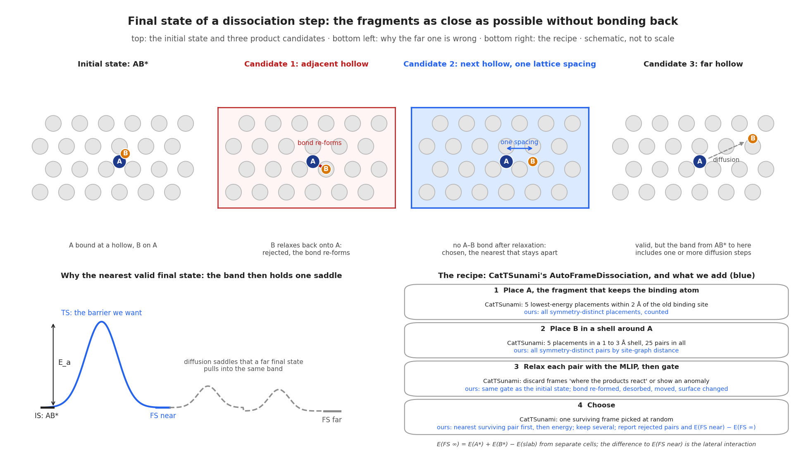

*Figure: nearest non-recombining final state · 4 candidates, 1 profile, 4 recipe steps, schematic, not to scale*

Reading the figure: the top row shows the initial state AB\* and three product candidates on a close-packed surface, A in blue and B in orange. Candidate 1 puts B at the adjacent hollow; it relaxes back onto A and is rejected, red outline. Candidate 2 puts B one lattice spacing away; the bond does not re-form, so it is chosen, blue highlight. Candidate 3 is far away and valid, but the band from AB\* to it includes diffusion. The profile at bottom left shows the single saddle to the near product in blue and the extra diffusion saddles a far product adds in dashed grey. The recipe at bottom right lists CatTSunami's four steps and, in each box, what we add.

**Formal statement.** Over all symmetry-distinct pairs of sites (s_A, s_B), choose the pair that minimises the site-graph distance between A\* and B\*, with the in-plane distance as a tiebreaker, subject to: after relaxation the connectivity graph is the product graph, so no A–B bond; neither fragment desorbed, moved to another site or went subsurface; the surface is unchanged; exactly zero imaginary modes; and the cell wide enough that the pair does not interact with its periodic images. The desorbed check runs per fragment: fairchem's DetectTrajAnomaly treats A\* + B\* as one adsorbate and passes a frame in which B has left while A stays bound. Keep the first few survivors in that order, not one.

**Who has done it.**

| Work                                                                                                   | What it does for the product state                                                                                                                                                                   | What it does not do                                                                        |
|--------------------------------------------------------------------------------------------------------|------------------------------------------------------------------------------------------------------------------------------------------------------------------------------------------------------|--------------------------------------------------------------------------------------------|
| [CatTSunami](https://arxiv.org/abs/2405.02078), AutoFrameDissociation (2024)                           | Product 1 is the fragment with the reactant's binding atom; 5 lowest-energy placements within 2 Å; for each, 5 placements of product 2 in a 1 to 3 Å shell; 25 frames relaxed by ML; frames "where the products react or some other anomaly occurs" discarded; one survivor picked at random. In the current fairchem code the shells are 2 and 3 times the largest slab covalent radius, and the band runs on ASE's DyNEB with the UMA calculator | No explicit minimum-distance objective; sampled, not symmetry-complete; random pick; rejected frames not reported |
| [Pynta](https://chemrxiv.org/engage/chemrxiv/article-details/647114454f8b1884b755bc5a) (JCIM 2023)      | Takes reactants, products and atom maps; enumerates unique adsorbate configurations with surface symmetry; saddle guesses by harmonically forced search; frequencies and IRC on every saddle            | Built for rate coefficients, not for the closest product; DFT-level cost                   |
| [NEBscape](https://www.nature.com/articles/s41524-026-02298-1) (2026), [code, MIT](https://gitlab.mpcdf.mpg.de/hjung/nebscape) | Both endpoints by global optimisation, paired by atom mapping; the atom mapper and the periodic alignment are reusable               | Global optimisation finds the lowest product, which may be the far one                     |
| [Reproducible NEB orchestration](https://arxiv.org/abs/2603.14737) (2026)                               | Snakemake workflow: endpoint minimisation, structural alignment, initial path generation with PET-MAD and eOn                                                                                          | Gas-phase molecules; no surface product placement                                          |
| [El Agente Potente](https://arxiv.org/abs/2609.14840) (2026)                                            | LLM agent with typed execution graphs; adsorption and catalytic reaction workflows on MLIPs; the agent selects the initial and final images for the band                                              | How the final image is chosen for a dissociation is not described in the abstract          |
| Classical DFT studies, by hand                                                                          | Fragments placed co-adsorbed at nearest-neighbour or next-nearest-neighbour hollows, chosen by the author                                                                                              | Not automated; the choice is rarely justified in the paper                                 |

So the answer to "has someone done this" is yes in heuristic form: CatTSunami's AutoFrameDissociation is this problem solved by sampling, and it is open source in fairchem. What is not done is the explicit objective, the complete enumeration, the code gate on both endpoints and the report of how many nearest pairs recombined. That last number is a measurable result on its own, and it feeds the propagation experiment of section 12.

**Where it sits in the pipeline.** It is step 9 of the solution planner, final-state enumeration, with the gate of step 4.1 applied to the product and a connectivity criterion added, and it feeds step 10, pairing. The pair enumeration of section 12, A\* + B\* in one cell with Burnside counting, is the enumeration this step needs. For the pairing, CatTSunami unwraps adsorbates across the periodic boundary by a depth-first search from the binding atom and moves the unbroken part as one moiety, which we reuse. Two extensions attach here: a coverage scan, the same pair in several cell sizes, to measure the lateral interaction directly; and the alternative target, the lowest-energy pair within one site hop.

**The whole pipeline for this problem.** Figure 23 redraws the augmented pipeline of section 15 around the stated problem: the final-state search becomes five steps of its own, 9a to 9e, and every other step is read as serving it.

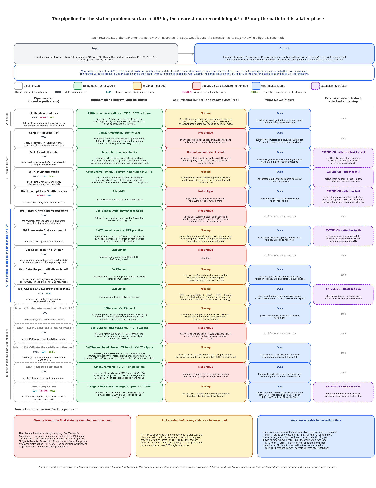

*Figure: pipeline for the stated problem · 15 rows, 5 columns, one colour per kind of idea, schematic*

Reading the figure: the two boxes at the top state the input, a slab with AB\* and the product named as A\* + B\*, and the output, the nearest non-recombining final state, the barrier to it, both uncertainties, the recombination rate and the cost of the DFT band. The strip under them says why nearest: a far product adds diffusion saddles and a longer band that may not converge, which is the reason the final state is chosen this way even though the band itself is a later phase. Rows 10 to 14 are drawn dashed and grey: a later phase, not the goal now. The rows then follow the colour key of figure 20: white is the step, with an owner line under its title that says whether a tool, the LLM, a human or a written skill does it, green the refinement to borrow with its paper, amber what is missing, red what already exists elsewhere, blue what is ours, dashed purple the extension layer at its step. The blue bracket on the left marks rows 9a to 9e, the stated problem: place A, enumerate B sites by distance, relax each pair, gate it for recombination and the other anomalies, then choose the nearest survivor and report the rest. Rows 9a and 9c carry no claim because CatTSunami already does them, and whether A stays at its initial-state site is a team decision; the claim sits in 9b, 9d and 9e, where the explicit objective, the logged gate and the recombination rate are new. The verdict band at the bottom restates what is taken, what is missing and what is ours for this problem.

| Sub-step | Owner | Does                                                                                     | Output                                               |
|----------|-------|------------------------------------------------------------------------------------------|------------------------------------------------------|
| 9a       | Tool  | Place A, the fragment that keeps the binding atom, at symmetry-distinct sites near the IS site, or fixed at it | Placements of A\*, counted                 |
| 9b       | Tool  | Enumerate B sites around each A, ordered by site-graph distance                           | Symmetry-distinct pairs, nearest first, counted     |
| 9c       | Tool  | Relax every pair with the same potential and settings as the initial state               | Relaxed pairs                                        |
| 9d       | Tool  | Gate: no A–B bond, nothing desorbed, moved or subsurface, surface intact, no imaginary mode | Survivors; every rejection with its reason         |
| 9e       | Tool, LLM writes it up | Choose the nearest survivor first, then by energy; keep several          | Final states, E(FS near), E(FS ∞), recombination rate |

**Questions for the team.**

- Distance metric: site-graph distance with in-plane distance as tiebreaker, or in-plane distance between the two binding atoms alone?

- Should the fragment that keeps the binding atom stay at the reactant's site, as CatTSunami assumes, or may it move?

- Target: the nearest surviving pair, or the lowest-energy pair within one site hop? They differ when adjacent fragments repel.

- Which dissociation to run first: \*OH → \*O + \*H on Pt(111) is the simplest in OC20NEB's list and has DFT bands to compare with.

## Positioning and hackathon strategy

Do not pivot; sharpen. Keep the adsorption domain and change the claim from "an agent that computes adsorption energies" to "an agent that knows when not to trust itself".

**What other teams will likely build.** At the 2025 LLM Hackathon for Materials Science and Chemistry, over 40 of 88 projects used tool-calling agents. So a DFT-calling agent is the median entry. Crowded ground: literature and RAG agents, end-to-end "AI scientist" pipelines, DFT and MD wrappers, large ML screening runs, data-analysis assistants, and demos without measured results.

**What tends to win.** Critique and reliability (the 2026 NAIS top prize went to an agent that spots research flaws before work begins); human-in-the-loop design (a judged criterion at the dkNET–Texera hackathon); systematic validation, traceability and explainability (Cambridge multi-agent hackathon rubric).

| Option                                      | Novelty      | Feasible in hackathon time | Verdict                        |
|---------------------------------------------|--------------|----------------------------|--------------------------------|
| Generic adsorption agent                    | Low (exists) | High                       | Avoid as the main claim        |
| Open skill + MCP tool pack                  | Medium–high  | High                       | Do                             |
| Reliability benchmark against a baseline    | High         | High                       | Do                             |
| Agent that detects ML failure and escalates | High         | Medium                     | Do; the demo centrepiece       |
| New catalyst discovery                      | Highest      | Low                        | Avoid; cannot validate in time |

**Scope for the hackathon.** Build phases 1 and 2 fully, with benchmark comparison and open release. Add one elementary step (H₂ dissociation or CO oxidation on Pt(111)) as a finale, on ML with one pre-computed DFT check. Leave the microkinetic loop for later. Pre-compute everything slow; keep a recorded fallback.

**Three-minute demo.**

1.  The problem: agents report adsorption energies without warning when wrong (AdsMind's finding of sign errors in an earlier agent).

2.  Live run on Pt(111): Formulate interview, symmetry enumeration, results with a full decision trace.

3.  Live run on Ni(111): the agent flags ML disagreement and stops for review instead of guessing.

4.  The benchmark table: success rate, error, cost, against a baseline.

5.  What is open: skill, MCP tools, data on Zenodo; one install command.

**Judges' hardest questions.** How is this different from AdsMind or Adsorb-Agent (a comparison table of verified features only)? Why trust the benchmark (full DFT, settings in PROJECT.md, data released)? Does the LLM add anything over a script (show diagnosed failures and escalations; be candid where a script suffices)? What happens on an unseen system (uncertainty flags and a checkpoint, not a guess)?

## Decisions, open questions and next steps

**Decided so far.**

- Wrap existing toolkits (CatKit, ACAT, pymatgen, ASE, AiiDA) rather than rewrite them.

- Put every check that can be code into code; keep the LLM for planning, failure diagnosis, network pruning and drafting.

- Human checkpoints at settings approval, flagged-case review, network approval and interpretation.

- Literature enters only before the run (settings) and after it (benchmarks on known systems).

- Lock references and DFT settings in PROJECT.md before any intermediate is computed.

- Pass on the top few configurations per intermediate, not one minimum.

- For the hackathon: adsorption core plus one pathway step; no discovery claim.

<!-- -->

- Build on AtomisticSkills rather than a standalone agent; contribute the trust layer as its skills and tools.

- Numerical settings (pseudopotential set, cutoff, k-mesh, smearing, layers) come from a verified protocol library or a convergence sweep on E_ads, never from the LLM's memory; the LLM picks the protocol and explains the choice.

- Intuition enters in four kinds: procedures into the skill, priors into thresholds, constraints into code, judgement through the interview and flagged-case review; corrections go to the lessons log and are promoted to the skill when they recur.

- Skills are few, human-written and procedural; facts and ranges live in code and PROJECT.md.

- The LLM never writes or edits coordinates. Geometry is enumerated, placed and checked by code and shown to the LLM as a descriptor card; the LLM acts through named tool calls.

**Open questions.**

- Which hackathon, with what rubric and build period?

- Which DFT code and compute are available (VASP, Quantum ESPRESSO, ML potentials only)?

- Which ML potential to use for pre-screening, given that none is best everywhere?

- How should the agent detect ML doubt: ensemble disagreement, geometric sanity, or both?

- Does symmetry-complete enumeration find lower minima than OC20-Dense, and how often?

- Which convergence target for E_ads (10 meV, 25 meV) is cheap enough for the hackathon and tight enough for the benchmark?

- How many lessons-log entries does it take before the Ni(111) failure is caught without a human, and can we show that curve in the demo?

- Can the Formulate interview be run by an interview agent (as in the tacit-knowledge papers) without losing what a human interviewer would catch?

- Does a rendered image beside the descriptor card help the agent catch geometry errors, or add noise? Decide from the geometry test in the benchmark.

- For the nearest non-recombining final state: site-graph distance or in-plane distance; does the binding fragment stay at the reactant's site; nearest survivor or lowest energy within one hop?

- Is an OC20NEB subset acceptable as ground truth for the path steps, given that it fixes the DFT settings to OC20's RPBE and PAW choices, so our locked settings must match them?

- Does any DFT nudged-elastic-band compute exist for the propagation experiment, or does it run on ML with OC20NEB labels as the reference?

- Should the headline claim move from "knows when not to trust itself" to "barrier-ready endpoints": every adsorption energy validated as an initial or final state for a transition-state search, with the endpoint-to-barrier error propagation measured? TSAgent and CatDT make a plain transition-state agent a crowded claim; the endpoint claim is not yet taken.

**Build plan.** Five columns in order; the numbered path is the shortest route to one validated nearest final state, and the answers in column 0 unblock everything to the right. The path steps after it are drawn as a later phase.

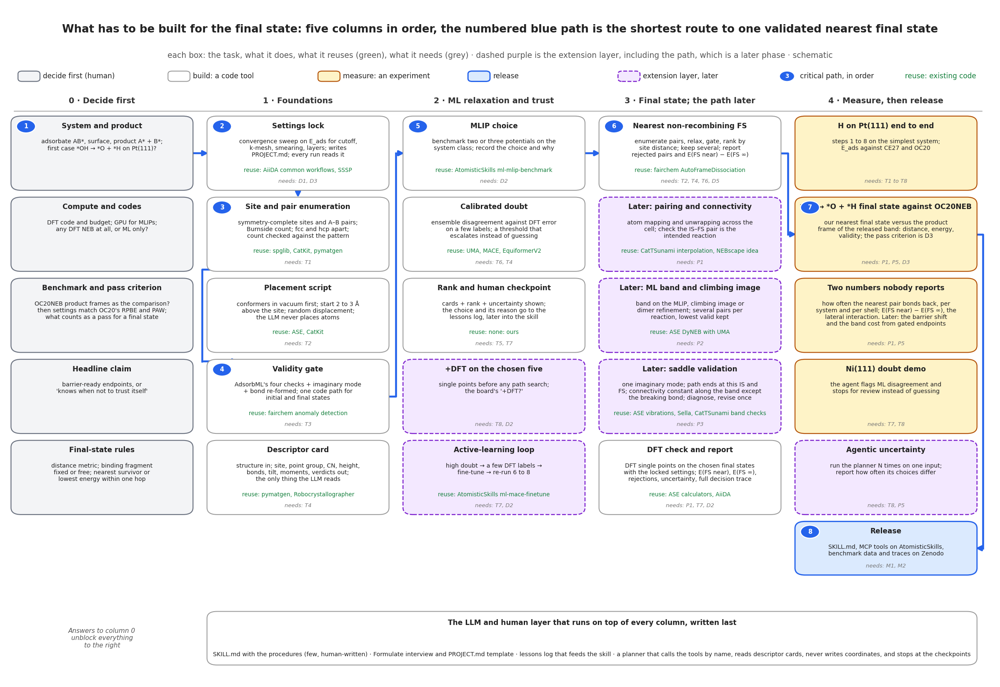

*Figure: build plan · 5 columns, 26 tasks, critical path of 8, schematic*

Reading the figure: column 0 holds the decisions only the team can make, in grey. Column 1 is the code foundation: settings lock, enumeration, placement, validity gate, descriptor card. Column 2 is ML relaxation and trust: potential choice, calibrated doubt, the human checkpoint, with the board's two question marks dashed. Column 3 holds the nearest non-recombining final state and the DFT check and report, with pairing, the ML band and saddle validation drawn dashed as a later phase. Column 4 is what gets measured, in amber, and the release, in blue. Each box names what it reuses in green and what it needs in grey. The numbered blue path is: system and product, settings lock, enumeration, validity gate, potential choice, nearest final state, the \*OH → \*O + \*H final state against the OC20NEB product frame, release. The band at the bottom is the LLM and human layer, written last because it only calls the tools.

**Repository layout.** A repository that mixes agents, skills, tools and data is hard to read unless each kind has one folder and calls go one way. The layout is a Claude Code plugin that installs beside AtomisticSkills; the build context (docs/agent-build-context.md, section 9) gives the tree and the rules.

*Figure: repository layout · tree, reading orders, the one-way rule, schematic*

Reading the figure: the tree on the left is coloured by kind: root files, documents, skills in green, agents in purple, MCP tools in blue, the library in white, runs and benchmark data in amber, tests outlined in pink. Each line carries a one-phrase note on what it holds. The top right gives the two reading orders, a human's from README to the design document to PROJECT.md to a run's report, and an agent's from CLAUDE.md to the agent context to the build context to the skill to the tool docstrings. The bottom right is the one-way rule: agents decide, skills say how, tools are typed entry points, the library holds every line of logic and every test, and runs hold every call and verdict. The rules under the tree keep it that way: one kind per file, skills under 200 lines that name tools and never contain code, one-page agents, and one tool per file wrapping one library module of the same name.

**Compute, agents and skills.** HPC is needed for DFT and for nothing else, and the roster stays short because the tools do the work; the build context, section 9, gives the lanes and the roster.

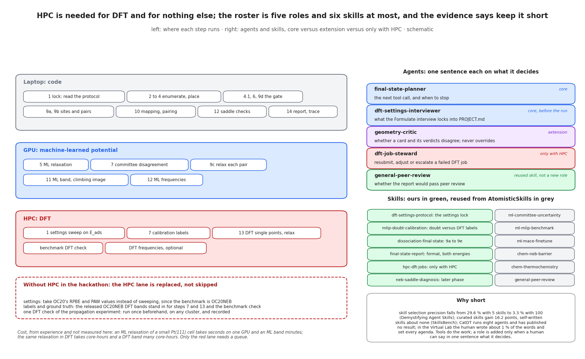

*Figure: compute lanes and the roster · 3 lanes, 5 roles, 12 skills, schematic*

Reading the figure: on the left, each pipeline step sits in the lane that runs it. Grey is the laptop, every check, enumeration, mapping and report. Blue is one GPU, every machine-learned relaxation, band and frequency. Red is HPC, every DFT step: the settings sweep, calibration labels, refinement, the benchmark check. The dashed red box says what replaces the HPC lane in a hackathon without a cluster: OC20's settings instead of a sweep, OC20NEB's released DFT bands as labels and ground truth, and one DFT check run beforehand. On the right, the agents are listed with the one sentence each decides and its status: the final-state planner and the DFT-settings interviewer in the core, the geometry critic as an extension, the DFT job steward only with HPC, and peer review as a reused skill rather than a role. Names say what each thing computes, in the words of the field. Below them the six skills of ours in green and the six reused from AtomisticSkills in grey. The box at the bottom gives the evidence for keeping both lists short.

**Next steps.**

- [ ] Draft SKILL.md for adsorption and transition-state calculations

- [ ] Draft the PROJECT.md template and the Formulate interview questions

- [ ] Implement symmetry enumeration (sites and pairs) and the validity-check tools

- [ ] Reproduce H on Pt(111) end to end as the first validation

- [ ] Assemble the benchmark subset (OC20-Dense, hard set, controls)

- [ ] Build the Ni(111) failure-detection demo

- [ ] Package tools as an MCP server and plan the Zenodo release

<!-- -->

- [x] Check the AtomisticSkills repository: no catalysis skill is public; MIT; the baseline is mat-surface-adsorption on pymatgen's site finder, which does not label fcc and hcp hollows (repository survey)

- [ ] Run its mat-surface-adsorption placement as the baseline in our benchmark

- [ ] Prototype the ML-doubt loop with ml-mlip-benchmark and ml-mace-finetune on Ni(111)

<!-- -->

- [ ] Build the convergence tool (cutoff, k-mesh, smearing, layers on E_ads of H on Pt(111)) and have it write PROJECT.md

- [ ] Write the Formulate interview questions into the SKILL.md and test them on one experienced researcher

- [ ] Start the lessons log with the known pitfalls (CO on Pt, Ni and Co magnetism, symmetry trap) as its first entries

- [ ] Redraw figure 12 with the "Converge numerical settings" step; its source script is not in the repository, so it must be recreated under docs/figures/src/

- [ ] Build the descriptor-card tool (structure in, text card and PNG out) and make every other tool return its output through it

- [ ] Write model-facing documentation for the geometry tools (place, enumerate, check), following the MatTools finding

- [ ] Add twenty geometry editing tasks to the benchmark and record the agent's success with and without tools

- [ ] Propagation experiment: run the same ML NEB (CatTSunami style) for one step on Pt(111) from endpoints found by single placement and from endpoints found by enumeration plus checks; report the barrier difference in eV and as a rate factor; check one case with DFT

- [ ] Read the TSAgent and TSBench papers in full and fill the gaps in the table (endpoint choice, saddle validation)

- [ ] Define the product as a structure with one set of gas-phase references, and add pair enumeration for A* + B* if the product forms from two adsorbates

- [ ] Write the initial–final connectivity check (same reaction, atom mapping as in NEBscape) and the saddle validation tool (one imaginary mode, path ends at both endpoints)

- [ ] Select an OC20NEB subset and the single-placement baseline for the path benchmark

- [ ] Build the nearest-non-recombining final-state tool (enumerate pairs, relax, gate, rank by distance, report rejected pairs and E(FS near) − E(FS ∞)) and run it for *OH → *O + *H on Pt(111) against the OC20NEB band

## Sources

- [AdsorbML and OC20-Dense](https://arxiv.org/pdf/2211.16486)

- [Adsorb-Agent](https://arxiv.org/html/2410.16658v3)

- [AdsMind](https://arxiv.org/html/2606.19152) and an [independent review of it](https://pith.science/paper/2606.19152)

- [DREAMS](https://alphaxiv.org/abs/2507.14267)

- [CatMaster](https://arxiv.org/pdf/2601.13508)

- [Catalyst-Agent](https://arxiv.org/pdf/2603.01311)

- [AutoDFT](https://arxiv.org/html/2605.26179v2)

- [CatKit](https://www.aiche.org/conferences/aiche-annual-meeting/2018/proceeding/paper/699a-catkit-symmetry-methods-automated-generation-catalytic-structures)

- [ACAT](https://pypi.org/project/acat/1.7.0/)

- [AdsMT and GMAE benchmarks](https://zenodo.org/records/12104162)

- [Kempen, Cheula and Andersen: 80 MLIPs benchmarked](https://phys.au.dk/intercat/news-and-events/show/artikel/new-intercat-paper-luuk-kempen-raffaele-cheula-and-mie-andersen)

- [Review of MLIPs for energy materials](https://advanced.onlinelibrary.wiley.com/doi/10.1002/aenm.71046)

- [CatTSunami and OC20NEB](https://arxiv.org/abs/2405.02078)

- [Fine-tuning universal MLIPs for transition-state search](https://arxiv.org/pdf/2603.24482)

- [Get Physics Done](https://github.com/psi-oss/get-physics-done)

- [Outcomes of the 2025 LLM Hackathon for Materials Science and Chemistry](https://arxiv.org/pdf/2605.03205)

- [Cambridge hackathon on multi-agent systems for scientific research](https://science.ai.cam.ac.uk/events/hackathon-multi-agent-systems-for-scientific-research)

- [dkNET–Texera agent hackathon](https://texera.apache.org/blog/2026/05/20/dknet-ai-apache-texera-agent-hackathon/)

- [NAIS AI Hackathon 2026 report](https://biz.heraldcorp.com/article/10890887)

<!-- -->

- [AtomisticSkills: harnessing agent skills for atomistic research](https://arxiv.org/abs/2605.24002) and its [code](https://github.com/learningmatter-mit/AtomisticSkills)

<!-- -->

- [SSSP: precision and efficiency in solid-state pseudopotential calculations](https://arxiv.org/pdf/1806.05609) and the [library](https://www.materialscloud.org/discover/sssp)

- [Δ-test: reproducibility in DFT calculations of solids (Lejaeghere et al., Science 2016)](https://archive.materialscloud.org/record/1874) and [Bosoni et al. 2024, verifying DFT precision via reproducible workflows](https://archive.materialscloud.org/record/2023.81)

- [AiiDA common workflows (Huber et al., npj Computational Materials 2021)](https://www.nature.com/articles/s41524-021-00594-6) and [documentation](https://aiida-common-workflows.readthedocs.io/)

- [VASP wiki: choosing pseudopotentials](https://vasp.at/wiki/Choosing_pseudopotentials) and [energy cutoff and FFT mesh](https://vasp.at/wiki/Energy_cut_off_and_FFT_mesh)

- [OC20 dataset paper, with the DFT settings](https://arxiv.org/pdf/2010.09990)

- [Convergence and ML prediction of k-points and cutoff in high-throughput DFT](https://arxiv.org/pdf/1809.01753)

- [Anthropic: Agent Skills](https://www.anthropic.com/news/skills), [Claude for Life Sciences](https://www.anthropic.com/news/claude-for-life-sciences), [Claude Science workbench](https://www.anthropic.com/news/claude-science-ai-workbench), [AI for Science program](https://support.claude.com/en/articles/11199177-anthropic-s-ai-for-science-program)

- [Scientific Agent Skills (K-Dense)](https://github.com/k-dense-ai/scientific-agent-skills) and [K-Bench](https://arxiv.org/pdf/2608.21601)

- [SkillsBench](https://www.emergentmind.com/papers/2602.12670) and [Demystifying Agent Skills](https://arxiv.org/pdf/2608.14036)

- [ether0: a scientific reasoning model for chemistry](https://www.futurehouse.org/news/ether0-a-scientific-reasoning-model-for-chemistry) ([paper](https://arxiv.org/html/2506.17238v2))

- [ChemCrow](https://arxiv.org/abs/2304.05376), [Coscientist](https://www.cmu.edu/news/stories/archives/2023/december/cmu-designed-artificially-intelligent-coscientist-automates-scientific-discovery), [El Agente](https://arxiv.org/abs/2505.02484)

- [Virtual Lab (Nature 2025)](https://biohub.org/news/with-no-need-for-sleep-or-food-ai-built-scientists-get-the-job-done-quickly/), [Google AI co-scientist](https://research.google/blog/accelerating-scientific-breakthroughs-with-an-ai-co-scientist/), [Kosmos](https://arxiv.org/html/2511.02824v2)

- Tacit knowledge and agents: [LLMs for tacit knowledge discovery](https://arxiv.org/pdf/2507.03811), [KUPAS MASTER](https://arxiv.org/abs/2609.37673), [Tacit Fragments](https://www.alphaxiv.org/abs/2609.operationalising-tacit-knowledge-agentic-ai)

- [OpenAI FrontierScience](https://openai.com/index/frontierscience)

- Repositories to wrap or copy, each opened on 21 October 2026: [repository survey](repo-survey.md)

- Final-state generation and automated kinetics: [Pynta (JCIM 2023, preprint)](https://chemrxiv.org/engage/chemrxiv/article-details/647114454f8b1884b755bc5a) and [code](https://github.com/zadorlab/pynta), [El Agente Potente](https://arxiv.org/abs/2609.14840), [Reproducible orchestration of NEB best practices](https://arxiv.org/abs/2603.14737)

- Transition-state agents and benchmarks: [TSAgent](https://arxiv.org/abs/2605.14154), [TSBench](https://arxiv.org/abs/2609.08503), [NEBscape](https://www.nature.com/articles/s41524-026-02298-1), [CatDT](https://urop.hkust.edu.hk/node/40500), [CopyCAT (ICIQ thesis)](https://iciq.org/es/?p=72665)

- Geometry: [AtomWorld](https://arxiv.org/html/2510.04704), [LLMConfBench: molecular geometry understanding has unintendedly emerged in frontier LLMs](https://arxiv.org/html/2609.20666), [MiSI-Bench](https://arxiv.org/html/2512.10867v1), [Robocrystallographer](https://www.cambridge.org/core/journals/mrs-communications/article/robocrystallographer-automated-crystal-structure-text-descriptions-and-analysis/3C201F132450877464B2D0B1B8C4ED01), [LLM-Prop](https://www.nature.com/articles/s41524-025-01536-2), [LLM4Mat-Bench](https://arxiv.org/pdf/2411.00177), [MatTools](https://arxiv.org/html/2505.10852v2), [LLaMP](https://arxiv.org/pdf/2401.17244)

From memory, not looked up here: Kozuch and Shaik, "How to conceptualize catalytic cycles? The energetic span model", Accounts of Chemical Research, 2011; Sholl and Steckel, *Density Functional Theory: A Practical Introduction*, Wiley, 2009; Nørskov, Studt, Abild-Pedersen and Bligaard, *Fundamental Concepts in Heterogeneous Catalysis*, Wiley, 2014; Wellendorff et al., "A benchmark database for adsorption bond energies to transition metal surfaces" (CE27), Surface Science, 2015.
